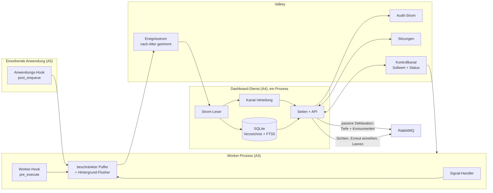
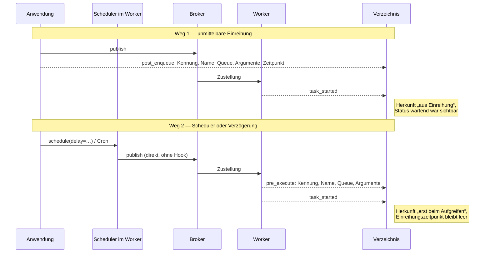
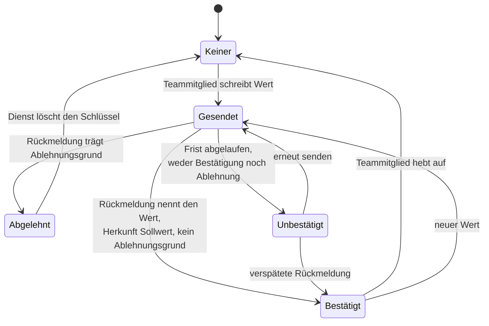

# swarmq Dashboard - Plan

## Goal Capsule

- **Objective:** Ein kleines Ops-Team beantwortet die Fragen „Ist Task X gelaufen, mit welchen Daten?“ und „Sind alle Worker da, und wie skaliert der Pool?“ im Browser und greift dort ein, ohne Logs zu lesen oder Worker über die Konsole zu administrieren. Der Eingriff umfasst in der ersten Auslieferung Stornieren und Dead-Letter-Bedienung; die Sollwerte kommen mit der Steuerungs-Stufe dazu (KD15).
- **Means:** Ein eigenständiges, optionales Paket neben der Bibliothek: Weboberfläche nach Flower-Muster, HTTP-API, lokale Konten, ein Ereignisstrom in Valkey als Quelle, gespeist von mitgelieferten Hooks in Worker und einreihender Anwendung (KTD1, KTD2).
- **Product authority:** Dieser Plan besitzt das Dashboard-Paket. Der Kontrollkanal im swarmq-Kern ist Voraussetzung mit benannter Schnittstelle, aber nicht aktiver Umfang; die Loadsuite-Anbindung ist ausdrücklich nicht Umfang. Beide Systeme werden getrennt entwickelt: jede weitere Änderung am Kern braucht eine eigene Absprache.
- **Execution profile:** Testgetrieben nach `AGENTS.md` — ein fehlschlagender Test je Schritt, kein Produktionscode ohne ihn. Ausnahmen nur für reine Konfiguration, Vorlagen, Stylesheet und mitgelieferte statische Dateien.
- **Stop conditions:** Halte an, wenn eine Einheit verlangt, dass ein Hook auf dem Task-Pfad auf Netzwerk wartet; wenn das Dashboard eine Funktion im swarmq-Kern ergänzen müsste; oder wenn eine DLQ-Operation im Hintergrund statt auf ausdrückliche Handlung läuft. Alle drei widersprechen getroffenen Entscheidungen.
- **Open blockers:** keine.

---

## Product Contract

### Summary

Wir bauen `swarmq-dashboard`, ein optionales Zusatzpaket, das Tasks, Worker und Dead-Letter-Queues eines swarmq-Deployments in Echtzeit zeigt und dem Team Cancel, Autoscale- und Prozesszahl-Änderungen sowie die DLQ-Bedienung im Browser erlaubt. Die Daten kommen aus einem Ereignisstrom in Valkey, den jeder Worker über den `--configure`-Hook des Pakets befüllt und jede einreihende Anwendung über einen zweiten mitgelieferten Hook; Befehle gehen als gemerkte Sollwerte an den Kontrollkanal im Kern.

Die Auslieferung ist zweistufig, weil der Kontrollkanal noch nicht veröffentlicht ist. Die erste Fassung liefert Tasks, Worker, Cancel, DLQ und Login gegen swarmq 0.6.2; die Steuerung folgt mit dem nächsten Bibliotheks-Release. Queue-Seite, Scheduler, Workflows, Audit-Ansicht und Graphen folgen als zweite Stufe.

### Problem Frame

swarmq beantwortet heute keine Betriebsfrage im Browser. Wer wissen will, ob ein bestimmter Task gelaufen ist und mit welchen Argumenten, hat nur die Logs: `swarmq inspect` zeigt Task-Typen, `swarmq dlq list` nur Gescheitertes, Ergebnisse verfallen mit ihrer Ablaufzeit, und Argumente speichert die Bibliothek nirgends. Ob alle Worker verbunden sind, sieht man in Grafana oder gar nicht; Prozesszahl und Autoscale-Grenzen stehen beim Start fest und lassen sich nur per Neustart über die Konsole ändern.

Der Betreiber kommt von Celery mit Flower. Dort waren genau diese beiden Griffe Alltag: einen Task suchen und seine Startdaten sehen, den Worker-Pool im Blick halten und das Autoscaling nachziehen. Mit swarmq in Phoenix soll ein kleines Ops-Team dieselben Griffe ohne ihn erledigen können. Die Bibliothek soll dabei klein bleiben; das Dashboard ist ein Angebot, das jeder Nutzer selbst hinzunimmt.

### Key Decisions

- KD1. **Eigenständiges, optionales Paket statt Einbau in die Bibliothek** (session-settled: user-directed — chosen over Einbau in `swarmq` selbst: der Kern bleibt klein, jeder Nutzer entscheidet selbst). Governs R1, R2.
- KD2. **Ereignis-Spiegel als Datenquelle** (session-settled: user-approved — chosen over einer Verwaltungsschnittstelle je Worker und über das reine Lesen vorhandenen Zustands: nur der Strom liefert die Task-Historie mit Argumenten ohne Änderung am Kern und begrenzt die Kernänderung auf den Kontrollkanal). Governs R3, R3a, R3b, R4, R4a, R5, R6.
- KD3. **Kontrollkanal im Kern ist Voraussetzung, wird separat geplant** (session-settled: user-approved — chosen over einem gemeinsamen Plan und über „Kern zuerst“: das Dashboard wird vollständig beschrieben, die Kernänderung bekommt eine klare Schnittstelle und einen eigenen kleinen MR). Governs R14, R17.
- KD4. **Steuerumfang: Autoscale-Grenzen und Prozesszahl zur Laufzeit** (session-settled: user-directed — chosen over „nur beobachten und canceln“ und über voller Flower-Fernsteuerung: deckt den Flower-Alltag des Betreibers ab, ohne Queue-Zuordnung, Neustart und Limits je Task in den Kern zu ziehen). Governs R14, R15.
- KD5. **Sollwerte überleben Neustarts** (session-settled: user-approved — chosen over flüchtigen Änderungen wie bei Flower: sonst kehrt die Konsole beim nächsten Deploy zurück). Governs R16.
- KD6. **Lokale Konten mit Passwort** (session-settled: user-approved — chosen over OIDC-Anbieter, Proxy-Login und gemeinsamem Token: keine Abhängigkeit nach außen, funktioniert im geschlossenen Netz, jede Aktion hat ein Konto). Governs R20, R21, R22, R23.
- KD7. **Sieben Tage Aufbewahrung** (session-settled: user-directed — chosen over 24 Stunden und über einer festen Task-Zahl: deckt Wochenendvorfälle; braucht ein eigenes Speicherbudget). Governs R5, R9.
- KD8. **Grundform „Seiten wie Flower“** (session-settled: user-directed — chosen over einem Live-Board auf einer Seite und über „Suche zuerst mit Statusleiste“, entschieden an einer Skizze: vertraut, ruhig, Stufe 2 hängt sich als weitere Seiten an). Governs R24, R25, R26.
- KD9. **Stufenfolge** (session-settled: user-directed — chosen over allem in einer Version: Tasks, Worker mit Steuerung und DLQ zuerst; Queue-Tiefen, Scheduler, Workflows, Audit-Ansicht und Graphen danach). Governs Scope Boundaries.
- KD10. **Nutzeraktionen sind Ereignisse im selben Strom** (session-settled: user-approved — chosen over keinem Protokoll: mit persönlichen Konten ist ein Audit fast kostenlos und beantwortet „wer hat das storniert“). Governs R27.
- KD11. **Argumente werden im Klartext vorgehalten** (session-settled: user-approved — chosen over Maskierungsregeln: der Zweck ist, die Startdaten zu sehen; Kundendaten im Verzeichnis sind eine bewusste Annahme des Betreibers). Governs R7, R7a.
- KD12. **Das Paket liefert auch einen Anwendungs-Hook** (session-settled: user-directed — chosen over einem reinen Worker-Hook: nur so kennt das Verzeichnis einen Task ab der Einreihung, mit seinen Argumenten und als wartend stornierbar; Preis ist eine Codezeile in jeder einreihenden Anwendung). Governs R2, R3a, R6, R12.
- KD13. **Getrennte Repositories, Kernänderungen nur nach Absprache** (session-settled: user-directed — chosen over einem gemeinsamen Repo und über freiem Zugriff auf die Bibliothek: das Dashboard entsteht als eigenes Projekt neben `swarmq-loadsuite` und veröffentlicht eigene Versionen; fehlt ihm eine Funktion im Kern, wird sie nicht nebenbei dort eingebaut, sondern erst abgestimmt und als eigener MR an der Bibliothek geplant). Governs R1, R1a.
- KD14. **Dead-Letter-Sichten ist eine bewusste, gewarnte Handlung** (session-settled: user-directed — chosen over Listen beim Seitenaufruf und über „nur Tiefe bis der Kern einen lesenden Pfad hat“: die Bibliothek hat keinen nicht-mutierenden Lesepfad, also bezahlt nur die ausdrückliche Handlung den Preis, und die Seite bleibt trotzdem nutzbar). Governs R28, R28a, R29.
- KD15. **Beobachtung zuerst, Steuerung nach dem Bibliotheks-Release** (session-settled: user-directed — chosen over einer gemeinsamen Auslieferung: der Kontrollkanal ist unveröffentlicht, und der Dashboard-Bau soll nicht an einem Termin hängen, den er nicht kontrolliert). Governs R33, Scope Boundaries.
- KD16. **Argumente im Klartext liegen künftig auch als Datei auf dem Dashboard-Host** (session-settled: user-directed — chosen over „Argumente nur in Valkey, kein Volltext“ und über Verschlüsselung: beide Alternativen kosten die Volltextsuche aus R10, die den Hauptfluss trägt). Governs R7a.

<!-- ce-section: work-relationships -->
### How This Work Fits Together

Dieser Plan besitzt das Dashboard-Paket. Die Aufteilung darunter ist der heutige Stand des Verständnisses, kein festgelegter Fahrplan.

- **Kontrollkanal im swarmq-Kern** — Depends on: dieser Plan setzt ihn für R14 bis R17 voraus. Er ist in der Bibliothek umgesetzt, aber noch nicht veröffentlicht; swarmq 0.6.2 auf PyPI kennt ihn nicht. Die Steuerungs-Stufe des Dashboards wird mit dem nächsten Release nutzbar (KD15). Er ist die einzige geplante Änderung am Kern; weiterer Bedarf wird abgestimmt, bevor etwas in der Bibliothek entsteht (KD13).
- **Zweite Stufe des Dashboards** — Enables: Queue-Tiefen je Queue, Scheduler- und Workflow-Ansicht, Audit-Ansicht und Echtzeit-Graphen hängen sich als weitere Seiten an die Grundform aus KD8; sie lesen dieselben Quellen und brauchen keine neue Kernänderung.
- **Nicht-mutierender DLQ-Lesepfad in der Bibliothek** — Still to decide: ein solcher Pfad würde R28a überflüssig machen. Er ist nicht Umfang und bräuchte nach KD13 eine eigene Absprache und einen eigenen MR.
- **Loadsuite-Anbindung** — Can proceed independently of: die Lasttest-Suite hat einen eigenen Ereignis-Relay; ob sie später den Strom des Dashboards mitnutzt, ist eine spätere Frage.

### Actors

- A1. **Ops-Teammitglied** — meldet sich mit eigenem Konto an, sucht Tasks, prüft Worker, storniert, ändert Sollwerte, bedient die DLQ. Alle Konten haben dieselben Rechte.
- A2. **Betreiber** — installiert das Paket, legt Konten an, konfiguriert Aufbewahrung und Worker-Hook; im Alltag selbst A1.
- A3. **Worker** — swarmq-Worker mit geladenem Hook; schreibt Signale in den Strom, empfängt Sollwerte über den Kontrollkanal des Kerns.
- A4. **Dashboard-Dienst** — eigener Prozess; liest den Strom, hält das Verzeichnis, bedient Oberfläche und API, merkt sich Sollwerte.
- A5. **Einreihende Anwendung** — hält den swarmq-Client; mit geladenem Anwendungs-Hook meldet sie jede Einreihung mit Argumenten in den Strom.

### Requirements

**Paket und Betrieb**

- R1. Das Dashboard ist ein eigenes Python-Paket mit eigenem Prozess und eigener Abhängigkeitsliste; die Bibliothek `swarmq` erhält dadurch keine neue Pflichtabhängigkeit.
- R1a. Das Dashboard entsteht in einem eigenen Repository, veröffentlicht eigene Versionen und hängt von `swarmq` in einer gepflegten Versionsspanne ab; es nutzt ausschließlich öffentliche Schnittstellen der Bibliothek. Fehlt eine Funktion im Kern, wird sie nicht als Teil dieser Arbeit dort ergänzt, sondern abgestimmt und getrennt geplant.
- R2. Das Paket liefert zwei Hooks mit: den Worker-Hook, den ein Betreiber per `swarmq worker --configure` lädt, und den Anwendungs-Hook, den eine einreihende Anwendung mit einer Codezeile auf ihre swarmq-Instanz anwendet. Ohne den jeweiligen Hook laufen Worker und Anwendung unverändert.

**Ereignisstrom und Verzeichnis**

- R3. Der Worker-Hook schreibt jedes Signal des Workers mit Zeitstempel, `worker_id` und vollständiger Nutzlast in einen Strom in Valkey.
- R3a. Der Anwendungs-Hook schreibt jede Einreihung mit Kennung, Name, Queue, Argumenten und Zeitpunkt in denselben Strom, bevor ein Worker den Task aufgreift.
- R3b. Der Worker-Hook meldet zusätzlich beim Aufgreifen eines Tasks dessen Argumente in den Strom, damit Einreihungen, die den Anwendungs-Hook nicht passieren, überhaupt mit Argumenten im Verzeichnis erscheinen. Diese Meldung läuft im Ausführungspfad des Tasks und unterliegt deshalb R4 in verschärfter Form.
- R4. Kein Hook darf den Task-Ablauf beeinflussen: kein Hook wartet auf Netzwerk, Fehler oder Verzögerungen beim Schreiben werden protokolliert, der Task läuft weiter, und das Einreihen gelingt auch dann, wenn der Strom nicht erreichbar ist.
- R4a. Jeder Hook zählt Ereignisse, die er nicht schreiben konnte, und schreibt nach Rückkehr des Stroms ein Verlust-Ereignis mit `worker_id`, Anzahl und Zeitspanne; Task-Liste und Worker-Ansicht weisen betroffene Zeitspannen als „unvollständig“ aus.
- R5. Der Dienst hält aus dem Strom ein Verzeichnis aller Tasks der letzten sieben Tage vor; ältere Einträge fallen ohne manuelles Eingreifen weg, sowohl im Strom als auch im Verzeichnis.
- R6. Das Verzeichnis kennt je Task Kennung, Name, Queue, Status, Zeitpunkte von Einreihung, Start und Ende, Laufzeit, Worker, Wiederholungszähler, Fehlertext und Ergebnisverweis, soweit die Signale sie tragen. Statuswerte sind: wartend, laufend, fertig, gescheitert, storniert, Stornierung angefordert, Wiederholung, Dead Letter, abgelaufen, abgewiesen.
- R7. Das Verzeichnis hält die Argumente jedes Tasks im Klartext, wie sie beim Einreihen übergeben wurden.
- R7a. Die Argumente liegen im Verzeichnis des Dienstes und damit als Datei auf dem Dashboard-Host. Die Datei gehört dem Dienstbenutzer und ist nur für ihn lesbar; ihr Ort ist konfigurierbar und dokumentiert; der Ablauf aus R5 löscht die Zeilen dort tatsächlich.
- R8. Die Oberfläche zeigt, wie weit die Suche gerade zurückreicht, gemessen am ältesten Eintrag des Verzeichnisses, und weist einen laufenden Neuaufbau des Verzeichnisses als solchen aus. *(Aus der Prüfung von Stufe B: der Ablauf löscht nach `last_seen_at`, der älteste Eintrag misst `first_seen_at`. Eine einzige langlebige Zeile zieht die gemeldete Reichweite darum beliebig weit zurück, obwohl der Zeitraum dazwischen längst gelöscht ist. Die Beschriftung muss „ältester Eintrag“ sagen, nicht „so weit reicht die Suche“ — oder die Zahl an der Aufbewahrungsgrenze abschneiden. Entscheidung gehört zu U9.)*
- R9. Der Speicherbedarf des Stroms ist begrenzt und für den Betreiber sichtbar: der Dienst trimmt den Strom nach Alter und deckelt ihn zusätzlich nach Länge, und zeigt Füllstand und wirksame Grenze an. Das Budget des Task-Stroms begrenzt den Audit-Strom aus R27 nicht.

**Tasks**

- R10. Ein Teammitglied findet einen Task über Kennung, Namen oder Argument-Text und filtert nach Status, Name, Worker und Zeitraum. Die Suche über Argument-Text findet auch Fragmente innerhalb eines Wertes.
- R11. Die Task-Ansicht zeigt alle Felder aus R6 und R7 sowie die Folge der Signale des Tasks in Zeitreihenfolge.
- R12. Ein Teammitglied storniert einen wartenden oder laufenden Task aus der Task-Ansicht; das Dashboard nutzt dafür die bestehende Cancel-Funktion der Bibliothek.
- R12a. Stornieren ist eine Anforderung, kein Vollzug: die Ansicht zeigt „Stornierung angefordert“, bis ein Signal den Ausgang belegt, nennt eine bereits laufende Anforderung als solche statt als Fehler, und sagt, dass ein rechnender Task die Anforderung möglicherweise nie bemerkt.
- R13. Neue Ereignisse erscheinen in offenen Listen und Ansichten ohne manuelles Neuladen innerhalb weniger Sekunden.
- R13a. Verliert eine offene Ansicht den Anschluss an den Ereignisstrom — Abbruch, Überlauf des Rückstaus oder Wiederverbindung —, lädt sie den betroffenen Bereich vollständig neu, statt auf einem stillen Teilstand stehen zu bleiben, und sagt dem Teammitglied, dass sie das getan hat.
- R31. Das Verzeichnis weist je Task aus, woher es ihn kennt: aus der Einreihung oder erst aus dem Aufgreifen durch einen Worker. Bei der zweiten Herkunft bleibt der Einreihungszeitpunkt leer statt geraten, und die Task-Liste trägt einen stehenden Hinweis, dass Scheduler- und verzögerte Einreihungen erst beim Aufgreifen erscheinen.

**Worker und Steuerung**

- R14. Die Worker-Ansicht zeigt je Worker Slot, `worker_id`, Verbundenheit, belegte Slots, verarbeitete Tasks, Uptime und den Zeitpunkt des letzten Lebenszeichens, gruppiert nach Worker-Gruppe. Je Gruppe zeigt sie zusätzlich die aktuelle Zahl wartender Nachrichten ihrer Queues und ob die wirksamen Werte aus einem Sollwert oder aus den Startargumenten stammen.
- R14a. Die Ansicht nennt, aus welcher Quelle sie die Verbundenheit ableitet, und markiert sich als eingeschränkt, wenn die belastbare Quelle fehlt. Reihenfolge der Quellen: Rückmeldung des Supervisors aus dem Kontrollkanal, sonst das Lebenszeichen-Signal, sonst der Zeitpunkt des letzten Signals dieses Workers überhaupt.
- R15. Ein Teammitglied ändert für eine Worker-Gruppe den Sollwert aus Autoscale-Grenzen und Prozesszahl; die Änderung wirkt zur Laufzeit über den Kontrollkanal des Kerns. Ein Sollwert beschreibt je Gruppe genau einen Zustand aus Unter- und Obergrenze; eine feste Prozesszahl N ist der Sollwert N..N und schaltet die Autoskalierung ab, Gruppen mit Rechen-Pool nehmen nur diese feste Form an. Ein neuer Sollwert ersetzt den vorigen vollständig. Ein Teammitglied hebt den Sollwert einer Gruppe auf; danach gelten wieder die Startargumente des Deployments.
- R15a. Der Sollwert gilt je Supervisor, nicht je Gruppe insgesamt. Die Oberfläche beschriftet ihn so, nennt die Zahl der meldenden Supervisoren und zeigt die daraus folgende Gesamtzahl der Prozesse; Spielraum, Slots und Worker-Zahlen einer Gruppe sind über alle meldenden Supervisoren summiert.
- R15b. Das Dashboard prüft einen Sollwert gegen die Angaben der meldenden Supervisoren, bevor es ihn schreibt, und weist eine Gruppe als uneinheitlich aus, wenn deren Supervisoren unterschiedlichen Spielraum oder unterschiedliche Autoskalierung melden. Ohne meldenden Supervisor ist das Schreiben erlaubt, aber als wirkungsunbekannt gekennzeichnet.
- R16. Der zuletzt gesetzte Sollwert je Worker-Gruppe liegt im Kontrollkanal; ein Supervisor liest ihn beim Start vor dem ersten Spawn und wendet ihn an. Die Startargumente des Deployments gelten nur, wenn kein Sollwert gesetzt ist. Der Dienst hält Anzeige und Verlauf der Sollwerte; für die Anwendung nach einem Deploy ist er nicht nötig.
- R16a. Der Betreiber setzt je Worker-Gruppe beim Start eine Obergrenze für Prozesszahl und Autoscale-Maximum; der Supervisor lehnt Sollwerte oberhalb dieser Grenze ab. Eine Ablehnung ist ein eigener, dauerhafter Zustand und keine ausstehende Bestätigung. Das Dashboard entfernt einen abgelehnten Sollwert aus dem Kontrollkanal, damit er keinen später startenden Supervisor mehr erreicht.
- R17. Die Worker-Ansicht unterscheidet vier Zustände eines Sollwerts: gesendet, bestätigt, abgelehnt mit Grund im Wortlaut, und unbestätigt nach Ablauf einer Frist mit dem Zeitpunkt des Sendens. Bei mehreren Supervisoren einer Gruppe nennt sie, wie viele davon bestätigt haben. Erneutes Senden wird bei einer Ablehnung nicht angeboten; dort führt der Weg über eine Korrektur des Wertes.
- R18. Der Dienst vergleicht je Queue die Zahl der Konsumenten am Broker mit der Zahl der verbundenen Worker, die der Strom für diese Queue kennt; einen Überschuss weist er als „Konsumenten ohne Hook“ aus, damit fehlende Einträge im Verzeichnis nicht als „nicht gelaufen“ gelesen werden. Der Fall, dass der Strom gar keinen Worker kennt, ist eingeschlossen.
- R19. Ein Worker ohne Lebenszeichen über die konfigurierte Frist wird als getrennt markiert und bleibt sichtbar, bis er zurückkehrt oder ein Teammitglied ihn entfernt. Das Entfernen ist eine Aktion nach R27.

**Anmeldung und Konten**

- R20. Jedes Teammitglied meldet sich mit eigenem Konto und Passwort an; der Betreiber legt Konten über die Kommandozeile des Pakets an, ändert Passwörter und sperrt Konten.
- R21. Passwörter werden nur als Hash mit anerkanntem Verfahren gespeichert; Sitzungen laufen nach Inaktivität ab und lassen sich durch Abmelden beenden. Das Sperren eines Kontos beendet dessen laufende Sitzungen.
- R22. Wiederholte Fehlanmeldungen verlangsamen weitere Versuche für dieses Konto und für die Herkunft des Versuchs; der Betreiber sieht Fehlanmeldungen im Audit. Die Antwort auf ein unbekanntes Konto ist von der auf ein bekanntes nicht zu unterscheiden, und die Verzögerung wird nie zur Sperre.
- R23. Alle Konten haben dieselben Rechte; Oberfläche, API und der Kanal für Live-Aktualisierung verweigern jeden Zugriff — Lesen wie Aktionen — ohne gültige Sitzung; nur die Anmeldeseite ist ohne Sitzung erreichbar. Zustandsändernde Anfragen sind gegen Aufrufe von fremden Seiten geschützt: Sitzungscookies gelten streng seitengebunden und die API nimmt Schreibanfragen nur mit einem sitzungsgebundenen Zusatzmerkmal an.
- R32. Eine offene Verbindung für Live-Aktualisierung prüft in festem Takt, ob ihre Sitzung noch gilt und das Konto nicht gesperrt ist, und beendet sich mit einer letzten Nachricht, sobald das nicht mehr zutrifft; die Ansicht zeigt dann einen Anmelde-Zustand statt einer eingefrorenen Seite. Eine offene Verbindung allein hält eine Sitzung nicht am Leben.

**Oberfläche**

- R24. Die Oberfläche folgt der Grundform „Seiten“: eine linke Navigation mit den Bereichen Worker, Tasks und DLQ, je Bereich eine Tabellenseite, Details als eigene Seite; die Startseite ist die Worker-Übersicht.
- R25. Die Oberfläche bleibt auf das Nötige beschränkt: keine Bereiche, Kacheln oder Kennzahlen, die nicht zu R8 bis R19 oder R28 bis R33 gehören; Stufe-2-Bereiche erscheinen erst, wenn sie da sind.
- R26. Die Oberfläche ist auf Notebook- und Desktop-Breite ausgelegt und zeigt Broker-, Backend- und Strom-Zustand in einer Kopfzeile: Broker und Backend als erreichbar oder nicht erreichbar, den Strom als aktuell oder verzögert mit dem Zeitpunkt des zuletzt empfangenen Signals. Die Aktualität des Stroms wird im Browser mitgemessen, damit sie nicht von derselben Verbindung abhängt, über die sie berichtet.
- R27. Jede Aktion eines Teammitglieds (Cancel, Sollwert setzen, aufheben und korrigieren, DLQ-Aktion, Worker entfernen, An- und Abmeldung) wird mit Konto, Zeitpunkt und Ziel als Ereignis in einem eigenen Audit-Strom in Valkey festgehalten, der unabhängig vom Task-Aufkommen mindestens die Aufbewahrungsdauer aus R5 nach Alter hält. Er ist in der ersten Stufe über die Kommandozeile des Pakets einsehbar; die Ansicht im Browser ist Stufe 2.
- R33. Fehlt eine Voraussetzung, sagt die betroffene Seite das benannt und an einer Stelle: Kontrollkanal nicht eingeschaltet, installierte Bibliothek ohne Kontrollkanal, Backend nicht erreichbar, Broker nicht erreichbar, noch keine Ereignisse, noch kein Worker bekannt. Jeder dieser Zustände nennt die wahrscheinliche Ursache statt eine leere Tabelle zu zeigen.

**Dead-Letter-Queues**

- R28. Die DLQ-Ansicht zeigt je Queue dauerhaft die Zahl der Dead-Letter-Nachrichten. Diese Zahl wird passiv ermittelt und verändert die Queue nicht.
- R28a. Der Inhalt einer Queue erscheint erst auf ausdrückliche Handlung, in begrenzter Menge, und die Oberfläche sagt vorher, was das kostet: die Nachrichten werden dabei neu eingereiht, ihre Reihenfolge ändert sich, ihr Zustellzähler beginnt von vorn, und bei einem Absturz des Dienstes während des Vorgangs können Nachrichten verlorengehen. Zwei Teammitglieder können diesen Vorgang nicht gleichzeitig auf derselben Queue auslösen.
- R29. Ein Teammitglied reiht eine Nachricht oder alle Nachrichten einer Queue erneut ein und leert eine Queue; das Dashboard nutzt dafür dieselben Wege wie `swarmq dlq retry` und `swarmq dlq purge`. Eine Sammelaktion meldet die Zahl der erfolgreich und der nicht verarbeiteten Nachrichten.
- R30. Leeren verlangt eine Bestätigung mit Nennung der Queue und der Nachrichtenzahl.

### Key Flows

- F1. Task-Rückfrage
  - **Trigger:** Ein Kollege fragt, ob Task X für Kunde Y heute gelaufen ist.
  - **Actors:** A1, A4
  - **Steps:** Teammitglied meldet sich an; öffnet Tasks; sucht nach Task-Name oder einem Argument-Fragment; öffnet den Treffer; liest Status, Argumente, Zeitpunkte und Fehlertext; storniert bei Bedarf.
  - **Covers R10, R11, R12, R20, R31**

- F2. Rückstau und Autoscale
  - **Trigger:** Die Worker-Übersicht zeigt alle Slots belegt und wachsende Task-Zahlen.
  - **Actors:** A1, A4, A3
  - **Steps:** Teammitglied öffnet die Worker-Gruppe; sieht Spielraum und Supervisor-Zahl; setzt die Autoscale-Obergrenze höher; Dienst prüft gegen die gemeldeten Grenzen und schreibt den Sollwert; Supervisoren bestätigen; Ansicht zeigt den bestätigten Sollwert und die neuen Slots.
  - **Covers R14, R15, R15a, R15b, R17, R27**

- F3. Deploy mit gemerktem Sollwert
  - **Trigger:** Ein Deploy startet die Worker-Gruppe mit den alten Startargumenten neu.
  - **Actors:** A3, A4
  - **Steps:** Supervisor startet; liest den gemerkten Sollwert aus dem Kontrollkanal; wendet ihn vor dem ersten Spawn an und bestätigt; die Ansicht zeigt den bestätigten Sollwert; ohne gemerkten Sollwert bleiben die Startargumente.
  - **Covers R16, R17**

- F4. DLQ-Aufräumen
  - **Trigger:** Die DLQ-Ansicht zeigt Nachrichten in einer Queue nach einem Fehlerdeploy.
  - **Actors:** A1, A4
  - **Steps:** Teammitglied sieht die Tiefe; löst das Sichten aus und bestätigt den Hinweis auf das Umreihen; sichtet Fehlervorschauen; reiht alle erneut ein, nachdem der Fix live ist; leert den Rest nach Bestätigung; Aktionen erscheinen im Audit.
  - **Covers R28, R28a, R29, R30, R27**

- F5. Worker ohne Hook
  - **Trigger:** Ein neu ausgerollter Worker startet ohne `--configure`.
  - **Actors:** A3, A4, A1
  - **Steps:** Der Broker meldet für die Queue mehr Konsumenten, als der Strom Worker kennt; Dienst weist die Differenz als „Konsumenten ohne Hook“ aus; Teammitglied sieht die Markierung statt leerer Task-Listen.
  - **Covers R18, R33**

- F6. Verspätet bekannter Task
  - **Trigger:** Eine Anwendung reiht mit Verzögerung ein, oder der Scheduler löst einen Cron-Eintrag aus.
  - **Actors:** A5, A3, A4, A1
  - **Steps:** Die Einreihung passiert den Anwendungs-Hook nicht; das Verzeichnis kennt den Task nicht; ein Worker greift ihn auf und meldet Kennung, Name, Queue und Argumente; die Zeile erscheint mit der Herkunft „erst beim Aufgreifen bekannt“ und ohne Einreihungszeitpunkt.
  - **Covers R3b, R31**

### Acceptance Examples

- AE1. **Covers R10, R11.** Given: Task `render_pdf` wurde vor drei Stunden mit `{"report_id": 812}` eingereiht und ist fertig. When: ein Teammitglied sucht nach `812`. Then: der Treffer zeigt Name, Status „fertig“, die Argumente im Klartext und die Signalfolge mit Zeitpunkten.
- AE1a. **Covers R10.** Given: ein Task trägt das Argument `{"invoice": "R-2026-0812"}`. When: ein Teammitglied sucht nach `0812`. Then: der Task erscheint im Ergebnis.
- AE2. **Covers R5, R8.** Given: das Verzeichnis enthält Einträge von fünf Tagen, obwohl sieben eingestellt sind. When: ein Teammitglied filtert auf die letzten zehn Tage. Then: die Ansicht zeigt die Treffer und den Hinweis, dass die Suche fünf Tage zurückreicht.
- AE3. **Covers R12, R12a.** Given: ein Task ist bereits fertig. When: ein Teammitglied klickt Stornieren. Then: das Dashboard meldet, dass der Task nicht mehr stornierbar ist, und protokolliert keinen Cancel.
- AE3a. **Covers R12a.** Given: für einen laufenden Task wurde bereits eine Stornierung angefordert. When: ein zweites Teammitglied Stornieren klickt. Then: die Ansicht meldet die bestehende Anforderung und behandelt das nicht als Fehler.
- AE4. **Covers R15, R15a, R17.** Given: eine Worker-Gruppe läuft mit Autoscale 2 bis 4 auf zwei Supervisoren. When: ein Teammitglied setzt 2 bis 8. Then: die Eingabe ist als „je Supervisor“ beschriftet und nennt 4 bis 16 als Gesamtzahl; der Sollwert erscheint als „gesendet“, nach der Bestätigung beider Supervisoren als „bestätigt“.
- AE5. **Covers R16.** Given: für die Gruppe ist der Sollwert 4..4 gemerkt, das Deployment startet mit `--processes 2`. When: der Supervisor startet. Then: er wendet 4..4 vor dem ersten Spawn an, die Ansicht zeigt vier Slots und nennt den Sollwert als Herkunft des wirksamen Werts.
- AE6. **Covers R16a, R17.** Given: ein Sollwert 2..12 wurde auf eine Gruppe mit Spielraum 8 geschrieben. When: die Rückmeldung des Supervisors den Ablehnungsgrund trägt. Then: die Ansicht zeigt „abgelehnt“ mit dem Grund im Wortlaut, bietet kein erneutes Senden an, und der Sollwert ist aus dem Kontrollkanal entfernt.
- AE6a. **Covers R17.** Given: ein Sollwert wurde gesendet. When: nach der konfigurierten Frist keine Bestätigung eintrifft und auch keine Ablehnung. Then: die Ansicht markiert ihn als unbestätigt und nennt den Zeitpunkt des Sendens.
- AE7. **Covers R18.** Given: eine Queue hat drei Konsumenten am Broker, der Strom kennt dafür zwei verbundene Worker. When: die Worker-Übersicht geladen wird. Then: die Queue trägt den Hinweis „1 Konsument ohne Hook“.
- AE7a. **Covers R18, R33.** Given: eine Queue hat vier Konsumenten am Broker, der Strom kennt keinen einzigen Worker. When: die Worker-Übersicht geladen wird. Then: die Ansicht nennt alle vier als Konsumenten ohne Hook statt eine leere Tabelle zu zeigen.
- AE8. **Covers R19, R14a.** Given: ein Worker sendet seit mehr als der konfigurierten Frist kein Lebenszeichen. When: die Worker-Übersicht geladen wird. Then: der Worker steht als getrennt mit Zeitpunkt des letzten Lebenszeichens in der Liste, und die Ansicht nennt die verwendete Lebenszeichen-Quelle.
- AE9. **Covers R22.** Given: fünf Fehlanmeldungen für ein Konto in kurzer Folge. When: der sechste Versuch kommt. Then: die Antwort verzögert sich spürbar, das Konto bleibt bestehen, und das Audit zeigt die Versuche.
- AE9a. **Covers R22.** Given: fünf Fehlanmeldungen auf ein Konto, das es nicht gibt. When: ein Versuch auf ein bestehendes Konto folgt. Then: die Antwortzeiten der beiden Fälle unterscheiden sich nicht erkennbar.
- AE10. **Covers R23.** Given: keine gültige Sitzung. When: die API für Cancel aufgerufen wird. Then: die Aktion wird verweigert, ohne dass etwas storniert wird. When: die Task-Liste ohne Sitzung abgerufen wird. Then: es werden keine Task-Daten ausgeliefert.
- AE10a. **Covers R21, R32.** Given: ein Teammitglied hat eine Ansicht offen, deren Live-Verbindung steht. When: der Betreiber das Konto sperrt. Then: die Verbindung endet innerhalb der Prüffrist mit einer letzten Nachricht, und die Ansicht zeigt den Anmelde-Zustand.
- AE11. **Covers R4, R4a.** Given: Valkey ist für den Strom kurz nicht erreichbar. When: der Worker Tasks verarbeitet. Then: die Tasks laufen unverändert durch, der Hook protokolliert den Schreibfehler, und die Task-Liste weist die betroffene Zeitspanne als unvollständig aus.
- AE11a. **Covers R3b, R4.** Given: Valkey antwortet auf Schreibvorgänge minutenlang nicht. When: Worker Tasks aufgreifen. Then: die Laufzeit der Tasks bleibt unverändert, und kein Task hält seinen Nebenläufigkeits-Slot länger als ohne Hook.
- AE12. **Covers R30.** Given: die DLQ `reports.XQ` enthält 37 Nachrichten. When: ein Teammitglied klickt „Leeren“. Then: eine Bestätigung nennt `reports.XQ` und 37 Nachrichten; erst die Bestätigung löscht.
- AE12a. **Covers R28, R28a.** Given: die DLQ `reports.XQ` enthält 37 Nachrichten. When: ein Teammitglied die Seite öffnet. Then: es sieht die Zahl 37, aber keine Nachrichtenliste, und die Queue ist unverändert.
- AE13. **Covers R6, R12.** Given: ein Task wartet seit zwei Minuten in seiner Queue, kein Worker hat ihn aufgegriffen, und er wurde über den Anwendungs-Hook eingereiht. When: ein Teammitglied ihn öffnet und Stornieren klickt. Then: die Ansicht zeigt ihn als wartend mit Einreihungszeitpunkt und Argumenten, und der Task läuft nicht an.
- AE14. **Covers R31.** Given: eine Anwendung reiht mit `delay=3600` ein. When: ein Teammitglied unmittelbar danach nach dem Task-Namen sucht. Then: der Task erscheint nicht, und die Task-Liste trägt den Hinweis, dass verzögerte Einreihungen erst beim Aufgreifen erscheinen.
- AE15. **Covers R33.** Given: die installierte Bibliothek kennt den Kontrollkanal nicht. When: die Worker-Übersicht geladen wird. Then: sie zeigt Worker und Signale, und nennt an einer Stelle, dass Steuerung mit dieser Bibliotheksversion nicht verfügbar ist.

### Success Criteria

- Drei Monate nach der ersten Auslieferung braucht das Team für Task-Rückfragen und für den Blick auf Worker, Rückstau und Dead-Letter-Queues keine Logs und keine Konsole mehr.
- Drei Monate nach der Steuerungs-Stufe gilt dasselbe für Änderungen an Prozesszahl und Autoscaling; die Anzahl solcher Konsolengriffe geht gegen null. Diese Frist läuft ab dem Kontrollkanal-Release, nicht ab der ersten Auslieferung (KD15).
- Ein Teammitglied beantwortet „ist Task X gelaufen, mit welchen Daten?“ in unter einer Minute, ohne Rückfrage an den Betreiber.
- Worker-Ausfälle und fehlende Hooks fallen im Dashboard auf, bevor jemand in Grafana oder Logs schaut.
- Kein Betriebsvorfall entsteht dadurch, dass das Dashboard eine Aussage gemacht hat, die es nicht halten konnte: keine falsche Zusage über die DLQ, kein geratener Einreihungszeitpunkt, keine Sollwertzahl, die anders wirkt als sie gelesen wird.

### Scope Boundaries

**Deferred for later (zweite Stufe)**

- Queue-Seite je Queue mit wartenden, unbestätigten und Dead-Letter-Nachrichten und deren Verlauf; die Summe wartender Nachrichten je Worker-Gruppe ist bereits Teil von R14.
- Scheduler-Ansicht mit Cron-Einträgen, nächster Ausführung und Leader-Worker; Workflow-Ansicht mit Status und Schritten.
- Audit-Ansicht im Browser; in der ersten Stufe wird der Audit-Strom geschrieben und über die Kommandozeile gelesen (R27).
- Echtzeit-Graphen für Durchsatz, Fehler und Laufzeiten; bis dahin bleibt Grafana der Ort dafür.
- Nur-Lese-Rollen und Mandantentrennung.

**Deferred to Follow-Up Work**

- Ein nicht-mutierender Lesepfad für Dead-Letter-Inhalte in der Bibliothek. Er würde R28a überflüssig machen, ist aber eine Kernänderung und braucht nach KD13 eine eigene Absprache und einen eigenen MR.
- Ein Re-Export der Kontrollkanal-Typen in `swarmq.__all__`. Bis dahin importiert das Dashboard sie aus dem Submodul, das die Kontrollkanal-Referenz als öffentlichen Zugriffsweg benennt (KTD14).

**Outside this product's identity**

- Queues je Worker hinzufügen oder entfernen, Worker neu starten oder herunterfahren, Rate- und Zeitlimits je Task-Typ ändern: Flower kann das, swarmq hält Task-Regeln bewusst im Code.
- Tasks aus dem Dashboard einreihen oder ausführen.
- Ersatz für Prometheus und Grafana als Langzeit-Monitoring.
- Eingriff in Deployment-Dateien (Compose, systemd) durch das Dashboard.
- Funktionen in der Bibliothek `swarmq` ergänzen, weil das Dashboard sie braucht: außer dem abgestimmten Kontrollkanal bleibt der Kern unberührt, weiterer Bedarf wird abgestimmt und getrennt geplant.

### Dependencies / Assumptions

- **Kontrollkanal im swarmq-Kern** (KD3, KD15): R15 bis R17 sind erst erfüllbar, wenn der Supervisor Sollwerte entgegennimmt, anwendet und bestätigt. Er ist in der Bibliothek umgesetzt, aber nicht veröffentlicht — swarmq 0.6.2 auf PyPI kennt ihn nicht. Die erste Stufe liefert ohne ihn aus.
- **Worker laden den Hook**: Der Betreiber kontrolliert die Startkommandos aller Worker in Phoenix; `--configure` läuft je Worker-Prozess vor dem Start.
- **Lebenszeichen sind nicht garantiert**: `WORKER_HEARTBEAT` feuert nur mit konfiguriertem Metrik-Port *und* installiertem `prometheus_client`; fehlt eines von beidem, gibt es weder Herzschlag noch Fehlermeldung. R14a regelt die Ersatzquellen.
- **Argumente sind im Kern nirgends gespeichert**; der Strom ist die einzige Quelle für R7. Der Nachrichtenkontext der Einreihung trägt sie im Client-Prozess, und der Ausführungspfad im Worker trägt sie ebenfalls — beides über öffentliche Middleware-Haken.
- **Anwendungen ohne Hook**: Eine einreihende Anwendung ohne den Hook erzeugt Tasks, die das Verzeichnis erst ab dem Aufgreifen kennt; das ist die Anwendungs-Entsprechung zum Worker ohne Hook aus R18 und deckungsgleich mit dem Scheduler-Fall aus R31.
- **Kundendaten im Verzeichnis** (KD11, KD16): sieben Tage Klartext für alle Kontoinhaber sind vom Betreiber bewusst akzeptiert, jetzt auch als Datei auf dem Dashboard-Host. Datenschutzfolgen liegen beim Betreiber; R7a regelt die technische Absicherung.
- **Valkey ist Vertrauensgrenze**: Wer auf den Valkey des Backends schreiben darf, kann Sollwerte setzen und Ereignisse in den Strom schreiben. Konten und Audit schützen nur den Weg über das Dashboard.
- **Getrennte Veröffentlichungswege**: `swarmq` liegt auf PyPI (0.6.2), `swarmq-dashboard` ist dort frei. Das Dashboard nennt eine Versionsspanne statt eines festen Pins, weil beide Pakete über die Signal-Nutzlasten gekoppelt sind.
- **Ein Dashboard je swarmq-Deployment**: ein Dienst bedient genau ein Paar aus Broker und Backend, in genau einem Prozess (KTD5).
- **Eigener Valkey-Datenbankindex**: die Testvorrichtungen der Bibliothek leeren Datenbank 0 bei jedem Integrationstest. Der Dashboard-Strom liegt deshalb auf einem eigenen Index (KTD9).

### Outstanding Questions

**Gemessen und entschieden** (Messwerte im Anhang)

- Trigramm-Indexgröße: **750 Byte je Task-Zeile**, davon 410 Byte Index. Bei 100.000 Tasks am Tag sind das 520 MB für sieben Tage. Der wortweise Index wäre 409 Byte je Zeile, findet aber Fragmente im Wortinneren gar nicht — der Aufpreis ist der Preis für R10. Ein zweiter Index daneben ist erst ab etwa 500.000 Tasks am Tag zu erwägen.
- Sperrverhalten der Kontendatei: mit gesetzter Wartefrist bis 16 gleichzeitige Schreiber **fehlerfrei**, Mittelwert unter 1 ms. Ohne Wartefrist scheitern 99 % der Vorgänge. Die Wartefrist ist damit Pflicht, keine Feinabstimmung.
- Frist für „getrennt“ (R19): je Quelle abgeleitet statt geschätzt — 40 s bei der Supervisor-Rückmeldung (Gnadenfrist 30 s + 5 s + 5 s), 35 s beim Lebenszeichen (drei verpasste Abtastungen à 10 s plus Nachsicht). Aus dem letzten Signal überhaupt ist keine Frist ableitbar; dort gilt ein langer Wert und die Ansicht markiert sich als eingeschränkt (R14a).
- Rückstau-Deckel je Verbindung (R13a): aus Aufkommen mal Überbrückungszeit gerechnet — 100 Einträge bis 10.000 Tasks am Tag, 300 bei 100.000, 1400 bei 500.000. Der Deckel ist konfigurierbar, und ein Überlauf verliert nie schweigend, sondern fordert zum Neuladen auf.

**Deferred to Implementation**

- Ob der gerechnete Rückstau-Deckel im Alltag reicht; die Rechnung nimmt an, dass ein Tab alle Ereignisse sieht, tatsächlich sieht er nur seine gefilterte Teilmenge. Der Wert ist damit eine Obergrenze, die sich im Betrieb senken lässt.

### Sources / Research

- Flower-Funktionsumfang als Vorlage: https://flower.readthedocs.io/en/latest/features.html, HTTP-API https://flower.readthedocs.io/en/latest/api.html.
- Bewusste Ablehnung eines eingebauten Dashboards: `website/explanation/design-decisions.md` in swarmq.
- Stack-Entscheidung mit Messwerten: `docs/reference/stack-entscheidung.md`.
- Freigegebene Gestaltung samt Regeln und Stylesheet: `docs/reference/oberflaeche.md`, `docs/reference/oberflaeche.css`, Mockup in `docs/mockup/`.
- Schnittstelle des Kontrollkanals: `docs/reference/kontrollkanal-schnittstelle.md`.
- Ankerpunkte im Kern: `docs/reference/swarmq-ankerpunkte.md`.
- Vorbild für den nicht-blockierenden Ereignis-Relay: `swarmq-loadsuite`, `src/loadsuite/worker/relay.py` — Handler hängt lokal an, Hintergrund-Flusher schreibt mit Retry, Rotation, Budget und Drop-Zähler.
- Testmethodik gegen abtastende Prozesse: `docs/reference/scheduler-cron-sync-clobber-test-flake-2026-06-01.md`.

---
## Planning Contract

**Product Contract preservation:** restructured und erweitert, kein Rückbau von Umfang. Erweitert: R3b, R4 (Netzwerk-Verbot ausformuliert), R6 (Statusliste vervollständigt), R7a, R8 (misst das Verzeichnis statt den Strom), R9 (Trimmform benannt), R10 (Fragmentsuche), R12a, R13a, R14a, R15a, R15b, R16a (Ablehnung als eigener Zustand), R17 (vier Zustände), R18 (Nullfall), R19 (Entfernen als Aktion), R21/R22 (Sperre beendet Sitzungen, Herkunftsbremse, gleiche Antwortzeit), R27 (Ansicht auf Stufe 2), R28/R28a/R29 (Sichten als Handlung), sowie neu R31, R32, R33. Verändert im Sinne des Umfangs: R27 verliert die Browser-Ansicht an Stufe 2 und R29 die Zusage, dass Gescheitertes in der Queue bleibt — beides vom Betreiber entschieden (KD14, KD9). Neue Key Decisions KD14, KD15, KD16. Alle `Governs`- und `Covers`-Verweise auf die neuen IDs nachgezogen.

### Key Technical Decisions

- KTD1. **Jeder Hook schreibt in einen beschränkten Prozesspuffer, ein Hintergrund-Task leert ihn nach Valkey.** Kein Hook wartet je auf Netzwerk. Läuft der Puffer über, fallen die ältesten Ereignisse weg und ein Zähler steigt; nach Rückkehr des Stroms geht daraus das Verlust-Ereignis hervor. Grund: swarmq verschickt Task-Signale sequenziell im Ausführungspfad, ohne Zeitgrenze, während der Nebenläufigkeits-Slot gehalten wird und vor dem Broker-Ack — ein wartender Handler riskiert die Zustellfrist des Brokers. Protokollzeilen über verlorene oder fehlgeschlagene Schreibvorgänge nennen Ereignisart, Anzahl und Fehlergrund, nie die Nutzlast — sonst landen die Klartext-Argumente aus R7 in einer dritten Ablage, die weder die Rechtezusage aus R7a noch die Trimmung aus R9 erreicht. Vorbild ist der Relay der Loadsuite, der dafür eine Datei benutzt; hier genügt Arbeitsspeicher, weil ein verlorenes Beobachtungsereignis keinen Beweis zerstört. Der Preis ist benannt: stirbt ein Worker während einer Valkey-Störung, gehen gepufferte Ereignisse **und** der Verlustzähler zusammen verloren, und die Zeitspanne wird nie als unvollständig ausgewiesen. Governs R4, R4a.
- KTD2. **Drei Aufnahmestellen statt zwei.** Der Anwendungs-Hook hängt an `post_enqueue`, der Worker-Hook an den Signalen *und* an `pre_execute`. Grund: Scheduler-Auslösungen und alle verzögerten Einreihungen publizieren direkt am Broker und passieren `post_enqueue` nie; ihre Argumente liegen erst im Ausführungspfad vor. Das Verzeichnis führt deshalb eine Aufwärts-Ergänzung je Kennung statt einer Einfügung. Governs R3, R3a, R3b, R31.
- KTD3. **Das Verzeichnis ist eine SQLite-Datei mit FTS5 im Trigramm-Modus** (session-settled: user-approved — chosen over reinem Valkey und über PostgreSQL: Volltext über Argumente gibt es in Valkey OSS nicht, und SQLite kostet null zusätzliche Pakete). Trigramm statt wortweiser Zerlegung, weil eine Ops-Suche nach einem Fragment im Wortinneren sonst gar nichts findet: gemessen findet der Trigramm-Index das Fragment `3@example` 10.000-mal, der wortweise **null**-mal. Preis ist ein knapp doppelt so großes Verzeichnis — 750 statt 409 Byte je Zeile. Governs R5, R7, R10.
- KTD4. **Litestar als Web-Rahmen** (session-settled: user-directed — chosen over Starlette und FastAPI: es bringt Sitzungsspeicher für Valkey, Kanal-Verteilung, Sitzungs-Anmeldung und CSRF fertig mit, und das wiegt 22 statt 4 Pakete auf). Governs R13, R20, R21, R23.
- KTD5. **Granian mit genau einem Arbeitsprozess** (session-settled: user-directed — chosen over uvicorn: gemessen 21 MB gegen 1,2 MB und fünffacher Durchsatz, der hier nichts kauft; beide sprechen ASGI, der Wechsel bliebe ein Wort). Ein Prozess ist zugleich Bedingung: die Kanal-Verteilung lebt im Prozess, und das Sichten der DLQ wird darüber serialisiert. Governs R13, R28a.
- KTD6. **Live-Aktualisierung über Server-Sent-Events mit gedeckeltem Rückstau je Verbindung** (session-settled: user-approved — chosen over WebSocket und Polling: eine Richtung genügt, das Sitzungscookie authentifiziert mit, der Browser verbindet selbst neu). Der Deckel ist Pflicht, nicht Feinabstimmung: ohne ihn wächst die Warteschlange einer stehengebliebenen Ansicht unbegrenzt. Läuft sie über, wird nicht still verworfen, sondern die Ansicht zum Neuladen aufgefordert. *(Nachtrag aus der Prüfung: die Überlaufbehandlung der Kanal-Verteilung leistet das **nicht** — sie verwirft in beiden Strategien ohne Rückmeldung, nachgemessen an litestar 2.24.0. Der Verlust muss über Folgenummern erkannt werden; siehe U12 Punkt 2a bis 2c.)* Dazu ein Herzschlag im Leerlauf, damit zwischengeschaltete Proxys die Verbindung nicht abräumen. Governs R13, R13a.
- KTD7. **Server-gerenderte Seiten mit Fragment-Austausch, ohne Build-Schritt** (session-settled: user-approved — chosen over einer SPA und über zusätzlichem Alpine: kein Node im Repo, keine gebauten Dateien im Wheel, und der Tabellenzustand liegt nur an einer Stelle). Governs R24, R25, R26.
- KTD8. **Sitzungen und Konten liegen in derselben lokalen Datei wie das Verzeichnis, nicht in Valkey; Passwörter als argon2id.** Die Stack-Entscheidung sah zunächst den Valkey-Sitzungsspeicher vor, weil er Ablaufzeit und Aufräumen geschenkt mitbringt. Dagegen steht der Zweck des Werkzeugs: liegt Valkey, kommt niemand mehr hinein — und das ist genau der Vorfall, für den das Dashboard existiert. Der einzige Vorteil des geteilten Speichers wäre die Nutzung über mehrere Prozesse, und die gibt es hier nicht (KTD5). Konten, Sitzungen und die Zähler der Anmeldebremse liegen in einer **eigenen** Datei neben dem Verzeichnis, nicht in derselben: der Neuaufbau des Verzeichnisses aus dem Strom ist ein vorgesehener Weg (U5), und läge alles in einer Datei, würde ihr Löschen das Team aussperren. Die Inaktivitätsfrist wird damit eine Ablaufspalte statt einer Schlüssel-Lebensdauer, Abmelden ein Löschen, Sperren ein Löschen aller Zeilen des Kontos. Governs R21, R32.
- KTD9. **Der Dashboard-Schlüsselraum liegt unter eigenem Präfix und auf einem eigenen Valkey-Datenbankindex.** Grund: die Integrationsvorrichtung der Bibliothek leert Datenbank 0 bei jedem Testlauf, und zwar automatisch. Das Präfix allein schützt davor nicht. Governs R3, R27.
- KTD10. **Die Verbundenheit eines Workers wird aus der besten verfügbaren Quelle abgeleitet, und die Ansicht nennt sie.** Reihenfolge: Supervisor-Rückmeldung, Lebenszeichen-Signal, letztes Signal überhaupt. Grund: das Lebenszeichen setzt einen Metrik-Port und ein optionales Paket voraus und schweigt sonst ohne Fehlermeldung. Governs R14, R14a, R19.
- KTD11. **Die Zahl der Konsumenten je Queue holt sich das Dashboard selbst über eine passive Queue-Deklaration.** Die Bibliothek gibt sie nicht heraus. Das begründet eine direkte AMQP-Abhängigkeit über den Umweg der Bibliothek hinaus. Jede passive Deklaration bekommt einen eigenen, wegwerfbaren Kanal, weil ein Fehlschlag den Kanal schließt. Governs R18.
- KTD12. **Dead-Letter-Tiefe passiv und dauerhaft, Inhalt nur auf Handlung und prozessweit serialisiert** (session-settled: user-directed — chosen over Listen beim Seitenaufruf und über einer reinen Tiefenanzeige: es gibt in der Bibliothek keinen Lesepfad, der die Queue unberührt lässt). Governs R28, R28a, R29.
- KTD13. **Der Sollwert wird als Zustandsmaschine mit vier Zuständen geführt, und eine Ablehnung löscht den Schlüssel.** Ablehnung ist dauerhaft, Unbestätigt ist vorübergehend; sie dürfen sich keine Darstellung teilen, sonst dreht sich das Teammitglied in einer Wiederholungsschleife. Das Löschen ist nötig, weil ein abgelehnter Wert sonst liegen bleibt und ein später startender Supervisor mit größerem Spielraum ihn anwendet. Governs R16a, R17.
- KTD14. **Abhängigkeit als Spanne, mit Fähigkeitsprüfung beim Start.** Beobachtung läuft gegen die veröffentlichte Bibliothek; die Steuerung prüft beim Start, ob die Kontrollkanal-Typen importierbar sind, und schaltet ihre Oberfläche sonst ab. Die Typen liegen in einem Submodul und nicht in der öffentlichen Namensliste der Bibliothek; die Kontrollkanal-Referenz benennt sie trotzdem als öffentlichen Zugriffsweg, und darauf stützt sich R1a hier. Governs R1a, R33.

### High-Level Technical Design

Drei Wege führen Daten ins Verzeichnis, und sie unterscheiden sich darin, was sie wissen.



Eine Task-Zeile entsteht auf zwei verschiedene Weisen, und nur eine davon kennt den Einreihungszeitpunkt.



Der Sollwert hat vier Zustände, und die Ablehnung ist eine Sackgasse, keine Warteschleife.



### Output Structure

```
swarmv/
  pyproject.toml
  src/swarmq_dashboard/
    __init__.py
    config.py                 Einstellungen aus Umgebung
    events.py                 Ereignisvertrag, Kodierung, Stromschlüssel
    buffer.py                 beschränkter Puffer + Hintergrund-Flusher (KTD1)
    hooks/
      worker.py               --configure-Ziel: Signale + pre_execute
      app.py                  post_enqueue-Middleware
    directory/
      schema.py               SQLite-Schema, FTS5, Migrationen
      writer.py               Strom-Leser, Aufwärts-Ergänzung, Aufbewahrung
      queries.py              Suche und Filter
    broker.py                 passive Deklaration: Tiefe, Konsumenten (KTD11)
    control.py                Sollwerte, Supervisor-Status, Zustandsmaschine
    dlq.py                    serialisiertes Sichten, Erneut einreihen, Leeren
    accounts.py               Konten, argon2id, Sperre (eigene Datei, KTD8)
    audit.py                  Audit-Strom
    web/
      app.py                  Litestar-Aufbau, Lebenszyklus
      auth.py                 Sitzung, CSRF, Anmeldebremse
      stream.py               SSE, Kanal-Verteilung, Sitzungs-Nachprüfung
      routes/                 worker.py, tasks.py, dlq.py, login.py
      templates/              base.html, worker/, tasks/, dlq/, login.html
      static/                 app.css, htmx.min.js, idiomorph.min.js, fonts/
    cli/
      __main__.py             argparse: serve, account, audit
  tests/
    conftest.py
    unit/                     je Modul ein test_<modul>.py
    integration/              conftest.py mit Broker- und Valkey-Verbindungen
```

### System-Wide Impact

Diese Arbeit greift an drei Stellen in fremde Systeme, und an allen dreien ist der Schaden größer als der eigene Ausfall.

- **Der Produktions-Ausführungspfad der Worker.** Der Worker-Hook hängt nicht nur neben den Signalen, sondern mit `pre_execute` **im** Pfad jedes Tasks (KTD2). Ein wartender oder werfender Hook hält den Nebenläufigkeits-Slot und verzögert das Broker-Ack; im Grenzfall läuft die Zustellfrist des Brokers ab und die Nachricht wird erneut zugestellt. Deshalb ist KTD1 keine Optimierung, sondern die Bedingung dafür, dass das Dashboard überhaupt in einem Produktions-Worker geladen werden darf. Ein Dashboard-Fehler darf niemals ein Task-Fehler werden.
- **Der gemeinsame Valkey.** Der Dashboard-Strom teilt sich die Instanz mit Ergebnissen, Cancel-Merkern, Zeitplänen und dem Kontrollkanal der Bibliothek. Er liegt deshalb unter eigenem Präfix **und** auf eigenem Datenbankindex (KTD9), und sein Speicherbedarf ist gedeckelt (R9) — ein volllaufender Ereignisstrom darf die Ergebnisablage nicht verdrängen.
- **Die Dead-Letter-Queues am Broker.** Jedes Sichten verändert die Queue (R28a). Das ist kein Lesevorgang mit Nebenwirkung, sondern ein Schreibvorgang mit Lesecharakter, und er konkurriert mit allem, was sonst an dieser Queue arbeitet.

Dazu eine Vertrauensgrenze, die sich verschiebt: Argumente im Klartext lagen bisher nur im Strom, jetzt zusätzlich als Datei auf dem Dashboard-Host (KD16, R7a). Wer den Host lesen kann, liest sieben Tage Kundendaten — ohne Konto, ohne Audit.

### Risks & Dependencies

| Risiko | Wirkung | Gegenmaßnahme |
|---|---|---|
| Ein Hook blockiert im Task-Pfad | Tasks werden langsamer, Slots bleiben belegt, Broker stellt erneut zu | Beschränkter Puffer ohne Netzwarten (KTD1); der Nachweis ist ein eigener Test in U3, nicht erst Integration |
| Signal-Nutzlasten der Bibliothek ändern sich | Ereignisspiegel verliert still Felder — `dispatch` verschluckt den Fehler als Warnung | Handler mit freien Schlüsselwortargumenten (U3); Versionsspanne statt offener Abhängigkeit (KTD14); ein Test je Signal, der ein unbekanntes Zusatzfeld duldet |
| Kontrollkanal-Typen liegen in einem Submodul ohne Stabilitätszusage | Ein Bibliotheks-Release kann die Steuerung brechen | Fähigkeitsprüfung beim Start statt Import auf Modulebene (KTD14); Re-Export als Folgearbeit angemeldet |
| Trigramm-Index wächst über das Vertretbare | Verzeichnisdatei läuft die Platte voll | Aufbewahrung löscht wirklich (R7a); Indexgröße ist eine offene Frage mit Messpunkt |
| Zwei Teammitglieder schreiben gleichzeitig einen Sollwert | Der letzte gewinnt still, der andere sieht seinen Wert als unbestätigt | Der Dienst merkt sich Konto und Zeitpunkt beim Schreiben des Sollwerts und zeigt sie am Sollwert-Zustand selbst — ohne die Audit-Ansicht, die nach R27 erst Stufe 2 ist (U16) |
| Dead-Letter-Sichten stürzt mitten im Vorgang ab | Nachrichten sind weg | Der Hinweis vor der Handlung sagt das zu (R28a); Mengengrenze je Durchlauf hält das Fenster klein |
| Sieben Tage Klartext als Datei | Datenabfluss ohne Konto und ohne Audit | Rechte nur für den Dienstbenutzer, dokumentierter Ort, echtes Löschen beim Ablauf (R7a) |
| Valkey fällt aus | Kein Ereignisstrom, keine Steuerung | Anmeldung, Konten und Bremse hängen nicht daran (KTD8); die Kopfzeile benennt die Ursache (R26, R33) |
| Zwei Supervisoren verschiedener Gruppen auf einem Host ohne gesetzte Worker-Kennung | Worker-Kennungen kollidieren, die Übersicht führt zwei Prozesse in einer Zeile | Die Stammdaten aus U3 tragen Gruppe und Queues mit; kollidierende Kennungen werden als solche ausgewiesen statt zusammengefasst |
| Ungleich verzögerte Puffer auf zwei Hosts | Ein älterer Ausgang trägt die jüngere Ereigniskennung; das Verzeichnis zeigt „gescheitert" für einen fertigen Task | Die Statusableitung in U5 ordnet nach dem Zeitstempel des Ereignisses, nicht nach der Stromkennung, und zieht die Stromkennung nur als Gleichstand-Entscheid heran |
| Ein Worker stirbt während einer Valkey-Störung | Gepufferte Ereignisse und Verlustzähler gehen zusammen verloren, die Lücke bleibt unbenannt | Bewusst hingenommen (KTD1); der Dateipuffer des Vorbilds hätte sie nicht, kostet aber eine Plattenabhängigkeit im Worker |

Abhängigkeiten mit Termin: die Steuerungs-Stufe wartet auf das nächste swarmq-Release (KD15). Alles andere läuft gegen 0.6.2.

### Assumptions

- Der Betreiber betreibt genau ein Dashboard je Broker-Backend-Paar und kann ihm einen eigenen Valkey-Datenbankindex geben (KTD9).
- Die Zahl gleichzeitig offener Ansichten liegt im einstelligen bis niedrigen zweistelligen Bereich; jede hält eine Verbindung, und der Server deckelt gleichzeitige Anfragen.
- Uhren von Worker- und Anwendungs-Hosts können auseinanderlaufen; die Reihenfolge der Signalfolge folgt deshalb der Kennung im Strom, die angezeigten Zeitpunkte stammen von den Hosts.
- Ein wiedereingereihter Dead-Letter läuft als Fortsetzung derselben Kennung, nicht als neuer Task.

---
## Implementation Units

Fünf Stufen. A bis D bilden die erste Auslieferung gegen die veröffentlichte Bibliothek; E folgt mit dem Kontrollkanal-Release (KD15).

### Unit Index

| U-ID | Einheit | Wichtigste Dateien | Hängt ab von |
|---|---|---|---|
| U0 | Korrekturen an der freigegebenen Gestaltung | `docs/mockup/`, `docs/reference/oberflaeche.md` | — |
| U1 | Paketgerüst, Werkzeuge, Testvorrichtung | `pyproject.toml`, `tests/conftest.py` | — |
| U2 | Ereignisvertrag und Strom-Schreiber | `src/swarmq_dashboard/events.py`, `buffer.py` | U1 |
| U3 | Worker-Hook: Signale und Ausführungspfad | `src/swarmq_dashboard/hooks/worker.py` | U2 |
| U4 | Anwendungs-Hook | `src/swarmq_dashboard/hooks/app.py` | U2 |
| U5 | Verzeichnis: Schema, Aufwärts-Ergänzung, Aufbewahrung | `src/swarmq_dashboard/directory/` | U2 |
| U6 | Suche und Filter | `src/swarmq_dashboard/directory/queries.py` | U5 |
| U7 | Broker-Beobachtung: Tiefe und Konsumenten | `src/swarmq_dashboard/broker.py` | U1, U3 |
| U8 | Konten, Passwörter, Konto-Kommandozeile | `src/swarmq_dashboard/accounts.py`, `cli/` | U1 |
| U9 | Dienstgerüst, Zustandsanzeige, Strom-Füllstand | `src/swarmq_dashboard/web/app.py` | U5, U8 |
| U17 | Sitzung, CSRF, Anmeldebremse | `src/swarmq_dashboard/web/auth.py` | U8, U9 |
| U10 | Audit-Strom | `src/swarmq_dashboard/audit.py` | U2, U17 |
| U11 | Seitengerüst, Stylesheet, statische Dateien | `src/swarmq_dashboard/web/templates/`, `static/` | U17 |
| U12 | Live-Schicht | `src/swarmq_dashboard/web/stream.py` | U17, U11 |
| U12a | Lücken dauerhaft halten und in der Suche benennen | `src/swarmq_dashboard/directory/` | U5, U6 |
| U13 | Tasks-Liste, Detail, Stornieren | `src/swarmq_dashboard/web/routes/tasks.py` | U6, U10, U11, U12 |
| U14 | Worker-Übersicht mit eingeschränkten Zuständen | `src/swarmq_dashboard/web/routes/worker.py` | U7, U10, U11, U12 |
| U15 | Dead-Letter-Seite | `src/swarmq_dashboard/dlq.py`, `web/routes/dlq.py` | U6, U7, U10, U11 |
| U16 | Sollwert-Steuerung | `src/swarmq_dashboard/control.py` | U14, Kontrollkanal-Release |

---

## Stufe A — Fundament

### U0. Korrekturen an der freigegebenen Gestaltung

- **Goal:** Die drei Stellen berichtigen, an denen das freigegebene Mockup etwas zusagt, das die Umsetzung nicht halten kann.
- **Requirements:** R24, R28, R28a, R15a, R27
- **Dependencies:** keine
- **Files:** `docs/mockup/DeadLetter.html`, `docs/mockup/Main.html`, `docs/mockup/WorkerDark.html`, `docs/mockup/Tasks.html`, `docs/mockup/TaskDetail.html`, `docs/mockup/canvas-quelle/*.dc.html`, `docs/reference/oberflaeche.md`
- **Approach:**
  1. Der Satz „Gelesen ohne Umreihen — die Reihenfolge der Queue bleibt unberührt“ auf der Dead-Letter-Seite wird durch die Warnung aus R28a ersetzt; die Liste weicht der Tiefenanzeige mit der Sicht-Handlung daneben.
  2. Der Navigationseintrag „Audit“ entfällt auf allen fünf Seiten und in den Canvas-Quellen (R27, Stufe 2).
  3. Die Sollwert-Beschriftung nennt „je Supervisor“, die Supervisor-Zahl und die daraus folgende Gesamtzahl (R15a); Spielraum- und Slot-Zahlen werden als Summe über die Supervisoren ausgewiesen.
  4. `oberflaeche.md` zieht die Zustandsliste nach: Ablehnung als eigener Zustand neben Unbestätigt, und „Stornierung angefordert“.
- **Patterns to follow:** Die Regeln in `docs/reference/oberflaeche.md`; Farbe trägt nur Bedeutung.
- **Test scenarios:** Test expectation: none -- reine Gestaltungsdateien ohne Verhalten. Prüfung ist das Auge am geöffneten Mockup.
- **Verification:** Keine Seite behauptet mehr eine Eigenschaft, die R28a ausschließt; die Navigation hat drei Einträge; eine Sollwert-Karte lässt sich nicht mehr als Gruppensumme missverstehen.

### U1. Paketgerüst, Werkzeuge, Testvorrichtung

- **Goal:** Ein installierbares Paket mit denselben Qualitätstoren wie die Bibliothek, und eine Testvorrichtung, die Broker und Valkey erreicht, ohne fremde Daten zu treffen.
- **Requirements:** R1, R1a
- **Dependencies:** keine
- **Files:** `pyproject.toml`, `src/swarmq_dashboard/__init__.py`, `src/swarmq_dashboard/config.py`, `tests/conftest.py`, `tests/unit/conftest.py`, `tests/integration/conftest.py`, `tests/unit/test_config.py`
- **Approach:**
  1. `src`-Layout mit hatchling, Python ab 3.14, Abhängigkeitsspanne auf `swarmq` nach KTD14.
  2. Werkzeugkonfiguration von der Bibliothek übernehmen: Zeilenlänge 120, dieselbe Regelauswahl, `mypy --strict`, `asyncio_mode = auto`, globale Zeitgrenze 30 s, Marker für Schichten.
  3. Drei Ebenen conftest; die Integrationsebene liefert Broker- und Valkey-Verbindungen aus Umgebungsvariablen mit den Vorgaben der lokalen Testdienste — und einem **eigenen Datenbankindex** (KTD9).
  4. `config.py` liest Broker-URL, Backend-URL, Dashboard-Datenbankindex, Verzeichnispfad, Aufbewahrungsdauer, Fristen.
- **Patterns to follow:** `pyproject.toml` und `tests/support/services.py` der Bibliothek; `AGENTS.md`.
- **Execution note:** Überwiegend Konfiguration — ein Installations- und Startnachweis wiegt hier mehr als Testabdeckung. `config.py` ist die Ausnahme und wird testgetrieben gebaut.
- **Test scenarios:**
  - Fehlende Pflicht-Umgebungsvariable führt **im Dienst** zu einem benannten Fehler statt zu einem späteren Absturz.
  - Dieselbe fehlende Variable lässt die Hook-Konfiguration ohne Ausnahme zurückkehren — der strenge Weg gilt nur dem Dienst (U3).
  - Der Dashboard-Datenbankindex ist standardmäßig ungleich dem der Bibliothek, und ein gleicher Index wird beim Start als Warnung benannt.
  - Aufbewahrungsdauer und Fristen haben Vorgaben und lassen sich einzeln überschreiben.
- **Verification:** `uv sync` installiert; alle drei Qualitätstore laufen grün auf dem leeren Paket; die Integrationsvorrichtung überspringt sauber, wenn die Dienste fehlen.

### U2. Ereignisvertrag und Strom-Schreiber

- **Goal:** Ein Ereignisformat, das alle drei Aufnahmestellen teilen, und ein Schreibweg, der den Aufrufer nie warten lässt.
- **Requirements:** R3, R4, R4a, R9
- **Dependencies:** U1
- **Files:** `src/swarmq_dashboard/events.py`, `src/swarmq_dashboard/buffer.py`, `tests/unit/test_events.py`, `tests/unit/test_buffer.py`, `tests/integration/test_stream_write.py`
- **Approach:**
  1. Ereignishülle mit Typ, Zeitstempel, Quelle (`worker_id` oder Anwendungskennung), Herkunftsart nach R31 und Nutzlast; Kodierung über die Serialisierung, die die Bibliothek ohnehin mitbringt.
  2. Der Puffer ist eine beschränkte Warteschlange mit Verwerfen der ältesten Einträge und einem Verlustzähler; `record()` ist synchron und kehrt sofort zurück (KTD1).
  3. Ein Hintergrund-Task schreibt in Stapeln; bei Fehlern wächst die Wartezeit, der Puffer läuft weiter, nichts wird gehoben.
  4. Nach Rückkehr des Stroms geht ein Verlust-Ereignis mit Anzahl und Zeitspanne hinaus (R4a).
  5. Trimmung ist geteilt, weil nur Hook-Prozesse schreiben: der Schreiber setzt allein den harten Längendeckel beim Anhängen — er schützt Valkey auch bei stehendem Dienst. Die Trimmung nach Alter macht der Strom-Leser des Dienstes im Takt der Verzeichnis-Aufbewahrung (U5), damit die Aufbewahrungsdauer aus R9 nicht auf jedem Worker-Host wohnt und die angezeigte Grenze die wirksame ist.
- **Patterns to follow:** `src/loadsuite/worker/relay.py` — Zählerführung, Stapelgröße, wachsende Wartezeit. Der dortige Dateipuffer wird bewusst nicht übernommen (KTD1).
- **Execution note:** Zuerst ein fehlschlagender Test, der belegt, dass `record()` bei unerreichbarem Valkey nicht blockiert.
- **Test scenarios:**
  - `record()` kehrt zurück, während der Flusher keine Verbindung hat, und hält die Zusage auch über viele Aufrufe.
  - Ein voller Puffer verwirft die ältesten Einträge und erhöht den Verlustzähler um genau die verworfene Zahl.
  - Covers AE11. Nach einer Schreibpause erscheint genau ein Verlust-Ereignis mit Anzahl und Zeitspanne.
  - Ein Fehler im Flusser beendet den Hintergrund-Task nicht.
  - Ein Schreibfehler erzeugt eine Protokollzeile mit Ereignisart, Anzahl und Grund, aber ohne Argumentwerte.
  - Integration: geschriebene Ereignisse erscheinen im Strom in Aufnahmereihenfolge.
  - Integration: der Längendeckel des Schreibers greift auch, wenn kein Dienst läuft.
  - Integration: die Trimmung nach Alter durch den Dienst entfernt zu alte Einträge und lässt jüngere stehen.
- **Verification:** Ein Lasttest mit abgeschaltetem Valkey zeigt keine messbare Verzögerung im Aufrufer; der Strom enthält nach Rückkehr die Lückenmeldung.

### U3. Worker-Hook: Signale und Ausführungspfad

- **Goal:** Ein `--configure`-Ziel, das alle Worker-Signale spiegelt und zusätzlich beim Aufgreifen die Argumente meldet, ohne den Task zu verzögern.
- **Requirements:** R2, R3, R3b, R4, R14, R18, R31; setzt F6 um
- **Dependencies:** U2
- **Files:** `src/swarmq_dashboard/hooks/worker.py`, `tests/unit/hooks/test_worker.py`, `tests/integration/test_worker_hook.py`
- **Approach:**
  1. Das Ziel nimmt genau die App entgegen, registriert Signal-Handler und eine Middleware, und gibt sofort zurück. Es **wirft nie**: jeder Fehler beim Lesen der Konfiguration oder beim Registrieren wird benannt protokolliert, danach kehrt es ohne Registrierung zurück und der Worker läuft wie ohne Hook (R2). Die Bibliothek hüllt sonst jede Ausnahme in einen Konfigurationsfehler und beendet den Worker, statt ihn neu zu starten — ein vergessener Umgebungswert würde die ganze Flotte am Hochfahren hindern.
  2. Alle Handler nehmen freie Schlüsselwortargumente entgegen und lesen mit Vorgabewerten — die tatsächlich verschickten Nutzlasten weichen an mehreren Stellen von der Dokumentation der Bibliothek ab, und ein Signaturfehler würde stillschweigend verschluckt.
  3. `pre_execute` meldet Kennung, Name, Queue und Argumente mit der Herkunftsart „erst beim Aufgreifen“ (KTD2).
  4. Keine Verbindung im Hook-Körper: der Hook läuft, bevor Broker und Backend verbunden sind. Verbindungsaufbau und Start des Flushers hängen am Signal für „Worker ist oben“.
  5. Das Signal für „Worker geht herunter“ schreibt das Abmelde-Ereignis und stößt ein Leeren an, **beendet den Flusher aber nicht**: die Bibliothek verschickt dieses Signal vor dem Auslaufen der laufenden Tasks, deren Ausgänge also erst danach anfallen. Der Flusher läuft bis zum Prozessende weiter, sonst stünden diese Zeilen sieben Tage lang auf „laufend“.
  6. Beim Signal für „Worker ist oben“ geht ein Stammdaten-Ereignis hinaus: `worker_id`, Slot, die Queue-Menge der App einschließlich der Prioritätsvarianten, Nebenläufigkeit, Startzeitpunkt und der Gruppenschlüssel, den der Betreiber dem Hook über eine eigene Umgebungsvariable mitgibt (Vorgabe: die sortierte, kommagetrennte Queue-Menge, wie der Supervisor ohne Label). Ohne dieses Ereignis hat das Dashboard keine Quelle für Queue-Menge und Gruppe eines Workers — die Signale tragen nur die Kennung, und das Gruppenlabel erreicht die App nicht.
- **Patterns to follow:** `signal_handler(event_type)` aus `src/loadsuite/worker/relay.py`; das Beispielmodul `tests/integration/_cli_hook_module.py` der Bibliothek.
- **Execution note:** Testgetrieben, beginnend mit dem Signal, dessen Nutzlast von der Dokumentation abweicht.
- **Test scenarios:**
  - Ein Signal mit undokumentiertem Zusatzfeld wird ohne Ausnahme aufgenommen und landet vollständig im Puffer.
  - Ein Signal, das ein erwartetes Feld nicht trägt, führt zu einem Ereignis mit leerem Feld statt zu einem Fehler.
  - `pre_execute` erzeugt ein Ereignis mit Argumenten und der Herkunftsart „erst beim Aufgreifen“.
  - Covers AE11a. Ein blockierender Strom verlängert die Ausführungszeit eines Tasks nicht messbar.
  - Der Hook-Körper stellt keine Verbindung her; ein Aufruf vor dem Verbinden wirft nicht.
  - Eine unvollständige Dashboard-Konfiguration lässt das Ziel ohne Ausnahme zurückkehren; der Worker startet und verarbeitet Tasks.
  - Ein Task, der nach dem Herunterfahr-Signal fertig wird, erscheint mit seinem Ausgang im Strom.
  - Ein Worker ohne einen einzigen Task erscheint mit Queue-Menge und Gruppe im Verzeichnis.
  - Integration: ein Worker mit `--configure` verarbeitet Tasks unverändert und füllt den Strom.
  - Integration: derselbe Worker ohne den Hook läuft unverändert und schreibt nichts.
- **Verification:** Ein echter Worker mit dem Hook zeigt dieselbe Durchsatzkurve wie ohne ihn; der Strom enthält für jeden Task mindestens Aufnahme, Start und Ausgang.

### U4. Anwendungs-Hook

- **Goal:** Eine Middleware, die jede unmittelbare Einreihung mit Argumenten meldet, bevor ein Worker den Task sieht.
- **Requirements:** R2, R3a, R4, R31
- **Dependencies:** U2
- **Files:** `src/swarmq_dashboard/hooks/app.py`, `tests/unit/hooks/test_app.py`, `tests/integration/test_app_hook.py`
- **Approach:**
  1. Eine Middleware am Haken nach erfolgreichem Publish; Herkunftsart „aus Einreihung“.
  2. Anmeldung über eine Zeile in der Anwendung; der Puffer aus U2 wird geteilt, wenn Worker und Anwendung im selben Prozess laufen.
  3. Workflow-Schritte passieren denselben Haken und tragen ihre Workflow-Kennung mit.
- **Patterns to follow:** Der Middleware-Vertrag der Bibliothek; Fehler in diesem Haken werden dort ohnehin verschluckt, der Hook verlässt sich nicht darauf.
- **Test scenarios:**
  - Eine Einreihung erzeugt ein Ereignis mit Kennung, Name, Queue, Argumenten und Herkunftsart „aus Einreihung“.
  - Ein Workflow-Schritt trägt zusätzlich Workflow-Kennung und Schrittpfad.
  - Ein unerreichbarer Strom lässt das Einreihen gelingen.
  - Integration: eine Stapel-Einreihung erzeugt je erfolgreichem Element genau ein Ereignis.
- **Verification:** Eine Anwendung mit der Zeile reiht unverändert ein; das Verzeichnis kennt den Task, bevor ein Worker ihn aufgreift.

---

## Stufe B — Verzeichnis und Beobachtung

### U5. Verzeichnis: Schema, Aufwärts-Ergänzung, Aufbewahrung

- **Goal:** Aus dem Strom ein Verzeichnis bauen, das eine Task-Zeile auch dann richtig führt, wenn sie in falscher Reihenfolge oder unvollständig entsteht.
- **Requirements:** R5, R6, R7, R7a, R8, R31; setzt F6 um
- **Dependencies:** U2
- **Files:** `src/swarmq_dashboard/directory/schema.py`, `src/swarmq_dashboard/directory/writer.py`, `tests/unit/directory/test_schema.py`, `tests/unit/directory/test_writer.py`, `tests/integration/test_directory_rebuild.py`
- **Approach:**
  1. Eine Tabelle je Task mit Kennung als Schlüssel, dazu eine Tabelle der Signalfolge und ein FTS5-Index im Trigramm-Modus über Name und Argumente (KTD3).
  2. Jedes Ereignis ergänzt die Zeile aufwärts statt sie einzufügen: ein `pre_execute` vor jeder Einreihungsmeldung legt die Zeile an, eine spätere Einreihungsmeldung füllt Zeitpunkt und Herkunft nach (KTD2).
  3. Die Herkunftsart wird nur von „erst beim Aufgreifen“ auf „aus Einreihung“ gehoben, nie umgekehrt; der Einreihungszeitpunkt bleibt leer, solange er unbekannt ist (R31).
  4. Statusableitung aus der Signalfolge, nicht aus einem einzelnen Ereignis. Geordnet wird nach dem Zeitstempel des Ereignisses; die Stromkennung entscheidet nur bei Gleichstand. Die Stromreihenfolge ist wegen KTD1 die Reihenfolge des Pufferleerens, nicht die der Ereignisse — sonst gewänne bei zwei ungleich verzögerten Puffern der ältere Ausgang.
  5. Jede Verbindung setzt eine Wartefrist auf gesperrte Schreibvorgänge — ohne sie scheitern unter Last 99 % der Vorgänge, mit ihr keiner bis 16 gleichzeitige Schreiber. Aufbewahrung ist ein Löschen nach Alter in der Datei, im selben Takt wie die Stromtrimmung durch den Dienst (R5, R7a, U2). Die Datei wird mit Rechten nur für den Dienstbenutzer angelegt. Damit „löscht wirklich“ auch stimmt, läuft die Verbindung mit sicherem Löschen, der Volltextindex wird im selben Takt aufgeräumt und ein Prüfpunkt des Journals angestoßen — ein gewöhnliches Löschen gibt die Seiten nur frei und lässt die Klartext-Argumente als Rohbytes stehen.
  6. Der Lesefortschritt im Strom wird mitgeführt, damit ein Neustart dort weitermacht. Bei jedem Lesen vergleicht der Leser ihn mit der kleinsten noch vorhandenen Ereigniskennung; liegt er davor, hat der Längendeckel ungelesene Ereignisse abgeschnitten, und die Zeitspanne dazwischen wird mit demselben Mittel als unvollständig markiert wie ein Verlust-Ereignis (R4a). Ohne diesen Vergleich setzt der Leser still am ältesten Rest auf und die fehlenden Tasks werden als „nicht gelaufen“ gelesen.
  7. Fehlt die Verzeichnisdatei, wird sie aus dem Strom neu aufgebaut und dieser Zustand ist von außen sichtbar (R8). Der Neuaufbau betrifft **nur** die Verzeichnisdatei; Konten, Sitzungen und Bremszähler liegen in einer eigenen Datei und werden nie berührt (KTD8).
- **Patterns to follow:** Schreibvorgang gebündelt in einem Task mit eigener Verbindung; Lesen über Threadauslagerung; Journal im WAL-Modus.
- **Execution note:** Testgetrieben, beginnend mit dem Fall „Aufgreifen vor Einreihung“ — er ist der Grund für die Aufwärts-Ergänzung.
- **Test scenarios:**
  - Eine Einreihungsmeldung gefolgt von Start und Ausgang ergibt eine Zeile mit allen Zeitpunkten und Herkunft „aus Einreihung“.
  - Covers AE14. Ein `pre_execute` ohne vorherige Einreihungsmeldung ergibt eine Zeile mit leerem Einreihungszeitpunkt und Herkunft „erst beim Aufgreifen“.
  - Eine verspätet eintreffende Einreihungsmeldung hebt die Herkunft und füllt den Zeitpunkt nach.
  - Eine zweite Einreihungsmeldung derselben Kennung senkt die Herkunft nicht zurück.
  - Ereignisse in vertauschter Reihenfolge ergeben denselben Endzustand wie in richtiger.
  - Wiederholungen erhöhen den Zähler, ohne den Ausgang zu überschreiben.
  - Covers AE2. Der Ablauf löscht Zeilen älter als die Aufbewahrungsdauer und lässt jüngere stehen; die gemeldete Reichweite folgt dem ältesten verbliebenen Eintrag.
  - Ein Verlust-Ereignis markiert die betroffene Zeitspanne als unvollständig.
  - Ein Strom, dessen ältester Eintrag jünger ist als der gemerkte Lesefortschritt, ergibt eine als unvollständig markierte Zeitspanne statt eines stillen Sprungs.
  - Nach dem Ablauf enthält die Datei die gelöschte Argumentzeichenkette auch als Rohbytes nicht mehr.
  - Zwei Ausgänge desselben Tasks mit vertauschter Stromreihenfolge, aber eindeutigen Zeitstempeln, ergeben den zeitlich späteren Status.
  - Integration: nach Löschen der Verzeichnisdatei baut der Dienst sie aus dem Strom neu auf, meldet den Neuaufbau, und die Konten bleiben bestehen.
  - Die angelegte Datei ist für andere Benutzer nicht lesbar.
- **Verification:** Ein Strom mit gemischten Herkünften ergibt ein Verzeichnis, in dem keine Zeile einen geratenen Einreihungszeitpunkt trägt.

### U6. Suche und Filter

- **Goal:** Die Fragen aus dem Hauptfluss in einer Abfrage beantworten: Kennung, Name, Argument-Fragment, dazu Status, Name, Worker und Zeitraum.
- **Requirements:** R10, R11, R8
- **Dependencies:** U5
- **Files:** `src/swarmq_dashboard/directory/queries.py`, `tests/unit/directory/test_queries.py`
- **Approach:**
  1. Volltext über den Trigramm-Index, kombiniert mit den Filtern über gewöhnliche Spalten.
  2. Der Zeitraumfilter arbeitet auf dem Einreihungszeitpunkt und weicht auf den ersten bekannten Zeitpunkt aus, wenn jener fehlt; die Oberfläche beschriftet das (R31).
  3. Seitenweises Lesen über einen stabilen Schlüssel, nicht über einen Versatz, damit gleichzeitige Schreibvorgänge keine Zeilen überspringen.
  4. Die Signalfolge eines Tasks kommt in Stromreihenfolge zurück, nicht nach Host-Zeitstempel.
- **Test scenarios:**
  - Covers AE1. Eine Suche nach einer Zahl aus den Argumenten findet den Task.
  - Covers AE1a. Eine Suche nach einem Fragment innerhalb eines zusammengesetzten Wertes findet den Task.
  - Eine Suche nach einem Fragment kürzer als die Trigramm-Länge liefert eine benannte Rückmeldung statt einer leeren Liste.
  - Filter auf Status, Name, Worker und Zeitraum wirken einzeln und zusammen.
  - Der Zeitraumfilter schließt Zeilen ohne Einreihungszeitpunkt nach der benannten Ersatzregel ein.
  - Seitenweises Lesen überspringt keine Zeile, während nebenher geschrieben wird.
  - Die Signalfolge kommt auch dann richtig geordnet, wenn Host-Zeitstempel gegeneinander laufen.
- **Verification:** Die Beispiele des Hauptflusses lassen sich gegen ein gefülltes Verzeichnis nachspielen.

### U7. Broker-Beobachtung: Tiefe und Konsumenten

- **Goal:** Die beiden Zahlen holen, die die Bibliothek nicht herausgibt oder nur mutierend liefert — ohne die Queues zu verändern.
- **Requirements:** R14, R18, R28
- **Dependencies:** U1, U3
- **Files:** `src/swarmq_dashboard/broker.py`, `tests/unit/test_broker.py`, `tests/integration/test_broker_observe.py`
- **Approach:**
  1. Eine eigene AMQP-Verbindung; je Abfrage ein wegwerfbarer Kanal, weil eine fehlschlagende passive Deklaration den Kanal schließt (KTD11).
  2. Passive Deklaration liefert Nachrichtenzahl und Konsumentenzahl; die Dead-Letter-Tiefe kommt aus derselben Quelle für die Dead-Letter-Queue.
  2a. Abgefragt wird je Queue auch ihre Prioritätsvarianten — die Bibliothek legt sie als eigene AMQP-Queues an. Eine Abfrage nur auf der Basis-Queue untertreibt die wartenden Nachrichten aus R14 und die Dead-Letter-Tiefe aus R28 und kann Konsumenten in R18 doppelt zählen. Die Queue-Menge stammt aus den Stammdaten-Ereignissen (U3).
  3. Eine unbekannte Queue ist kein Fehler, sondern ein benanntes „nicht vorhanden“.
  4. Die Konsumenten-Differenz nach R18 wird hier nur gemessen, nicht gedeutet; die Deutung gehört zur Worker-Seite.
- **Patterns to follow:** Der Wegwerfkanal der Bibliothek in ihrer Broker-Verbindung.
- **Test scenarios:**
  - Tiefe und Konsumentenzahl einer bestehenden Queue kommen zurück, ohne dass sich die Queue ändert.
  - Eine nicht vorhandene Queue liefert „nicht vorhanden“ und hinterlässt keine geschlossene Verbindung.
  - Mehrere Abfragen hintereinander scheitern nicht daran, dass eine davon fehlschlug.
  - Die Tiefe einer Queue summiert Basis- und Prioritätsvarianten; eine fehlende Variante zählt als null statt als Fehler.
  - Integration: nach zehn Abfragen ist die Nachrichtenzahl unverändert.
- **Verification:** Eine gefüllte Queue lässt sich beliebig oft abfragen, ohne dass ein Konsument etwas davon merkt.

---

## Stufe C — Zugang

### U8. Konten, Passwörter, Konto-Kommandozeile

- **Goal:** Lokale Konten mit anerkannt gehashten Passwörtern, bedienbar über die Kommandozeile des Pakets.
- **Requirements:** R20, R21
- **Dependencies:** U1
- **Files:** `src/swarmq_dashboard/accounts.py`, `src/swarmq_dashboard/cli/__main__.py`, `tests/unit/test_accounts.py`, `tests/unit/test_cli_account.py`
- **Approach:**
  1. Konten in einer **eigenen** Datei neben dem Verzeichnis (KTD8), damit der Neuaufbau des Verzeichnisses sie nie mitnimmt; Passwörter als argon2id.
  2. Unterbefehle zum Anlegen, Passwortändern, Sperren und Entsperren; Passworteingabe verdeckt, nie als Argument.
  3. Sperren ist ein Zustand am Konto, kein Löschen; das Beenden der Sitzungen gehört zu U9 und wird von hier ausgelöst.
  4. Die Prüffunktion braucht für ein unbekanntes Konto dieselbe Zeit wie für ein bekanntes (R22).
- **Test scenarios:**
  - Ein angelegtes Konto lässt sich mit dem Passwort prüfen und mit einem falschen nicht.
  - Der gespeicherte Wert enthält das Passwort nicht im Klartext und trägt die Kennung des Verfahrens.
  - Covers AE9a. Die Prüfung eines unbekannten Kontos dauert nicht erkennbar kürzer als die eines bekannten.
  - Ein gesperrtes Konto wird abgewiesen, auch mit richtigem Passwort.
  - Passwortänderung macht das alte Passwort ungültig.
  - Der Unterbefehl nimmt kein Passwort als Argument entgegen.
- **Verification:** Ein Betreiber richtet ohne weitere Hilfe das erste Konto ein und meldet sich damit an.

### U9. Dienstgerüst und Zustandsanzeige

- **Goal:** Ein lauffähiger Dienst mit Lebenszyklus, der auch hochfährt, wenn Broker oder Backend fehlen, und das benennt.
- **Requirements:** R9, R26, R33
- **Dependencies:** U5, U8
- **Files:** `src/swarmq_dashboard/web/app.py`, `tests/unit/web/test_app.py`, `tests/integration/test_service_start.py`
- **Approach:**
  1. Anwendungsaufbau mit Lebenszyklus: Verzeichnis öffnen, Strom-Leser starten, Kanal-Verteilung starten, Broker-Beobachtung anmelden.
  2. Jeder Lebenszyklus-Schritt darf einzeln fehlschlagen, ohne den Start zu verhindern; der Fehlgrund wird festgehalten und von der Kopfzeile ausgewiesen.
  3. Zustandsanzeige für Broker, Backend und Strom nach R26; fehlt eines beim Start, fährt der Dienst hoch und benennt die Ursache (R33).
  4. Dieselbe Kopfzeile nennt Füllstand und wirksame Grenze des Stroms (R9) und weist einen Rückstand des Lesers hinter dem Längendeckel aus (U5) — ohne das kann der Deckel Ereignisse abschneiden, bevor sie jemand gesehen hat.
  5. **Bindend aus der Prüfung von Stufe B:** `poll_once()` und `expire()` sind `async`, arbeiten aber synchron auf SQLite. Gemessen blockiert ein Neuaufbau den Ereignis-Loop zu 100 % (50.000 Ereignisse in 10,3 s, Einzelblockade bis 1430 ms; hochgerechnet auf sieben Tage à 100 k Tasks rund **sieben Minuten**), und ein Pflegelauf auf einem vollen Verzeichnis (971 MB) blockiert **6,4 s**. Granian fährt einen Arbeiter — in dieser Zeit beantwortet das Dashboard keine einzige Anfrage, ausgerechnet während es „ich baue gerade neu auf“ sagen soll. Beide gehören in `asyncio.to_thread`; `schema.connect()` braucht dafür `check_same_thread=False` oder eine Verbindung je Thread.
  6. **Bindend aus der Prüfung von Stufe B:** `ValkeyStreamClient.connect()` baut keine Verbindung auf — `Valkey.from_url` erzeugt nur ein Objekt, und ein Aufruf gegen einen toten Port kehrt in 0,1 ms ohne Fehler zurück. Für „fährt hoch und benennt, was fehlt“ gibt es an dieser Stelle also nichts zu prüfen. Der Aufbau braucht ein abschließendes `ping()` und einen eigenen Ausnahmetyp (`StreamUnavailable`) als Gegenstück zu `BrokerUnavailable`, dazu `socket_connect_timeout`.
  7. **Bindend aus der Prüfung von Stufe B:** Die Kopfzeile weist auch `rejected` (Ereignisse, die die Datenbank nicht annahm), `dropped` (unlesbare Stromeinträge) und `erasure_pending` (ein Löschversprechen aus R7a, das noch aussteht, weil ein offener Leser das Zusammenführen des Journals verhindert hat) aus. Alle drei liefert `StreamReader.status()` bereits.
- **Test scenarios:**
  - Der Dienst fährt hoch, wenn das Backend nicht erreichbar ist, und die Kopfzeile nennt das.
  - Der Dienst fährt hoch, wenn der Broker nicht erreichbar ist, und die Kopfzeile nennt das.
  - Kehrt ein Dienst zurück, wechselt die Anzeige ohne Neustart.
  - Der Strom gilt als verzögert, wenn länger als die Frist kein Signal kam.
  - Die Kopfzeile nennt Füllstand und wirksame Grenze des Stroms.
  - Liegt der Lesefortschritt vor dem ältesten Stromeintrag, weist die Kopfzeile den Rückstand aus.
  - Integration: ein vollständiger Start mit allen Diensten meldet dreimal erreichbar.
  - Ein Pflegelauf auf einem großen Verzeichnis hält den Ereignis-Loop nicht länger als eine benannte Grenze an (gemessen, nicht geschätzt).
  - Ein Aufbau gegen ein totes Valkey scheitert erkennbar, statt lautlos durchzukommen.
  - Die Kopfzeile nennt ein ausstehendes Löschversprechen.
- **Verification:** Der Dienst ist mit abgeschaltetem Valkey und abgeschaltetem Broker erreichbar und sagt an einer Stelle, was fehlt.

### U17. Sitzung, CSRF, Anmeldebremse

- **Goal:** Ohne gültige Sitzung ist nichts erreichbar außer der Anmeldung, und Fehlversuche werden teurer.
- **Requirements:** R20, R21, R22, R23
- **Dependencies:** U8, U9
- **Files:** `src/swarmq_dashboard/web/auth.py`, `src/swarmq_dashboard/web/routes/login.py`, `tests/unit/web/test_auth.py`, `tests/integration/test_login_flow.py`
- **Approach:**
  1. Sitzungen in derselben eigenen Datei wie die Konten (KTD8), Ablaufspalte gleich der Inaktivitätsfrist, Verlängerung bei Zugriff — aber höchstens einmal je Minute, sonst ist jede Anfrage ein Schreibvorgang und die Schreiber reihen sich auf. Jede Verbindung setzt eine Wartefrist auf gesperrte Schreibvorgänge. Sitzungs- und CSRF-Cookie tragen ausdrücklich `secure` und strenge Seitenbindung, das Sitzungscookie zusätzlich den Skriptschutz — der Rahmen setzt nichts davon von selbst, seine Vorgaben sind `secure=False` und lockere Bindung. Der Dienst ist ausschließlich über TLS erreichbar, entweder direkt oder hinter einem vorgelagerten Abschluss; sonst gehen Passwörter und sieben Tage Klartext-Argumente über eine mitlesbare Leitung.
  2. Der Sitzungsspeicher wird ausdrücklich registriert; ein unbekannter Name muss den Start scheitern lassen, weil der Rahmen sonst still auf einen prozesslokalen Speicher zurückfällt.
  3. CSRF für alle schreibenden Anfragen; das Merkmal erreicht Formulare über das eingebaute Feld und Fragmentaufrufe über einen Kopfzeilenwert.
  4. Anmeldebremse von Hand im Anmelde-Handler: Zähler je Konto **und** je Herkunft, wachsende Verzögerung, keine Sperre. Die Zähler liegen in derselben eigenen Datei wie Konten und Sitzungen (KTD8) — lägen sie in Valkey, verschwände die Bremse genau bei dem Ausfall, für den KTD8 die Anmeldung erreichbar hält. Die eingebaute Ratenbegrenzung des Rahmens kann das nicht, weil ihre Schlüsselfunktion den Anfragekörper nicht lesen kann.
  5. Statische Dateien und Anmeldeseite von der Anmeldepflicht ausgenommen, alles andere nicht — einschließlich der Live-Verbindung.
- **Execution note:** Testgetrieben und zuerst die Verweigerungen: ohne Sitzung kein Zugriff, ohne Merkmal kein Schreiben.
- **Test scenarios:**
  - Covers AE10. Ein Aufruf ohne Sitzung liefert keine Task-Daten und führt keine Aktion aus.
  - Eine schreibende Anfrage ohne gültiges Merkmal wird abgewiesen.
  - Das Merkmal aus einer Sitzung gilt in einer anderen nicht.
  - Das Sitzungscookie ist seitengebunden und nicht über Skript lesbar.
  - Eine Sitzung läuft nach Inaktivität ab; ein Zugriff davor verlängert sie.
  - Abmelden macht die Sitzung sofort ungültig.
  - Covers AE9. Nach mehreren Fehlversuchen verzögert sich die Antwort für dieses Konto spürbar, und das Konto bleibt bestehen.
  - Fehlversuche von einer Herkunft bremsen diese Herkunft auch für andere Konten.
  - Sperren eines Kontos beendet dessen bestehende Sitzungen.
  - Ein unbekannter Sitzungsspeicher-Name lässt den Start scheitern statt still zu ersetzen.
  - Die Anmeldung gelingt auch dann, wenn Valkey nicht erreichbar ist.
  - Bei nicht erreichbarem Valkey bremst die Anmeldung nach Fehlversuchen weiterhin.
  - Sitzungs- und CSRF-Cookie tragen das `secure`-Merkmal und strenge Seitenbindung.
- **Verification:** Ein Durchlauf aus Anmelden, Aktion, Abmelden hinterlässt im Audit drei Einträge und danach keinen Zugriff mehr.

### U10. Audit-Strom

- **Goal:** Jede Aktion eines Teammitglieds nachvollziehbar festhalten, unabhängig vom Task-Aufkommen.
- **Requirements:** R9, R27
- **Dependencies:** U2, U17
- **Files:** `src/swarmq_dashboard/audit.py`, `src/swarmq_dashboard/cli/__main__.py`, `tests/unit/test_audit.py`, `tests/integration/test_audit_stream.py`
- **Approach:**
  1. Eigener Strom unter eigenem Schlüssel, eigene Trimmung nach Alter; das Budget des Task-Stroms wirkt hier nicht (R9).
  2. Ein Aufruf je Aktion mit Konto, Zeitpunkt, Aktionsart und Ziel; die Aktion gilt erst als ausgeführt, wenn das Audit geschrieben ist oder der Schreibfehler protokolliert wurde.
  3. Ein Unterbefehl liest den Strom lesbar aus; die Browser-Ansicht ist Stufe 2.
- **Test scenarios:**
  - Jede der aufgezählten Aktionsarten erzeugt genau einen Eintrag mit Konto, Zeitpunkt und Ziel.
  - Eine fehlgeschlagene Aktion wird als Versuch mit Ergebnis festgehalten, nicht als Erfolg.
  - Der Audit-Strom wird nicht von der Trimmung des Task-Stroms erfasst.
  - Fehlanmeldungen erscheinen im Audit.
  - Der Unterbefehl gibt die Einträge in Zeitreihenfolge aus und filtert nach Konto und Aktionsart.
- **Verification:** Nach einer Sitzung mit mehreren Aktionen beantwortet der Unterbefehl „wer hat das storniert“ ohne Logs.

---

## Stufe D — Oberfläche

### U11. Seitengerüst, Stylesheet, statische Dateien

- **Goal:** Die freigegebene Gestaltung als lauffähige Vorlagen, ohne Build-Schritt und ohne Zugriff nach außen.
- **Requirements:** R24, R25, R26
- **Dependencies:** U17
- **Files:** `src/swarmq_dashboard/web/templates/base.html`, `src/swarmq_dashboard/web/static/app.css`, `src/swarmq_dashboard/web/static/`, `tests/unit/web/test_templates.py`
- **Approach:**
  1. `oberflaeche.css` wird zu `app.css`; HTMX, Idiomorph und die sechs Schriftdateien liegen im Paket, kein Zugriff auf ein fremdes Netz (KTD7).
  2. Grundvorlage mit linker Navigation über drei Bereiche, Kopfzeile mit den drei Zuständen, Konto-Fußbereich.
  3. Statische Dateien über einen eigenen Router, von der Anmeldepflicht ausgenommen; die Auslieferung ist nicht die veraltete Konfigurationsform.
  4. Eine Vorlagen-Hilfsfunktion für Zeitformate; das CSRF-Merkmal ist bereits vorhanden und wird nicht nachgebaut.
  5. Jede Tabellenseite hat einen benannten Leerzustand nach R33 statt einer leeren Tabelle.
- **Patterns to follow:** `docs/reference/oberflaeche.md` und die Mockup-Seiten nach der Korrektur aus U0.
- **Execution note:** Überwiegend Vorlagen und Stil; der Nachweis ist die gerenderte Seite neben dem Mockup, plus die wenigen Tests unten.
- **Test scenarios:**
  - Die Grundvorlage rendert mit den drei Navigationseinträgen und ohne einen vierten.
  - Die Kopfzeile stellt alle drei Zustände dar, auch den nicht erreichbaren.
  - Das CSRF-Feld erscheint in jedem schreibenden Formular und ist nicht leer.
  - Jede Bereichsseite rendert ihren Leerzustand mit benannter Ursache.
  - Die ausgelieferten statischen Dateien enthalten keinen Verweis auf ein fremdes Netz.
- **Verification:** Die gerenderten Seiten sind neben dem korrigierten Mockup nicht zu unterscheiden; ohne Netzzugang ändert sich nur die Schrift.

### U12. Live-Schicht

- **Goal:** Neue Ereignisse erscheinen in offenen Ansichten, ohne dass eine stehengebliebene Ansicht Speicher frisst oder eine abgelaufene Sitzung weiter Daten bekommt.
- **Requirements:** R13, R13a, R23, R32, R26
- **Dependencies:** U17, U11
- **Files:** `src/swarmq_dashboard/web/stream.py`, `tests/unit/web/test_stream.py`, `tests/integration/test_sse.py`
- **Approach:**
  1. Der Strom-Leser veröffentlicht in die Kanal-Verteilung; die Ansicht abonniert über den Lebenszyklus-gebundenen Kontext, damit das Abmelden beim Schließen sicher läuft.
  2. Der Rückstau je Verbindung ist gedeckelt; ein Überlauf führt nicht zum stillen Verwerfen, sondern zu einer Nachricht, die die Ansicht zum Neuladen bewegt (KTD6, R13a).
  2a. **Der Deckel darf nicht `subscriber_max_backlog` der Kanal-Verteilung sein.** Gegen litestar 2.24.0 nachgelesen und nachgemessen: `ChannelsPlugin._sub_worker` (`plugin.py:312`) ruft `subscriber.put_nowait(payload)` und **verwirft den Rückgabewert**; `Subscriber.put_nowait` meldet einen vollen Puffer nur als `False`. Gemessen mit Deckel 3 und zehn gesendeten Nachrichten: `backoff` liefert `n0 n1 n2` und verwirft `n3` bis `n9`, `dropleft` liefert `n7 n8 n9` und verwirft `n0` bis `n6` — beide Male ohne jedes Signal an die betroffene Verbindung. Das ist genau das Verhalten, das KTD6 „nicht still verworfen" nennt und R13a ausschließt.
  2b. Stattdessen **Folgenummern**: jedes veröffentlichte Ereignis trägt eine je Verbindung fortlaufende Nummer, und die SSE-Route vergleicht sie mit der zuletzt weitergereichten. Eine Lücke heißt Verlust, gleich wo er entstand — im Puffer der Verteilung, im Backend oder beim Abbruch —, und löst die Neuladen-Nachricht aus. Der Deckel selbst bleibt `subscriber_max_backlog` (er verhindert das unbegrenzte Wachsen, um das es KTD6 zuerst geht), aber er ist nicht mehr die Stelle, an der der Verlust bemerkt wird. `Subscriber.qsize` als alleinige Prüfung genügt nicht: sie sieht nur den Füllstand, nicht den bereits verworfenen Eintrag.
  2c. Der Testfall „Ein Überlauf des Rückstaus erzeugt die Neuladen-Nachricht statt stiller Verluste" muss über den **tatsächlich benutzten** Weg laufen — die echte Kanal-Verteilung mit gesetztem Deckel —, nicht über einen handgebauten Nebenpfad. Sonst prüft er eine Mechanik, die im Betrieb niemand fährt.
  3. Im Leerlauf geht in festem Takt ein Herzschlag hinaus, damit zwischengeschaltete Proxys nicht abräumen.
  4. Im selben Takt prüft die Verbindung die Sitzung und die Sperre des Kontos; fällt eine weg, geht eine letzte Nachricht hinaus und die Verbindung endet (R32).
  5. Der Generator hört auf Verbindungsabbruch und auf das Herunterfahren des Dienstes — ohne das hängt jedes Beenden an jeder offenen Verbindung. Der Server bekommt zusätzlich eine Frist als Netz darunter.
  6. Die Ansicht misst die Aktualität des Stroms selbst mit, damit die Anzeige nicht von der Verbindung abhängt, über die sie berichtet (R26).
- **Execution note:** Zuerst der fehlschlagende Test für das Beenden mit offener Verbindung — das ist die Pflicht aus der Stack-Entscheidung, und ohne sie hängt jeder Neustart.
- **Test scenarios:**
  - Ein veröffentlichtes Ereignis erreicht eine abonnierte Verbindung.
  - Das Herunterfahren beendet auch bei offener Verbindung innerhalb der Frist, ohne Abschuss.
  - Ein Verbindungsabbruch meldet das Abonnement ab; die Zahl der Abonnements geht zurück auf null.
  - Ein Überlauf des Rückstaus erzeugt die Neuladen-Nachricht statt stiller Verluste.
  - Covers AE10a. Eine abgelaufene oder gesperrte Sitzung beendet die Verbindung innerhalb der Prüffrist mit einer letzten Nachricht.
  - Eine offene Verbindung allein verlängert die Sitzung nicht.
  - Im Leerlauf geht ein Herzschlag hinaus.
  - Integration: zwei Ansichten desselben Kontos bekommen dasselbe Ereignis; das Abmelden der einen beendet die andere nicht.
- **Verification:** Eine über Nacht offene Ansicht wächst nicht im Speicher und zeigt nach Sitzungsablauf den Anmelde-Zustand.

### U12a. Lücken dauerhaft halten und in der Suche benennen

- **Goal:** Eine Zeitspanne, aus der Ereignisse fehlen, bleibt über einen Neustart hinweg bekannt und wird in jeder Suche benannt, die sie schneidet.
- **Requirements:** R4a, R8
- **Dependencies:** U5, U6
- **Files:** `src/swarmq_dashboard/directory/schema.py`, `queries.py`, `reader.py`
- **Warum, aus der Prüfung von Stufe B:** Heute sind Lücken auf zwei Wegen bekannt, und beide reichen nicht. `incomplete=1` markiert nur **überlebende** Zeilen — die verlorenen Tasks haben definitionsgemäß gar keine Zeile, und `mark_incomplete` meldet dann schlicht `0`. Und `behind`/`gap` leben nur im Arbeitsspeicher; ein Neustart vergisst sie. Reproduziert: der Leser steht bei t=100, der Längendeckel wirft die 500 Tasks zwischen t=200 und t=700 ungelesen weg, ein Durchlauf später steht `behind=False`. Ein Teammitglied filtert auf 300…600 und bekommt „keine Treffer“ über einen Zeitraum, der nie gelesen wurde. Das ist genau die stille Falschaussage, gegen die das vierte Erfolgskriterium steht.
- **Approach:**
  1. Eine Tabelle `gap(von, bis, quelle, erkannt_am)`; der Strom-Leser und das Verlust-Ereignis der Hooks schreiben beide dorthin.
  2. `Page.note` trägt den Hinweis, wenn der Filterzeitraum eine Lücke schneidet — dieselbe Sprache wie beim zu kurzen Suchbegriff.
  3. Lücken laufen mit derselben Frist ab wie die Tasks; ein Neustart findet sie wieder.
- **Test scenarios:**
  - Eine Suche über eine Lückenspanne liefert eine benannte Rückmeldung statt „keine Treffer“.
  - Die Lücke überlebt einen Neustart des Lesers.
  - Eine Suche außerhalb der Spanne bekommt keinen Hinweis.
- **Verification:** Nach einem künstlich erzeugten Rückstand meldet die Task-Liste für die betroffene Spanne, dass dort etwas fehlen kann.

### U13. Tasks-Liste, Detail, Stornieren

- **Goal:** Die Frage aus dem Hauptfluss im Browser beantworten und den Task bei Bedarf stornieren.
- **Requirements:** R8, R10, R11, R12, R12a, R13, R27, R31, R4a; setzt F1 um
- **Dependencies:** U6, U10, U11, U12
- **Files:** `src/swarmq_dashboard/web/routes/tasks.py`, `src/swarmq_dashboard/web/templates/tasks/`, `tests/unit/web/test_tasks_routes.py`, `tests/integration/test_tasks_page.py`
- **Approach:**
  1. Listenseite mit Suchfeld und vier Filtern; die Zeilen kommen aus U6, die Aktualisierung über Fragmentaustausch aus U12.
  2. Zwei stehende Hinweisleisten: Reichweite des Verzeichnisses (R8) und Herkunftshinweis für Scheduler- und verzögerte Einreihungen (R31); dazu Lückenmeldungen nach R4a.
  3. Detailseite mit allen Feldern, Argumenten im Klartext und der Signalfolge in Stromreihenfolge.
  4. Stornieren ist eine Anforderung: der Rückgabewert der Bibliothek bedeutet „Merker neu gesetzt“, nicht „storniert“. Ein bereits gesetzter Merker ist kein Fehler. Die Ansicht wechselt auf „Stornierung angefordert“ und erst mit dem Signal auf den Ausgang (R12a).
  5. Ein bereits beendeter Task wird abgewiesen, ohne etwas zu schreiben, und mit einem Satz begründet.
  6. Stornieren schreibt einen Audit-Eintrag mit Konto und Task-Kennung (R27) — die Frage „wer hat das storniert“ ist die Begründung des Audits überhaupt.
- **Test scenarios:**
  - Covers AE1. Eine Suche nach einem Argument-Fragment zeigt den Treffer mit Status und Argumenten.
  - Covers AE13. Ein wartender Task zeigt Einreihungszeitpunkt und Argumente und lässt sich stornieren.
  - Covers AE3. Stornieren eines beendeten Tasks wird abgewiesen, begründet, und schreibt keinen Cancel.
  - Covers AE3a. Eine zweite Stornierung desselben Tasks meldet die bestehende Anforderung und gilt nicht als Fehler.
  - Covers AE14. Eine Zeile mit Herkunft „erst beim Aufgreifen“ zeigt keinen geratenen Einreihungszeitpunkt, und der Hinweis steht auf der Seite.
  - Die Reichweiten-Hinweisleiste nennt den ältesten Eintrag des Verzeichnisses.
  - Eine als unvollständig markierte Zeitspanne ist in der Liste erkennbar.
  - Ein neues Ereignis tauscht die betroffene Zeile aus, ohne Scrollposition oder offene Auswahl zu verlieren.
  - Ein Cancel erscheint im Audit mit Konto und Ziel.
  - Stornieren ohne Sitzung wird abgewiesen.
- **Verification:** Der Hauptfluss läuft von der Anmeldung bis zur Antwort in unter einer Minute gegen ein gefülltes Verzeichnis.

### U14. Worker-Übersicht mit eingeschränkten Zuständen

- **Goal:** Die Startseite, die auch dann etwas Wahres sagt, wenn der Kontrollkanal fehlt.
- **Requirements:** R13, R14, R14a, R18, R19, R27, R33; setzt F5 um
- **Dependencies:** U7, U10, U11, U12
- **Files:** `src/swarmq_dashboard/web/routes/worker.py`, `src/swarmq_dashboard/web/templates/worker/`, `tests/unit/web/test_worker_routes.py`, `tests/integration/test_worker_page.py`
- **Approach:**
  1. Worker aus dem Strom nach Gruppe gebündelt; der Gruppenschlüssel kommt aus der Rückmeldung, sonst aus der sortierten Queue-Menge des Workers.
  2. Verbundenheit nach der Quellenreihenfolge aus KTD10; die Seite nennt die verwendete Quelle und markiert sich als eingeschränkt, wenn nur die schwächste greift (R14a). Die Frist für „getrennt“ hängt an der Quelle und ist aus deren Takt abgeleitet: 40 s bei der Supervisor-Rückmeldung, 35 s beim Lebenszeichen, ein langer konfigurierbarer Wert beim letzten Signal überhaupt.
  3. Konsumenten-Differenz je Queue aus U7, einschließlich des Falls „kein Worker bekannt“ (R18). `stats_many()` liefert seit der Prüfung von Stufe B je Queue entweder Zahlen oder einen Fehlergrund — die Ansicht zeigt beides nebeneinander, nie einen leeren Bereich für eine Queue, die nur nicht erreichbar war. Gemessen kostet ein Lauf über dreißig Queues bei 4 ms Netzlaufzeit 3,2 s, weil jede Queue fünf Proben nacheinander fährt; die fünf Proben **einer** Queue gleichzeitig zu fahren kürzt das um den Faktor fünf und öffnet trotzdem nur fünf Kanäle gleichzeitig.
  4. Getrennte Worker bleiben mit dem Zeitpunkt des letzten Lebenszeichens stehen; Entfernen ist eine Aktion mit Audit-Eintrag (R19).
  5. Ohne Kontrollkanal entfallen Spielraum, die vom Supervisor gemeldete Slot-Kapazität und der Sollwert; an ihrer Stelle steht eine benannte Ursache, kein leerer Bereich (R33). Die Zahl wartender Nachrichten **bleibt** — sie kommt aus U7 und hängt nicht am Kontrollkanal. Sie ist in der ersten Auslieferung die einzige Antwort auf „staut es sich?“.
- **Test scenarios:**
  - Covers AE8. Ein Worker ohne Lebenszeichen über die Frist erscheint als getrennt mit Zeitpunkt, und die Quelle ist benannt.
  - Covers AE7. Drei Konsumenten gegen zwei bekannte Worker ergeben den Hinweis auf einen Konsumenten ohne Hook.
  - Covers AE7a. Vier Konsumenten gegen keinen bekannten Worker nennen alle vier, statt eine leere Tabelle zu zeigen.
  - Covers AE15. Ohne Kontrollkanal zeigt die Seite Worker und Signale und nennt an einer Stelle, dass Steuerung nicht verfügbar ist.
  - Fehlt das Lebenszeichen-Signal, fällt die Quelle auf das letzte Signal zurück, und die Seite sagt das.
  - Das Entfernen eines getrennten Workers verschwindet aus der Liste und erscheint im Audit mit Konto und Ziel.
  - Ohne Kontrollkanal zeigt die Gruppe weiterhin die Zahl wartender Nachrichten.
  - Ein zurückkehrender Worker wird wieder als verbunden geführt, ohne dass jemand eingreift.
  - Ein neues Signal tauscht die Zeile aus, ohne die Gruppierung neu aufzubauen.
- **Verification:** Gegen ein Deployment ohne Kontrollkanal ist die Seite nutzbar und sagt an genau einer Stelle, was fehlt.

### U15. Dead-Letter-Seite

- **Goal:** Die DLQ bedienen, ohne dass das bloße Ansehen Schaden anrichtet oder eine Zusage gemacht wird, die nicht hält.
- **Requirements:** R6, R27, R28, R28a, R29, R30; setzt F4 um
- **Dependencies:** U6, U7, U10, U11
- **Files:** `src/swarmq_dashboard/dlq.py`, `src/swarmq_dashboard/web/routes/dlq.py`, `src/swarmq_dashboard/web/templates/dlq/`, `tests/unit/test_dlq.py`, `tests/integration/test_dlq_page.py`
- **Approach:**
  1. Dauerzustand ist die Tiefe je Queue aus U7 — passiv, beliebig oft, ohne Wirkung (R28).
  1a. Daneben zeigt die Seite die Dead-Letter-Tasks aus dem Verzeichnis (Status „Dead Letter“ nach R6) mit Name, Argumenten und Fehlertext — ebenfalls passiv, beschriftet als aus dem Verzeichnis stammend und möglicherweise unvollständig; die Tiefe aus U7 bleibt die maßgebliche Zahl. Damit beantwortet der Alltagsfall nach einem Fehlerdeploy die Frage nach dem Fehlergrund, ohne eine einzige Umreihung zu bezahlen. Das Sichten nach R28a bleibt der Weg für Nachrichten, die das Verzeichnis nicht kennt.
  2. Das Sichten ist eine ausdrückliche Handlung mit vorgeschaltetem Hinweis auf Umreihung, zurückgesetzten Zustellzähler und mögliche Verluste bei Absturz (R28a).
  3. Ein prozessweiter Riegel je Queue verhindert gleichzeitiges Sichten; ein zweites Teammitglied sieht „wird gerade gesichtet“ statt eines zweiten Durchlaufs. Der Riegel trägt, weil der Dienst in einem Prozess läuft (KTD5).
  4. Erneut einreihen je Nachricht und für alle; die Sammelaktion meldet erfolgreiche und nicht verarbeitete Zahl (R29).
  5. Leeren verlangt Bestätigung mit Queue-Name und Zahl, und der Knopf wiederholt die Zahl (R30).
  6. Jede der drei Aktionen schreibt einen Audit-Eintrag.
- **Execution note:** Testgetrieben beginnend mit dem Riegel — er ist der einzige Schutz gegen zwei gleichzeitige Durchläufe.
- **Test scenarios:**
  - Covers AE12a. Das Öffnen der Seite zeigt die Tiefe und verändert die Queue nicht.
  - Nach einem Fehlerdeploy beantwortet die Seite die Frage nach dem Fehlergrund ohne eine einzige Umreihung.
  - Eine Nachricht, die das Verzeichnis nicht kennt, fehlt in der Verzeichnis-Liste, und die Seite sagt das statt Vollständigkeit zu suggerieren.
  - Das Sichten fordert vorher eine Bestätigung an, die die Wirkung benennt.
  - Ein zweiter gleichzeitiger Sicht-Versuch auf dieselbe Queue wird abgewiesen und erklärt.
  - Zwei verschiedene Queues lassen sich gleichzeitig sichten.
  - Covers AE12. Leeren nennt Queue und Zahl und löscht erst nach Bestätigung.
  - Eine Sammel-Wiedereinreihung meldet erfolgreiche und nicht verarbeitete Zahl getrennt.
  - Alle drei Aktionen erscheinen im Audit mit Konto und Ziel.
  - Eine Aktion ohne gültiges Merkmal wird abgewiesen.
  - Integration: nach zehn Seitenaufrufen ohne Sichten ist die Nachrichtenzahl unverändert.
- **Verification:** Ein Teammitglied räumt eine Queue auf und kann hinterher sagen, was mit jeder Nachricht geschah; die Seite hat zu keinem Zeitpunkt eine Eigenschaft behauptet, die R28a ausschließt.

---

## Stufe E — Steuerung (nach dem Kontrollkanal-Release)

### U16. Sollwert-Steuerung

- **Goal:** Prozesszahl und Autoscale-Grenzen im Browser ändern, mit einer Anzeige, die Ablehnung von Warten unterscheidet.
- **Requirements:** R15, R15a, R15b, R16, R16a, R17, R14, R27, R33; setzt F2 und F3 um
- **Dependencies:** U14, Kontrollkanal im nächsten swarmq-Release
- **Files:** `src/swarmq_dashboard/control.py`, `src/swarmq_dashboard/web/routes/worker.py`, `src/swarmq_dashboard/web/templates/worker/`, `tests/unit/test_control.py`, `tests/integration/test_control_roundtrip.py`
- **Approach:**
  1. Fähigkeitsprüfung beim Start: sind die Kontrollkanal-Typen importierbar, ist die Steuerung da, sonst bleibt der Bereich abgeschaltet und begründet (KTD14, R33).
  2. Supervisoren einer Gruppe über einen Suchlauf auf dem Status-Schlüsselraum finden — eine Auflistung gibt es nicht. Zahlen der Gruppe über alle meldenden Supervisoren summieren (R15a).
  3. Vor dem Schreiben gegen die gemeldeten Grenzen prüfen: kleinster Spielraum der Gruppe, Autoskalierung überall; uneinheitliche Gruppen ausweisen; ohne meldenden Supervisor schreiben, aber als wirkungsunbekannt kennzeichnen (R15b).
  4. Zustandsmaschine mit vier Zuständen nach KTD13; die Ablehnung zeigt den Grund im Wortlaut, bietet kein erneutes Senden, und der Dienst löscht den Schlüssel, damit kein später startender Supervisor ihn anwendet (R16a).
  5. Die Bedienung ist ein **Dialog**, nicht eine inline editierbare Gruppenzeile: die Beschriftung „je Supervisor“, die Supervisor-Zahl, die daraus folgende Gesamtzahl und die Prüfung vor dem Schreiben (R15b) brauchen mehr Platz, als eine Tabellenzelle hergibt. Der Dialog kennt zwei Formen — Unter- und Obergrenze für Gruppen mit Autoskalierung, eine feste Zahl für Gruppen mit Rechen-Pool (R15).
  6. Aufheben löscht den Schlüssel; danach gelten wieder die Startargumente (R15).
  7. Setzen, Korrigieren und Aufheben schreiben Audit-Einträge.
- **Patterns to follow:** `docs/reference/kontrollkanal-schnittstelle.md`, Abschnitt zur Lesart der Rückmeldung.
- **Execution note:** Testgetrieben und zuerst die Zustandsableitung aus der Rückmeldung — dort entscheidet sich, ob Ablehnung und Warten auseinandergehalten werden.
- **Test scenarios:**
  - Covers AE4. Eine Eingabe auf einer Gruppe mit zwei Supervisoren ist als „je Supervisor“ beschriftet und nennt die Gesamtzahl.
  - Covers AE6. Eine Rückmeldung mit Ablehnungsgrund ergibt den Zustand „abgelehnt“ mit Grund, kein Angebot zum erneuten Senden, und der Schlüssel ist gelöscht.
  - Covers AE6a. Bleibt eine Rückmeldung nach der Frist aus, entsteht „unbestätigt“ mit dem Sendezeitpunkt.
  - Covers AE5. Eine Rückmeldung mit Herkunft „Sollwert“ und dem gesendeten Wert ergibt „bestätigt“.
  - Bei zwei Supervisoren, von denen einer bestätigt, nennt die Ansicht das Verhältnis statt „bestätigt“.
  - Ein Wert über dem kleinsten Spielraum der Gruppe wird vor dem Schreiben abgelehnt.
  - Eine Gruppe mit uneinheitlichem Spielraum wird als solche ausgewiesen.
  - Ohne meldenden Supervisor wird geschrieben und als wirkungsunbekannt gekennzeichnet.
  - Ein Bereichswert auf einer Gruppe ohne Autoskalierung wird vor dem Schreiben abgelehnt.
  - Aufheben löscht den Schlüssel und führt die Ansicht auf „aus Startargumenten“ zurück.
  - Covers AE15. Ohne Kontrollkanal ist der Bereich abgeschaltet und begründet.
  - Integration: ein echter Supervisor bestätigt einen geschriebenen Sollwert, und die Ansicht folgt.
- **Verification:** Der Rückstau-Fluss läuft gegen einen echten Worker mit Kontrollkanal durch, und eine Ablehnung führt nie zu einer Wiederholungsschleife.

---

## Verification Contract

Die Tore sind die der Bibliothek, auf dieses Paket gezogen. Kein Commit mit rotem Tor.

| Tor | Womit | Erwartung |
|---|---|---|
| Stil | `ruff` über `src/` und `tests/` | keine Meldung; Zeilenlänge 120, dieselbe Regelauswahl wie der Kern |
| Typen | `mypy --strict` über das Paket | keine Meldung; jedes verbleibende Ignorieren trägt einen Fehlercode |
| Einheiten | `pytest tests/unit` | grün, unter 30 Sekunden insgesamt |
| Integration | `pytest tests/integration` | grün gegen die lokalen Testdienste, auf **eigenem** Valkey-Datenbankindex |

Bedingungen, die über die Tore hinaus erfüllt sein müssen:

- **Kein Hook wartet auf Netzwerk.** Ein Lauf mit abgeschaltetem Valkey zeigt keine messbare Verlängerung der Task-Laufzeit (AE11a). Dieser Nachweis gehört zu U3 und wird nicht auf die Integrationsstufe verschoben.
- **Das Herunterfahren endet auch mit offener Live-Verbindung.** Ohne diesen Test hängt jeder Neustart an jeder offenen Ansicht; der Server-Zeitgrenze ist nur das Netz darunter (U12).
- **Die Dead-Letter-Tiefe ist beliebig oft abfragbar.** Nach zehn Seitenaufrufen ohne Sichten ist die Nachrichtenzahl unverändert (U15).
- **Integrationstests treffen nie Datenbank 0** des Valkey, den die Bibliothek testet. Ein Lauf der Bibliotheks-Integrationstests parallel zu den eigenen darf keine Ereignisse kosten.
- **Jede Zeile Produktionscode wurde durch einen fehlschlagenden Test motiviert**, außer in `pyproject.toml`, den Vorlagen, dem Stylesheet und den statischen Dateien.

Tests sind deterministisch und warten nicht mit `sleep`, sondern auf Ereignisse — die Testmethodik gegen abtastende Prozesse in `docs/reference/scheduler-cron-sync-clobber-test-flake-2026-06-01.md` gilt hier sinngemäß, weil Supervisor und Strom-Leser beide abtasten.

## Definition of Done

**Je Einheit**

- Die Testliste der Einheit steht als Kommentar im Testfile und ist abgearbeitet.
- Alle vier Tore sind grün.
- Die Einheit ist refaktoriert; es lässt sich kein sinnvoller fehlschlagender Test mehr formulieren.
- Kein Code aus verworfenen Versuchen bleibt liegen.

**Stufe A bis D — erste Auslieferung**

- Ein Betreiber installiert das Paket, legt ein Konto an, lädt beide Hooks und beantwortet im Browser die Frage aus dem Hauptfluss, ohne Logs zu lesen.
- Alle Akzeptanzbeispiele außer AE4, AE5, AE6 und AE6a laufen nach; diese vier hängen am Kontrollkanal.
- Die Oberfläche macht an keiner Stelle eine Zusage, die die Umsetzung nicht hält: keine Behauptung über unveränderte Dead-Letter-Queues, kein geratener Einreihungszeitpunkt, keine Sollwertzahl ohne ihre Bezugsgröße.
- Gegen ein Deployment ohne Kontrollkanal ist jede Seite nutzbar und benennt das Fehlende an genau einer Stelle.
- Ein über Nacht offener Browser-Tab wächst nicht im Speicher und zeigt nach Sitzungsablauf den Anmelde-Zustand.
- Die Argumentdatei ist nur für den Dienstbenutzer lesbar, ihr Ort ist dokumentiert, und der Ablauf löscht dort wirklich — nachgewiesen daran, dass die gelöschte Zeichenkette auch als Rohbytes nicht mehr in der Datei steht.
- `README.md` nennt Installation, beide Hook-Zeilen, den eigenen Valkey-Datenbankindex und die Versionsspanne.

**Stufe E**

- Der Rückstau-Fluss läuft gegen einen echten Worker mit Kontrollkanal durch.
- AE4, AE5, AE6 und AE6a laufen nach.
- Eine Ablehnung führt nie zu einer Wiederholungsschleife, und ein abgelehnter Wert bleibt nicht im Kontrollkanal liegen.

---

## Appendix — Messwerte

Gemessen am 2026-09-17 auf der Entwicklungsmaschine, gegen synthetische Task-Zeilen in der erwarteten Form (fünf Argument-Muster, gemischte Größen) und gegen SQLite 3.45.1.

### Verzeichnisgröße und Suchzeit (KTD3)

| Tokenisierung | Datei je 100.000 Zeilen | davon Index | Byte je Zeile | Indexbau |
|---|---|---|---|---|
| wortweise | 39,0 MB | 7,0 MB | 409 | 0,2 s |
| **Trigramm** | **73,5 MB** | **40,8 MB** | **770** | 1,2 s |

Bei 300.000 Zeilen: 213,2 MB, 745 Byte je Zeile — der Aufwand wächst linear.

Suchzeit bei 300.000 Zeilen, Trigramm: 0,0 ms für seltene Begriffe, 7 ms für einen Begriff mit 60.000 Treffern, 18 ms für den häufigsten. Die Oberfläche blättert, zählt also nie alles.

Entscheidend für die Wahl ist nicht die Größe, sondern was gefunden wird:

| Fragment | wortweise | Trigramm |
|---|---|---|
| `kunde3@example.com` (ganzer Wert) | 5 | 5 |
| `kunde3` (Wortanfang) | 5 | 1.115 |
| `3@example` (**quer über die Wortgrenze**) | **0** | **10.000** |
| `nde3` (Wortinneres) | 0 | 1.115 |

Hochrechnung für sieben Tage Aufbewahrung: 10.000 Tasks/Tag → 53 MB · 50.000 → 260 MB · 100.000 → 520 MB · 500.000 → 2,6 GB.

### Sperrverhalten der Konten- und Sitzungsdatei (KTD8)

SQLite im WAL-Modus, je Vorgang ein Lesen plus ein Schreiben, jeder zehnte zusätzlich ein Bremszähler.

| Wartefrist | Threads | Durchsatz | Mittel | 95 % | 99,9 % | Sperrfehler |
|---|---|---|---|---|---|---|
| 5 s | 4 | 856/s | 0,99 ms | 1,12 ms | 731 ms | 0 |
| 5 s | 16 | 1.448/s | 0,48 ms | 1,03 ms | 1,73 s | 0 |
| 5 s | 64 | 1.504/s | 0,48 ms | 1,00 ms | 3,36 s | 22 |
| **keine** | 32 | 24.128/s | 3,94 ms | 15,3 ms | 23,9 ms | **6.348 von 6.400** |

Lesart: die Wartefrist ist Pflicht — ohne sie scheitern 99 % der Vorgänge. Mit ihr trägt die Datei bis 16 gleichzeitige Schreiber fehlerfrei, und der Mittelwert bleibt unter einer Millisekunde. Der lange Schwanz entsteht daraus, dass SQLite immer nur einen Schreiber zulässt; deshalb wird die Sitzungsverlängerung auf höchstens einmal je Minute gedrosselt (U17), was die meisten Anfragen zu reinen Lesevorgängen macht.

### Abgeleitete Fristen

| Größe | Wert | Woraus |
|---|---|---|
| „unbestätigt“ (R17) | 15 s | zwei Abtastintervalle des Supervisors (2 × 5 s) plus Nachsicht |
| „getrennt“, Supervisor-Rückmeldung | 40 s | Gnadenfrist 30 s + Terminierung 5 s + Intervall 5 s |
| „getrennt“, Lebenszeichen | 35 s | drei verpasste Abtastungen (3 × 10 s) plus Nachsicht |
| „getrennt“, letztes Signal | nicht ableitbar | ein untätiger Worker sendet nichts; langer Wert plus Kennzeichnung nach R14a |

### Rückstau-Deckel je Verbindung (R13a)

Vier Ereignisse je Task, Überbrückung einer 60-Sekunden-Stockung:

| Tasks/Tag | Ereignisse/s | Deckel |
|---|---|---|
| 10.000 | 0,5 | 100 |
| 100.000 | 4,6 | 300 |
| 500.000 | 23,1 | 1.400 |

Obergrenze, weil ein Tab nur seine gefilterte Teilmenge sieht.
