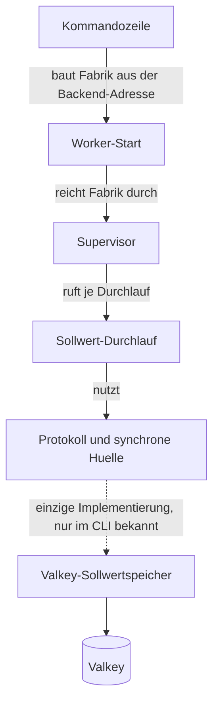
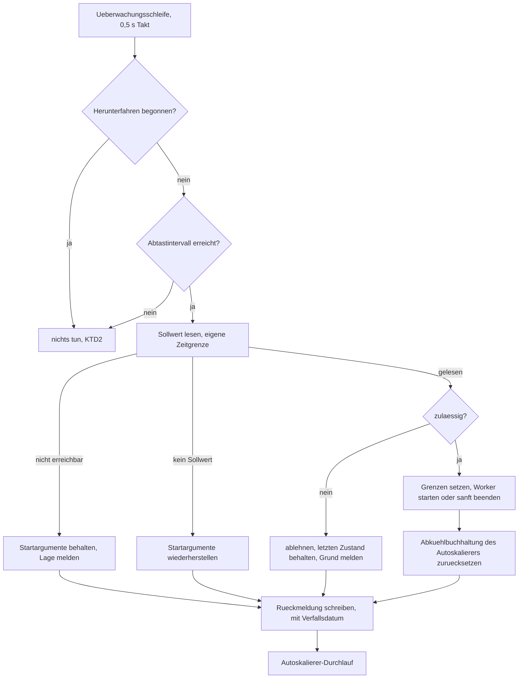
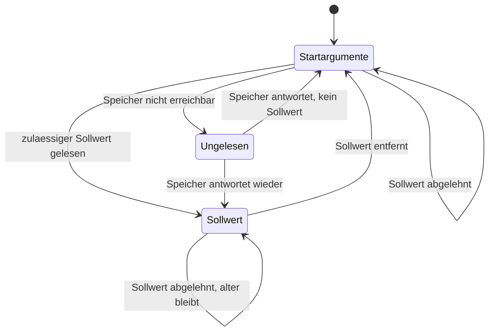

# swarmq Kontrollkanal - Plan

## Goal Capsule

- **Objective:** Ein Ops-Team ändert Prozesszahl und Autoscale-Grenzen je Supervisor einer Worker-Gruppe im laufenden Betrieb, und die zuletzt gesetzte Größe gilt auch nach dem nächsten Deploy, ohne dass jemand eine Konsole öffnet oder eine Deployment-Datei anfasst.
- **Means:** Der Supervisor nimmt Sollwerte aus dem Backend entgegen, das das Deployment ohnehin konfiguriert hat. Er liest sie beim Start vor dem ersten Kindprozess, wendet Änderungen zur Laufzeit an und meldet seine wirksamen Werte zurück (KTD1, KTD4).
- **Product authority:** Dieser Plan besitzt die Änderung an der Bibliothek. Das Dashboard-Paket ist nicht Umfang, sondern der erste Nutzer dieser Schnittstelle. Weitere Wünsche des Dashboards an den Kern gehören nicht hierher.
- **Execution profile:** testgetrieben, wie `AGENTS.md` es für dieses Repo vorschreibt: ein fehlschlagender Test je Schritt, kein Produktionscode ohne ihn.
- **Stop conditions:** Halte an, wenn eine Einheit verlangt, dass die Prozessverwaltung Backend-Code importiert, wenn die Slot-Tabelle zur Laufzeit wachsen müsste, oder wenn ein Sollwert den Start des Supervisors scheitern lassen würde. Alle drei widersprechen getroffenen Entscheidungen.
- **Open blockers:** keine; die in der Planung offenen Punkte sind als KTD1 bis KTD11 entschieden.

---

## Product Contract

### Summary

Der Supervisor lernt, Sollwerte für Prozesszahl und Autoscale-Grenzen je Worker-Gruppe entgegenzunehmen: gelesen beim Start vor dem ersten Kindprozess, angewandt zur Laufzeit, mit Rückmeldung der wirksamen Werte. Eingeschaltet wird das über ein einziges Startargument, das zugleich den Spielraum erklärt, bis zu dem jemand hochsetzen darf. Ein Sollwert beschreibt die Größe je Supervisor; laufen mehrere unter demselben Gruppenschlüssel, vervielfacht sich die Gesamtzahl entsprechend. Ohne dieses Argument verhält sich der Supervisor exakt wie heute.

### Problem Frame

Prozesszahl und Autoscale-Grenzen stehen beim Start fest. Der Autoskalierer bewegt die Zahl der Worker zwischen seinen Grenzen, aber die Grenzen selbst sind eingefroren: Wer sie ändern will, bearbeitet die Deployment-Datei und startet die Gruppe neu. In einem Rückstau, in dem das Nachziehen zählt, ist das der langsamste Weg.

Ein Reload-Pfad existiert, hilft aber nicht. `SIGHUP` führt einen vollständigen Neustart des Prozesses mit einem beim Bau eingefrorenen Kommandozeilen-Abbild aus, kann also nichts ändern, was nicht schon beim ersten Start dort stand. Die Datei-Überwachung, die ihn auslösen kann, ist ausdrücklich ein Entwicklerwerkzeug.

Dazu kommt eine Blindstelle. Der Supervisor gibt nach außen nichts über sich preis: weder seine wirksame Worker-Zahl noch seine Grenzen. Ein Beobachter kann die Kinder zählen, aber nicht erfahren, worauf der Supervisor eigentlich zielt. Ohne diese Rückmeldung kann niemand sagen, ob eine Änderung angekommen ist.

### Key Decisions

- KD1. **Fernsteuerung ist ausgeschaltet, bis der Betreiber sie einschaltet** (session-settled: user-directed — chosen over „immer an, wenn ein Backend konfiguriert ist" und über „das Gruppen-Argument schaltet sie mit ein": wer kein Dashboard betreibt, bekommt weder einen Backend-Zugriff beim Start noch dessen Fehlerfall). Governs R1, R2.
- KD2. **Ein einziges Startargument erklärt den Spielraum und schaltet zugleich ein** (session-settled: user-directed — chosen over drei getrennten Argumenten und einer kombinierten Kurzform: es gibt keinen anderen Grund, Spielraum zu reservieren, also trägt eine Zeile beide Bedeutungen ohne Mehrdeutigkeit). Governs R1, R3.
- KD3. **Der Spielraum kommt aus diesem eigenen Argument, nicht aus der heutigen Autoscale-Obergrenze** (session-settled: user-directed — chosen over der Autoscale-Obergrenze als Spielraum und einer stillen großzügigen Vorgabe: nur so kann jemand über den ausgerollten Bereich hinaus hochsetzen, und die Slot-Tabelle muss dafür nie wachsen). Governs R3, R4.
- KD4. **Der Gruppenschlüssel kommt aus einem expliziten Label, ersatzweise aus der sortierten Queue-Menge** (session-settled: user-directed — chosen over nur der Queue-Menge, Hostname plus Queues und einem Pflicht-Label: eindeutig benennbar, ohne dass jedes Deployment angefasst werden muss). Governs R5.
- KD5. **Ein unerreichbares Backend beim Start blockiert keinen Deploy** (session-settled: user-directed — chosen over einer Wartefrist und einem Startabbruch: der Supervisor fährt mit seinen Startargumenten hoch und zieht den Sollwert nach, sobald er ihn lesen kann). Governs R8.
- KD6. **Der Supervisor liest den Sollwert selbst, statt ihn zugeschickt zu bekommen** (session-settled: user-approved — chosen over dem Dashboard als Absender nach jedem Deploy: sonst hängt die Größe einer Worker-Gruppe an der Verfügbarkeit eines optionalen Zusatzpakets). Governs R6, R7.
- KD7. **Ein Sollwert beschreibt genau einen Zustand aus Unter- und Obergrenze** (session-settled: user-approved — chosen over getrennten Stellschrauben für Prozesszahl und Grenzen: die Prozesszahl ist unter Autoskalierung heute nur der Startwert, zwei Stellschrauben würden einander überschreiben). Governs R9, R10.
- KD8. **Ein gesenkter Sollwert schrumpft die Gruppe sofort und sanft** (session-settled: user-approved — chosen over dem Warten auf die Leerlaufregel des Autoskalierers: die Absicht des Betreibers wirkt gleich, und kein laufender Task geht verloren). Governs R12.
- KD9. **Der Sollwert gilt je Supervisor, nicht je Gruppe insgesamt.** Er ersetzt die Startargumente, und die gelten ebenfalls je Prozess; alles andere verlangte Abstimmung zwischen Supervisoren. Governs R13.

<!-- ce-section: work-relationships -->
### How This Work Fits Together

Dieser Plan besitzt die Kernänderung. Die Aufteilung darunter ist der heutige Stand des Verständnisses, kein festgelegter Fahrplan.

- **Dashboard-Paket** — Enables: die Steuerungs-Seite des Dashboards wird mit dieser Änderung nutzbar; sie ist dort als Voraussetzung benannt (`docs/plans/2026-09-16-1558-feat-dashboard-plan.md`, KD3 und R15 bis R17). Das Dashboard ist nicht Umfang dieses Plans.
- **Beobachtung durch das Dashboard** — Can proceed independently of: Tasks, Worker-Übersicht und Dead-Letter-Bedienung lesen den Ereignisstrom und brauchen diese Änderung nicht.
- **Weitere Wünsche des Dashboards an den Kern** — Still to decide: sie werden einzeln abgestimmt und getrennt geplant, nicht an diesen Plan angehängt.

### Actors

- A1. **Betreiber** — schaltet den Kontrollkanal je Worker-Gruppe ein, erklärt den Spielraum und benennt die Gruppe.
- A2. **Supervisor** — liest den Sollwert, wendet ihn an, meldet seine wirksamen Werte zurück und lehnt Unzulässiges ab.
- A3. **Steuernder Dienst** — schreibt Sollwerte und liest die Rückmeldung; im ersten Fall das Dashboard, grundsätzlich jeder Schreibberechtigte.

### Requirements

**Einschalten und Spielraum**

- R1. Ein Startargument des Workers erklärt die höchste Prozesszahl, auf die ein Sollwert diese Gruppe bringen darf, und schaltet damit zugleich den Kontrollkanal ein.
- R2. Ohne dieses Argument verhält sich der Supervisor wie bisher: kein Lesen, kein Schreiben, kein zusätzlicher Backend-Zugriff und kein neuer Fehlerfall beim Start.
- R3. Der erklärte Spielraum ist von den Startwerten unabhängig: Prozesszahl und Autoscale-Grenzen des Deployments bleiben, was sie sind, und der Spielraum begrenzt allein, wie weit ein Sollwert sie verschieben darf.
- R4. Slot-Tabelle, Bereich der Beobachtungs-Ports und die Voreinstellung der Rechenslots je Worker werden beim Start einmal aus dem erklärten Spielraum abgeleitet statt aus der Startprozesszahl, und einmal geprüft; zur Laufzeit wächst keines davon.

**Gruppe, Sollwert und Anwendung**

- R5. Der Supervisor bestimmt seinen Gruppenschlüssel aus einem beim Start vergebenen Label; fehlt es, bildet er ihn aus der sortierten Menge seiner Queues. Der Schlüssel ist nur innerhalb eines Backends eindeutig: Deployments, die sich ein Backend teilen und dieselben Queues bedienen, brauchen ein Label, sonst steuern sie einander. Ändert sich die Queue-Menge einer Gruppe ohne Label, entsteht ein neuer Schlüssel, und der unter dem alten hinterlegte Sollwert gilt nicht mehr.
- R6. Der Supervisor liest den Sollwert seiner Gruppe beim Start, bevor er den ersten Kindprozess erzeugt, und wendet ihn an; die Startargumente gelten, wenn kein Sollwert hinterlegt ist oder der hinterlegte nach R10 abgelehnt wird.
- R7. Der Supervisor bemerkt einen geänderten Sollwert im laufenden Betrieb und wendet ihn an, ohne dass jemand den Prozess neu startet. Ein entfernter Sollwert zählt als Änderung: der Supervisor kehrt zu seinen Startargumenten zurück, beim Start wie zur Laufzeit.
- R8. Ist der Sollwertspeicher beim Start nicht erreichbar, fährt der Supervisor mit seinen Startargumenten hoch, versucht es weiter und wendet den Sollwert an, sobald er ihn lesen kann; sein zurückgemeldeter Zustand weist diese Lage aus.
- R9. Ein Sollwert besteht aus Unter- und Obergrenze; eine feste Prozesszahl N ist der Sollwert N..N und schaltet die Autoskalierung für diese Gruppe ab. Ein neuer Sollwert ersetzt den vorigen vollständig.
- R10. Der Supervisor lehnt einen Sollwert ab, dessen Obergrenze über dem erklärten Spielraum liegt, dessen Untergrenze kleiner als eins ist, dessen Grenzen verdreht sind, der auf einer Gruppe im Rechen-Pool oder auf einer Gruppe mit abgeschalteter Autoskalierung nicht die feste Form trägt, oder der sich nicht lesen und als Unter- und Obergrenze deuten lässt. Ein abgelehnter Sollwert wird nicht angewandt und verdrängt den zuletzt wirksamen nicht; wird er beim Start abgelehnt, gelten die Startargumente und die Gruppe fährt hoch. Ein Sollwert lässt den Start nie scheitern.
- R11. Eine Gruppe im Rechen-Pool nimmt nur die feste Form N..N an, weil Autoskalierung und Rechen-Pool sich schon heute ausschließen.
- R12. Ein Sollwert, der die Gruppe verkleinert, beendet überzählige Worker sofort auf dem sanften Weg des Autoskalierers: der laufende Task wird fertig, dann endet der Prozess. Ein Sollwert, der die Untergrenze über die laufende Worker-Zahl hebt, startet die fehlenden Worker ebenso sofort, ohne auf Schwellwert oder Abkühlung des Autoskalierers zu warten. Übernommen wird allein die Art des Beendens; Mindestlaufzeit, Abkühlzeit und der Takt von einem Worker je Entscheidung gelten für einen Sollwert nicht.
- R13. Ein Sollwert gilt für jeden Supervisor der Gruppe einzeln, so wie die Startargumente, die er ersetzt.

**Rückmeldung und Anbindung**

- R14. Der Supervisor meldet je Gruppe seinen wirksamen Gruppenschlüssel, welchen Sollwert er zuletzt gelesen hat oder dass keiner hinterlegt ist, welche Grenzen bei ihm wirksam sind und ob sie aus einem Sollwert oder aus den Startargumenten stammen, wie viele Slots belegt sind und wann er das zuletzt gemeldet hat.
- R15. Eine Ablehnung nach R10 erscheint in derselben Rückmeldung mit ihrem Grund, damit der Absender den Unterschied zwischen abgelehnt und noch nicht angekommen erkennt.
- R16. Der Zugang zum Sollwertspeicher erreicht den Supervisor als vom Kommandozeilen-Teil gereichte Fabrik, wie heute schon die Messung der Queue-Tiefen; das Paket `process_manager` importiert weiterhin keine Backend-Implementierung.
- R17. Sollwerte und Rückmeldungen liegen in einem eigenen Schlüsselraum des Backends, getrennt von den Schlüsseln, die Tasks und Ergebnisse tragen, und darin je Richtung unter einem eigenen Präfix, damit ein Betreiber Schreibrechte für Sollwerte und für Rückmeldungen getrennt vergeben kann.

### Key Flows

- F1. Deploy mit gemerktem Sollwert
  - **Trigger:** Ein Deploy startet die Worker-Gruppe mit ihren alten Startargumenten neu.
  - **Actors:** A2
  - **Steps:** Supervisor startet; bestimmt seinen Gruppenschlüssel; liest den Sollwert; wendet ihn vor dem ersten Kindprozess an; meldet seine wirksamen Werte.
  - **Covers R5, R6, R14**

- F2. Anheben im laufenden Betrieb
  - **Trigger:** Ein steuernder Dienst schreibt für die Gruppe eine höhere Obergrenze.
  - **Actors:** A3, A2
  - **Steps:** Supervisor bemerkt den geänderten Sollwert; prüft ihn gegen den Spielraum; wendet ihn an; meldet die neuen wirksamen Grenzen; der Autoskalierer nutzt die zusätzlichen Slots bei Last.
  - **Covers R7, R9, R10, R14**

- F3. Abgelehnter Sollwert
  - **Trigger:** Ein Sollwert verlangt mehr, als der Spielraum hergibt.
  - **Actors:** A3, A2
  - **Steps:** Supervisor erkennt die Überschreitung; wendet nichts an; behält den zuletzt wirksamen Zustand; meldet die Ablehnung mit Grund.
  - **Covers R10, R15**

- F4. Sollwertspeicher beim Start nicht erreichbar
  - **Trigger:** Das Backend antwortet nicht, während der Supervisor hochfährt.
  - **Actors:** A2
  - **Steps:** Supervisor fährt mit seinen Startargumenten hoch; versucht weiter zu lesen; wendet den Sollwert nach der Rückkehr an; die Rückmeldung weist die Zeit dazwischen als ungelesen aus.
  - **Covers R8, R14**

### Acceptance Examples

- AE1. **Covers R1, R2.** Given: eine Worker-Gruppe startet ohne das neue Argument. When: ein steuernder Dienst hinterlegt für ihren Schlüssel einen Sollwert. Then: der Supervisor liest nichts, ändert nichts und meldet nichts.
- AE2. **Covers R3, R6.** Given: das Deployment startet mit Autoscale 2 bis 4 und einem Spielraum von 16, für die Gruppe ist der Sollwert 2..8 hinterlegt. When: der Supervisor startet. Then: er wendet 2..8 vor dem ersten Kindprozess an, nicht 2 bis 4.
- AE3. **Covers R4.** Given: ein Spielraum von 16. When: der Supervisor startet. Then: die Slot-Tabelle fasst 16 Einträge und der Portbereich wird einmal über alle 16 geprüft, unabhängig davon, wie viele Worker tatsächlich laufen.
- AE4. **Covers R5.** Given: zwei Worker-Gruppen auf demselben Host bedienen dieselben Queues, eine trägt ein Label. When: beide starten. Then: die beschriftete Gruppe trägt ihr Label als Schlüssel, die andere den aus ihren Queues gebildeten.
- AE5. **Covers R9, R10.** Given: ein Spielraum von 8 und der wirksame Sollwert 2..6. When: ein Sollwert 2..12 hinterlegt wird. Then: der Supervisor bleibt bei 2..6 und meldet die Ablehnung mit dem überschrittenen Spielraum als Grund.
- AE6. **Covers R9, R12.** Given: sechs Worker laufen, vier davon bearbeiten gerade Tasks. When: der Sollwert auf 4..4 gesetzt wird. Then: zwei Worker enden, laufende Tasks werden vorher fertig, und die Autoskalierung ist für diese Gruppe abgeschaltet.
- AE7. **Covers R8, R14.** Given: der Sollwertspeicher ist beim Start nicht erreichbar, das Deployment nennt zwei Prozesse. When: der Supervisor hochfährt und der Speicher nach einer Minute antwortet. Then: zunächst laufen zwei Worker und die Rückmeldung weist den Sollwert als ungelesen aus; danach gilt der hinterlegte Sollwert.
- AE8. **Covers R13.** Given: zwei Hosts tragen denselben Gruppenschlüssel. When: der Sollwert 4..4 gesetzt wird. Then: jeder der beiden Supervisoren führt vier Worker, insgesamt laufen acht.

- AE9. **Covers R7, R14.** Given: für eine Gruppe ist der Sollwert 4..4 wirksam, das Deployment nennt Autoscale 2 bis 4. When: der Sollwert entfernt wird. Then: die Gruppe läuft wieder mit 2 bis 4, und die Rückmeldung nennt die Startargumente als Herkunft der wirksamen Werte.
- AE10. **Covers R12.** Given: zwei Worker laufen, die Queues sind leer, der Spielraum beträgt 16. When: der Sollwert 6..8 gesetzt wird. Then: sechs Worker laufen, ohne dass Last anliegen muss.
- AE11. **Covers R10, R11.** Given: eine Gruppe läuft im Rechen-Pool. When: der Sollwert 2..6 gesetzt wird. Then: der Supervisor lehnt ihn ab und nennt die verlangte feste Form als Grund.
- AE12. **Covers R10.** Given: für eine Gruppe ist der Sollwert 2..8 hinterlegt, ein Deploy senkt den Spielraum auf 4. When: der Supervisor startet. Then: er fährt mit seinen Startargumenten hoch und meldet den Sollwert als abgelehnt.

- AE13. **Covers R9, R10.** Given: eine Gruppe läuft mit dem wirksamen Sollwert 4..4, ihre Autoskalierung ist damit aus. When: der Sollwert 2..8 gesetzt wird. Then: der Supervisor lehnt ihn ab und bleibt bei 4..4.

### Success Criteria

- Eine Änderung an Prozesszahl oder Autoscale-Grenzen innerhalb des erklärten Spielraums braucht weder einen Deploy noch einen Konsolenzugriff.
- Ein Deploy stellt die zuletzt gesetzte Größe wieder her, auch wenn der steuernde Dienst zu diesem Zeitpunkt nicht läuft.
- Ein Deployment ohne das neue Argument verhält sich messbar wie vorher: kein zusätzlicher Backend-Zugriff beim Start und kein neuer Weg, auf dem der Start scheitern kann.

### Scope Boundaries

**Deferred for later**

- Schwellwerte des Autoskalierers zur Laufzeit ändern: wann hochskaliert wird, wie lange Leerlauf vor dem Abbau nötig ist, wie lange die Abkühlung dauert.
- Die Slot-Tabelle zur Laufzeit wachsen lassen; bis auf Weiteres verlangt mehr Spielraum einen Deploy.
- Abstimmung mehrerer Supervisoren derselben Gruppe auf eine gemeinsame Gesamtzahl.

**Outside this product's identity**

- Queues einer Gruppe hinzufügen oder entfernen, Worker neu starten oder herunterfahren, Rate- und Zeitlimits je Task-Typ ändern: swarmq hält Task-Regeln bewusst im Code.
- Zugriffsschutz auf den Sollwertspeicher. Wer schreiben darf, darf steuern; die Beschränkung gehört in die Zugriffsregeln des Betreibers, nicht in den Supervisor.
- Eine Oberfläche für Sollwerte. Dieser Plan liefert die Schnittstelle, nicht ihre Bedienung.

### Dependencies / Assumptions

- **Das Backend ist bereits Pflicht** (verifiziert: der Supervisor verlangt Broker- und Backend-Adresse aus der Umgebung und bricht sonst ab, `src/swarmq/process_manager/run.py`). Der Kontrollkanal braucht daher keine neue Konfiguration, nur die Erlaubnis, sie zu nutzen.
- **Der Supervisor importiert keine Backend-Implementierung** (verifiziert: `src/swarmq/process_manager/sampler.py`, KTD6). Der Zugang kommt als Fabrik von außen, wie bei der Messung der Queue-Tiefen, die je Abtastung eine eigene Verbindung öffnet und wieder schließt.
- **Der Supervisor hat keine asyncio-Schleife** (verifiziert: ebenda). Sollwerte werden abgetastet, nicht abonniert; die Übernahme dauert bis zu einem Abtastintervall.
- **Sanftes Beenden funktioniert bereits** (verifiziert: der Abbau eines Workers markiert die Beendigung als erwartet und schickt ein Terminierungssignal, das der Worker als geordnetes Herunterfahren behandelt, `src/swarmq/process_manager/autoscale.py`, `src/swarmq/worker/lifecycle.py`).
- **Die Portprüfung läuft nur beim Start** (verifiziert: `src/swarmq/process_manager/check.py`, aufgerufen im Vorflug). Deshalb muss der Spielraum schon dort die Obergrenze sein.
- **Der Name „Kontrollkanal" bleibt der Begriff, nicht der Bezeichner im Code**: Dieser Plan und der Dashboard-Plan nennen die Sache so, und dabei bleibt es. Im Code ist `SupervisorChannel` bereits für die prozessinterne Verständigung zwischen Supervisor und seinen Kindern vergeben (`src/swarmq/supervision.py`), die neue Klasse braucht also einen eigenen Bezeichner; die Wahl gehört in die Planung.
- **Der Spielraum setzt den Mindestabstand der Basisports**: Sind Metrik- und Health-Port gesetzt, prüft die Vorflugprüfung ihre Bereiche über die Obergrenze und lehnt Überschneidungen ab (verifiziert: `src/swarmq/process_manager/check.py`). Sobald der Spielraum diese Obergrenze stellt, kann das Einschalten auf einem bestehenden Deployment eine Portänderung verlangen.
- **Eine Worker-Kennung per Startargument gibt es nicht** (verifiziert: die Kennung entsteht aus einer Umgebungsvariablen oder dem Hostnamen, dazu der Slot, `src/swarmq/config.py`). Das Label aus R5 ist ein neues Argument und keine Umdeutung eines vorhandenen.

### Outstanding Questions

**Resolve Before Planning**

Keine.

**Deferred to Planning**

Alle beim Brainstorm offenen Punkte sind entschieden. Die Antworten liegen als Key Technical Decisions im Planning Contract: Schlüsselzuschnitt und Datenform in KTD6, Abtasten statt Benachrichtigung in KTD5, Verfall der Rückmeldung statt einer Bestätigungsfrist in KTD7, Argumentnamen in KTD10, und die Frage nach dem Spielraum ohne Autoskalierung in KTD8.

### Sources / Research

- Anforderungen des ersten Nutzers: `docs/plans/2026-09-16-1558-feat-dashboard-plan.md` (KD3 bis KD5, R15 bis R17).
- Heutige Prozessverwaltung: Supervisor und Slot-Tabelle `src/swarmq/process_manager/supervisor.py`, `src/swarmq/process_manager/slots.py`; Autoskalierer `src/swarmq/process_manager/autoscale.py`; Messung der Queue-Tiefen `src/swarmq/process_manager/sampler.py`; Vorflugprüfung `src/swarmq/process_manager/check.py`.
- Startargumente und ihre Prüfung: `src/swarmq/cli/parser.py`, `src/swarmq/slots.py`.
- Bestehender Reload-Pfad: `docs/plans/2026-04-20-002-feat-r5.3-hot-reload-plan.md`; Ursprungsplan der Autoskalierung: `docs/plans/2026-04-19-008-feat-r4.6-r4.7-processmanager-autoscaling-plan.md`.
- Schlüsselkonventionen und prozessinterne Verständigung: `src/swarmq/backend/valkey/results.py`, `src/swarmq/supervision.py`.

**Für die Umsetzung**

- Vorlage für ein neues Startargument von der Typfunktion bis zur Vorflugprüfung: `--autoscale` in `src/swarmq/cli/_shared.py`, `src/swarmq/cli/parser.py`, `src/swarmq/process_manager/check.py`.
- Vorlage für die eingespritzte Fabrik und den synchronen Zugriff ohne Ereignisschleife: `src/swarmq/process_manager/sampler.py`, verdrahtet in `src/swarmq/cli/__init__.py` und `src/swarmq/process_manager/run.py`.
- Vorlage für Form und Selbsttaktung des Durchlaufs sowie den sanften Abbau: `src/swarmq/process_manager/autoscale.py`.
- Vorlage für eine kleine Backend-Klasse mit Fehlerwandlung: `src/swarmq/backend/valkey/locks.py`, Verbindungs- und Wiederholstrategie in `src/swarmq/backend/valkey/connection.py`.
- Messung, dass Abonnements sich nach einer Unterbrechung nicht selbst wiederherstellen, Lesezugriffe mit Wiederholstrategie dagegen schon: `docs/solutions/spikes/2026-04-17-toxiproxy-reconnect-spike.md`.
- Methodik gegen Flakigkeit bei Tests gegen einen Abtastvorgang: `docs/solutions/logic-errors/scheduler-cron-sync-clobber-test-flake-2026-06-01.md`.
- Konventionen für mehrfach aufrufbares Verbinden und die Wandlung fremder Ausnahmen: `docs/solutions/logic-errors/swarmq-async-semaphore-deadlock-and-error-wrapping-2026-04-15.md`.
- Testvorgaben des Repos, einschließlich der Pflicht zur testgetriebenen Entwicklung: `AGENTS.md`.

---

## Planning Contract

**Product Contract preservation:** Product Contract unverändert. Einzige Änderung außerhalb des Planungsteils ist die Auflösung der offenen Punkte unter Outstanding Questions, die jeweils auf die entscheidende KTD zeigt.

### Key Technical Decisions

- KTD1. **Der Sollwert-Durchlauf ist ein eigenes Modul in der Form des Autoskalierers.** Eine freie Funktion `tick(pm)` in einem neuen Modul, aus der Überwachungsschleife des Supervisors aufgerufen und selbst getaktet, hält den Supervisor frei von Backend-Wissen und spiegelt die vorhandene Trennung zwischen `supervisor.py` und `autoscale.py`. Governs R7.
- KTD2. **Der Durchlauf ruht, sobald das Herunterfahren begonnen hat** (session-settled: user-approved — chosen over „Sollwerte gelten bis zur letzten Sekunde": ein zufällig gleichzeitiger Sollwert würde sonst neue Worker starten, auf die das Herunterfahren die volle Nachfrist warten muss). Governs R7, R12.
- KTD3. **Der Durchlauf läuft vor dem Autoskalierer und setzt dessen Abkühl- und Leerlaufbuchhaltung zurück, wenn er etwas geändert hat.** Sonst entscheidet der Autoskalierer in derselben Schleifenrunde auf veralteter Grundlage und schrumpft eine gerade gesetzte Gruppe weiter. Governs R7, R12.
- KTD4. **Der Zugang zum Sollwertspeicher kommt als eingespritzte Fabrik hinter einem strukturellen Protokoll**, synchron aufgerufen mit eigener Zeitgrenze, weil der Supervisor keine Ereignisschleife hat. Das ist dieselbe Form, die die Messung der Queue-Tiefen bereits nutzt. Governs R16.
- KTD5. **Abgetastet wird, nicht abonniert.** Ein Abonnement stellt sich nach einer Unterbrechung nicht von selbst wieder her und bräuchte eigene Wiederanmeldung; ein Lesezugriff mit der vorhandenen Wiederholstrategie ist der bereits gemessene Weg (`docs/solutions/spikes/2026-04-17-toxiproxy-reconnect-spike.md`). Voreinstellung fünf Sekunden, also schneller als die zehn Sekunden der Queue-Messung, weil ein Sollwert eine ausdrückliche Handlung ist. Lesen und Schreiben bekommen je eine Zeitgrenze von einer Sekunde, das Schließen die kürzere Frist der Vorlage, sodass ein vollständiger Durchlauf auch im Fehlerfall unter der Hälfte des Intervalls bleibt. Nach einem Fehlschlag überspringt der Durchlauf den Rest des Intervalls, statt in derselben Runde erneut zu versuchen. Governs R7.
- KTD6. **Sollwert und Rückmeldung bekommen je einen eigenen Schlüsselpräfix unter dem vorhandenen `sq:`-Stamm**, die Rückmeldung zusätzlich je Supervisor, damit mehrere Supervisoren einer Gruppe einander nicht überschreiben. Datenform ist JSON, damit ein Betreiber den Wert ohne Werkzeug lesen kann. Governs R17.
- KTD7. **Die Rückmeldung trägt ein Verfallsdatum und wird bei jedem Durchlauf erneuert** (session-settled: user-approved — chosen over einer Abschlussmeldung beim geordneten Ende: die hilft im harten Fall nicht, ein Verfallsdatum lässt die Meldung eines toten Supervisors in beiden Fällen verschwinden). Die Frist ist keine feste Zahl, sondern leitet sich aus der Gnadenfrist des Herunterfahrens, der Terminierungsfrist und einem Abtastintervall ab, weil der Durchlauf nach KTD2 während des gesamten Abbaus nichts mehr erneuert und die Gnadenfrist vom Betreiber einstellbar ist. Governs R14.
- KTD8. **Eine Gruppe ohne Autoskalierung nimmt nur feste Sollwerte an** (session-settled: user-approved — chosen over „ein Bereichs-Sollwert schaltet die Autoskalierung ein": der Modus entscheidet im Supervisor heute auch über Ziel- und Abbruchbedingungen, ihn zur Laufzeit umzulegen sprengt den kleinen Kern-MR). Governs R9, R10.
- KTD9. **Dauerhaft gesperrte Slots bleiben gesperrt; ihre Zahl steht in der Rückmeldung** (session-settled: user-approved — chosen over einer Entsperrung: das ist eine eigene Änderung am Supervisor, unabhängig vom Kontrollkanal). Governs R14.
- KTD10. **Die neuen Startargumente heißen `--max-processes` und `--group`.** Beide folgen der englischen Benennung der vorhandenen Argumente; `--max-processes` trägt den Spielraum und schaltet damit ein, `--group` trägt allein das Label. Governs R1, R5.
- KTD11. **Vergrößern und Verkleinern sind Bestes-Bemühen je Durchlauf.** Sind Slots gerade im Übergang oder gesperrt, erreicht ein Durchlauf den Sollwert nicht vollständig und der nächste zieht nach. Das ist selbstheilend und vermeidet eine Sonderbehandlung im Abbaupfad. Governs R12.

- KTD12. **Die wirksamen Grenzen liegen in einem eigenen Feld auf dem Prozessmanager**, das die Zielberechnung auch ohne Autoskalierung heranzieht. Weder die Startprozesszahl noch das Autoscale-Feld werden zur Laufzeit umgeschrieben: an beiden hängen die zwei Ausstiegspfade des Supervisors, und ein per Sollwert beendeter Worker erhöht keinen der Abzüge, aus denen sich das heutige Ziel ohne Autoskalierung bildet. Ohne dieses Feld macht die Nachfüllschleife jedes Verkleinern in derselben Runde rückgängig. Governs R7, R9, R12.

### High-Level Technical Design

Wie der Backend-Zugang den Supervisor erreicht, ohne dass die Prozessverwaltung Backend-Code importiert (KTD4):

Ein Durchlauf, von der Überwachungsschleife bis zur Rückmeldung:

Woher die wirksamen Grenzen stammen, ist der Zustand, den die Rückmeldung trägt:

### Risks & Dependencies

- **Der Abtastvorgang blockiert die Aufsichtsschleife.** Der Supervisor hat keine Ereignisschleife, also läuft jeder Backend-Zugriff als eigener Lauf mit Zeitgrenze und hält die Schleife so lange an. Bei wiederholten Fehlversuchen nach R8 verzögert das die Erkennung toter Kinder. Die Zeitgrenze muss deutlich unter dem Abtastintervall bleiben, und der Durchlauf darf nach einem Fehlschlag nicht in derselben Runde erneut versuchen.
- **Ein gesperrter Slot verkleinert den Spielraum dauerhaft.** Fünf Abstürze desselben Platzes in einer Stunde sperren ihn bis zum nächsten Deploy. Ein erhöhter Sollwert wird dann nicht vollständig erreicht; die Rückmeldung macht es sichtbar, löst es aber nicht (KTD9).
- **Ein rollender Deploy kann zwei Spielräume nebeneinander haben.** Alte und neue Supervisoren derselben Gruppe tragen dann verschiedene Obergrenzen, derselbe Sollwert wird von einem angewandt und vom anderen abgelehnt. Die Rückmeldung je Supervisor macht den gemischten Zustand sichtbar.
- **Der Zugriffsschutz hängt an getrennten Zugangsdaten, die es heute nicht gibt.** Client, Kommandozeile und Supervisor lesen dieselbe Backend-Adresse aus der Umgebung. Bis der Betreiber dem steuernden Dienst eigene Zugangsdaten gibt, kann jeder Task-Erzeuger auch Sollwerte setzen. Der getrennte Schlüsselpräfix aus KTD6 ist die Voraussetzung dafür, nicht die Lösung.

### Sequencing

U1 und U3 sind unabhängig und können parallel entstehen. U2 setzt U1 voraus, U4 setzt U3 voraus, U5 setzt U2 und U4 voraus, U6 setzt U5 voraus, U7 setzt U6 voraus. U8 kommt zum Schluss.

---

## Implementation Units

### U1. Sollwert-Speicher im Valkey-Backend

- **Goal:** Ein kleiner Speicher liest und schreibt Sollwert und Rückmeldung je Worker-Gruppe unter eigenen Schlüsselpräfixen.
- **Requirements:** R17, und die Datengrundlage für R14, R15
- **Dependencies:** keine
- **Files:** `src/swarmq/backend/valkey/control.py` (neu), `tests/unit/backend/test_valkey_control.py` (neu), `tests/integration/backend/test_valkey_control.py` (neu)
- **Approach:**
  1. Eine Klasse auf Basis von `ValkeyConnection`, mit privaten Schlüsselbauern je Richtung nach KTD6.
  2. Lesen liefert den Sollwert einer Gruppe oder nichts; unlesbare Daten kommen als eigenes Ergebnis zurück, nicht als Ausnahme, damit der Aufrufer sie nach R10 behandeln kann.
  3. Schreiben der Rückmeldung setzt das Verfallsdatum aus KTD7 bei jedem Aufruf neu.
  4. Fremde Ausnahmen werden an der Ein- und Ausgabegrenze in `BackendConnectionError` gewandelt; `connect()` bleibt mehrfach aufrufbar.
- **Patterns to follow:** `src/swarmq/backend/valkey/locks.py` für den Zuschnitt einer kleinen Klasse und die Fehlerwandlung; `src/swarmq/backend/valkey/results.py` für die Schlüsselbauer.
- **Execution note:** Testgetrieben wie im Repo vorgeschrieben, ein fehlschlagender Test je Schritt.
- **Test scenarios:**
  - Lesen einer Gruppe ohne hinterlegten Sollwert liefert nichts.
  - Lesen eines geschriebenen Sollwerts liefert Unter- und Obergrenze unverändert zurück.
  - Lesen eines Schlüssels mit nicht deutbarem Inhalt liefert das Ergebnis „unlesbar" statt einer Ausnahme.
  - Ein Verbindungsfehler beim Lesen kommt als `BackendConnectionError` heraus, nicht als Bibliotheksausnahme.
  - Zweimaliges `connect()` öffnet keine zweite Verbindung.
  - Integration: eine geschriebene Rückmeldung verschwindet nach Ablauf ihres Verfallsdatums von selbst.
  - Integration: zwei Supervisoren derselben Gruppe schreiben Rückmeldungen, die einander nicht überschreiben.
- **Verification:** Die Einheitentests laufen ohne echtes Valkey, die Integrationstests gegen den Container aus den vorhandenen Fixtures.

### U2. Protokoll und Fabrik für den Supervisor

- **Goal:** Der Prozessmanager erreicht den Sollwert-Speicher über ein strukturelles Protokoll und eine vom Kommandozeilen-Teil gereichte Fabrik, synchron und mit Zeitgrenze.
- **Requirements:** R16
- **Dependencies:** U1
- **Files:** `src/swarmq/process_manager/setpoint_store.py` (neu), `tests/unit/process_manager/test_setpoint_store.py` (neu)
- **Approach:**
  1. Ein `Protocol` mit genau den Methoden, die der Durchlauf braucht, plus ein Fabrik-Typalias.
  2. Zwei synchrone Hüllen, die den asynchronen Aufruf je Verwendung in einem eigenen Lauf mit der Zeitgrenze aus KTD5 ausführen und die Verbindung danach schließen. Die Zahl wird hier gesetzt, nicht aus der Vorlage übernommen, deren fünf Sekunden dem Abtastintervall entsprächen.
  3. Das Modul importiert keine Backend-Implementierung.
- **Patterns to follow:** `src/swarmq/process_manager/sampler.py`, einschließlich der getrennten kürzeren Frist für das Schließen.
- **Execution note:** Testgetrieben.
- **Test scenarios:**
  - Ein erfolgreicher Lesevorgang gibt den Sollwert zurück und schließt die Verbindung.
  - Eine überschrittene Zeitgrenze liefert „nicht gelesen" statt einer Ausnahme und schließt trotzdem.
  - Eine Ausnahme beim Öffnen liefert „nicht gelesen" und protokolliert einmal.
  - Ein Fehler beim Schließen verhindert nicht, dass der gelesene Wert zurückkommt.
  - Die gesetzten Zeitgrenzen für Lesen und Schreiben liegen zusammen unter der Hälfte des Abtastintervalls.
  - Das Modul importiert nichts aus `swarmq.backend`, geprüft als Zusicherung über die Modulquelle.
- **Verification:** Der Prozessmanager bleibt ohne Backend-Import; die Zeitgrenze greift im Test messbar.

### U3. Neue Startargumente und ihre Prüfung

- **Goal:** `--max-processes` und `--group` existieren, werden geprüft und erreichen den Supervisor und seine Kinder.
- **Requirements:** R1, R2, R3, R5
- **Dependencies:** keine
- **Files:** `src/swarmq/cli/_shared.py`, `src/swarmq/cli/parser.py`, `src/swarmq/process_manager/config.py`, `src/swarmq/process_manager/check.py`, `src/swarmq/process_manager/run.py`, `tests/unit/process_manager/test_check.py`, `tests/unit/process_manager/test_config.py`, `tests/unit/test_cli_module_surface.py`
- **Approach:**
  1. Eine Typfunktion für `--max-processes` in `_shared.py`, die nur ganze Zahlen ab eins annimmt.
  2. Beide Argumente im Worker-Parser, beide mit Vorgabe „nicht gesetzt", damit vorhandene Aufrufe unverändert laufen (R2).
  3. Zwei neue Felder auf der einfrierbaren Worker-Konfiguration, beide in der Liste erlaubter Typen.
  4. Der Kommandozeilen-Teil bildet den Gruppenschlüssel aus dem Label, ersatzweise aus der sortierten Queue-Menge, und reicht ihn fertig weiter: als Feld der Worker-Konfiguration an die Kinder und als Konstruktorargument an den Supervisor, der ihn schon vor dem ersten Kind braucht (R6) und in jede Rückmeldung trägt (R14). Die Bedeutung des Labels bleibt damit außerhalb der Prozessverwaltung.
  5. Die Vorflugprüfung lehnt einen Spielraum unter der Startprozesszahl oder unter der Autoscale-Obergrenze ab.
  6. Im Rechen-Pool lehnt sie zusätzlich einen Spielraum ab, bei dem die Rechenslots im Vollausbau die zugeteilten CPUs überschreiten: ohne ausdrückliche Nebenläufigkeit, wenn der Spielraum über der CPU-Zuteilung liegt, mit ausdrücklicher, wenn ihr Produkt mit dem Spielraum darüber liegt. Ohne diese Regel greift die Ableitung aus U4 nicht, weil sie bei mindestens einem Slot klemmt und eine ausdrückliche Nebenläufigkeit sie ganz überspringt.
- **Patterns to follow:** `--autoscale` als nächstliegende Vorlage, von der Typfunktion bis zur Prüfung.
- **Execution note:** Testgetrieben. Die Oberflächen-Whitelist in `tests/unit/test_cli_module_surface.py` muss mitwachsen, sonst schlägt sie fehl.
- **Test scenarios:**
  - `--max-processes 0` und `--max-processes -1` werden vom Parser abgelehnt.
  - Ein Aufruf ohne beide Argumente ergibt eine Konfiguration, die sich von der heutigen nicht unterscheidet.
  - `--max-processes 4` zusammen mit `--processes 8` scheitert in der Vorflugprüfung mit Exit-Code 78.
  - `--max-processes 4` zusammen mit `--autoscale 2,8` scheitert ebenso.
  - Die Worker-Konfiguration bleibt mit beiden neuen Feldern einfrierbar und über die Prozessgrenze übertragbar.
  - Ohne `--group` entsteht der Schlüssel aus der sortierten Queue-Menge; mit `--group` aus dem Label. Covers AE4.
  - Der gebildete Gruppenschlüssel erreicht sowohl die Worker-Konfiguration als auch den Konstruktor des Supervisors.
  - Im Rechen-Pool ohne ausdrückliche Nebenläufigkeit scheitert ein Spielraum über der CPU-Zuteilung mit Exit-Code 78.
  - Im Rechen-Pool mit ausdrücklicher Nebenläufigkeit scheitert ein Spielraum, dessen Produkt damit die CPU-Zuteilung überschreitet.
- **Verification:** Bestehende Aufrufe ohne die neuen Argumente verhalten sich unverändert; die Oberflächenprüfung ist grün.

### U4. Dimensionierung aus dem Spielraum

- **Goal:** Slot-Tabelle, Portbereich und die Rechenslots je Worker richten sich nach dem erklärten Spielraum statt nach der Startprozesszahl.
- **Requirements:** R4, R11
- **Dependencies:** U3
- **Files:** `src/swarmq/process_manager/supervisor.py`, `src/swarmq/process_manager/check.py`, `src/swarmq/cli/pool.py`, `src/swarmq/slots.py`, `tests/unit/process_manager/test_supervisor.py`, `tests/unit/process_manager/test_check.py`, `tests/unit/test_slots.py`, `tests/unit/test_cli_pool.py`
- **Approach:**
  1. Die Slot-Tabelle wird auf den Spielraum dimensioniert, wenn er gesetzt ist, sonst wie bisher.
  2. Die Obergrenze der Portbereichsprüfung wird um den Spielraum erweitert.
  3. Die Ableitung der Rechenslots je Prozess teilt die zugeteilten CPUs durch den Spielraum statt durch die Startprozesszahl, wenn er gesetzt ist.
  4. Nichts davon wächst zur Laufzeit.
- **Patterns to follow:** die vorhandene Berechnung der Portbereiche, die die Autoscale-Obergrenze schon heute aus demselben Grund heranzieht.
- **Execution note:** Testgetrieben. Der dritte Punkt ist der, den die Prüfung als Überbuchungsrisiko benannt hat; er braucht eine eigene fehlschlagende Prüfung vor der Änderung.
- **Test scenarios:**
  - Mit Spielraum 16 fasst die Slot-Tabelle 16 Einträge, unabhängig von der Startprozesszahl. Covers AE3.
  - Ohne Spielraum bleibt die Dimensionierung unverändert.
  - Metrik- und Health-Basisport mit zu geringem Abstand werden bei gesetztem Spielraum abgelehnt, ohne ihn angenommen.
  - Im Rechen-Pool ergibt Spielraum 8 bei acht zugeteilten CPUs einen Slot je Prozess, nicht vier.
  - Ohne Spielraum bleibt die Ableitung der Rechenslots unverändert.
- **Verification:** Die Summe der Rechenslots über alle Prozesse überschreitet die CPU-Zuteilung auch beim höchsten zulässigen Sollwert nicht. Getragen wird das von der Ableitung hier und der Vorflugregel aus U3 gemeinsam; die Ableitung allein genügt nicht.

### U5. Lesen beim Start und Anwenden vor dem ersten Kind

- **Goal:** Der Supervisor liest den Sollwert seiner Gruppe vor dem ersten Kindprozess, prüft ihn und wendet ihn an.
- **Requirements:** R6, R8, R9, R10, R11, R13
- **Dependencies:** U2, U4
- **Files:** `src/swarmq/process_manager/setpoint.py` (neu), `src/swarmq/process_manager/supervisor.py`, `src/swarmq/process_manager/run.py`, `src/swarmq/cli/__init__.py`, `tests/unit/process_manager/test_setpoint.py` (neu), `tests/unit/process_manager/test_supervisor.py`, `tests/unit/process_manager/test_run.py`
- **Approach:**
  1. Die Prüfregeln aus R10 als eigene, reine Funktion, damit Start und Laufzeit dieselbe nutzen.
  2. Eine Fabrik für den Sollwert-Speicher im Kommandozeilen-Teil, gebaut aus der Backend-Adresse der Umgebung, gereicht wie die vorhandene Broker-Fabrik.
  3. Der Supervisor liest einmal vor dem ersten Start; ein gelesener zulässiger Sollwert füllt das eigene Grenzenfeld aus KTD12, ein abgelehnter oder ungelesener lässt die Startwerte gelten.
  4. Der Sollwert gilt je Supervisor, es wird nichts zwischen Supervisoren abgestimmt.
- **Patterns to follow:** die Verdrahtung der Broker-Fabrik von `cli/__init__.py` über `run.py` bis in den Konstruktor.
- **Execution note:** Testgetrieben. Die reine Prüffunktion zuerst, weil U6 sie mitbenutzt.
- **Test scenarios:**
  - Ohne `--max-processes` wird keine Fabrik gebaut und kein Lesevorgang versucht, auch wenn für den Gruppenschlüssel ein Sollwert hinterlegt ist. Covers AE1.
  - Ein Sollwert innerhalb des Spielraums ersetzt die Startwerte vor dem ersten Kind. Covers AE2.
  - Eine Obergrenze über dem Spielraum wird abgelehnt, die Gruppe fährt mit den Startargumenten hoch. Covers AE12.
  - Eine Untergrenze unter eins und verdrehte Grenzen werden abgelehnt.
  - Ein Bereichs-Sollwert auf einer Gruppe im Rechen-Pool wird abgelehnt. Covers AE11.
  - Ein Bereichs-Sollwert auf einer Gruppe mit abgeschalteter Autoskalierung wird abgelehnt. Covers AE13.
  - Ein nicht erreichbarer Speicher lässt die Gruppe mit den Startargumenten hochfahren. Covers AE7.
  - Ein unlesbarer Sollwert wird wie ein abgelehnter behandelt und lässt den Start nie scheitern.
  - Zwei Supervisoren derselben Gruppe führen beide die volle Zahl. Covers AE8.
- **Verification:** Kein Pfad, auf dem ein Sollwert den Start scheitern lässt.

### U6. Laufzeit-Durchlauf: Übernehmen, Ablehnen, Aufheben

- **Goal:** Der Supervisor bemerkt Änderungen im laufenden Betrieb und setzt sie in beide Richtungen um.
- **Requirements:** R7, R9, R10, R12
- **Dependencies:** U5
- **Files:** `src/swarmq/process_manager/setpoint.py`, `src/swarmq/process_manager/supervisor.py`, `tests/unit/process_manager/test_setpoint.py`, `tests/unit/process_manager/test_supervisor.py`, `tests/integration/test_cli_worker_setpoint.py` (neu)
- **Approach:**
  1. Eine freie Funktion `tick(pm)` im Sollwert-Modul, selbst getaktet über ein eigenes Intervall auf dem Prozessmanager.
  2. Aufruf aus der Überwachungsschleife vor dem Autoskalierer, mit der Ruhe-Regel aus KTD2 und dem Zurücksetzen der Abkühlbuchhaltung aus KTD3.
  3. Verkleinern nutzt den sanften Weg des Autoskalierers, ohne dessen Mindestlaufzeit, Abkühlzeit und Einzeltakt; Vergrößern startet direkt. Beide schreiben das Grenzenfeld aus KTD12, das die Zielberechnung auch ohne Autoskalierung heranzieht; Startprozesszahl und Autoscale-Feld bleiben unangetastet.
  4. Ein entfernter Sollwert stellt die Startargumente wieder her.
- **Patterns to follow:** `src/swarmq/process_manager/autoscale.py` für die Form der Funktion, die Selbsttaktung und den sanften Abbau.
- **Execution note:** Testgetrieben. Tests, die einen Sollwert schreiben und auf seine Übernahme prüfen, warten auf ein Anzeichen, dass ein Durchlauf stattgefunden hat, nie auf eine feste Zeitspanne (`docs/solutions/logic-errors/scheduler-cron-sync-clobber-test-flake-2026-06-01.md`).
- **Test scenarios:**
  - Ein erhöhter Sollwert startet die fehlenden Worker im selben Durchlauf, ohne anliegende Last. Covers AE10.
  - Ein gesenkter Sollwert beendet die überzähligen Worker im selben Durchlauf; laufende Tasks werden fertig. Covers AE6.
  - Frisch gestartete Worker sind vom Abbau nicht ausgenommen.
  - Sind Slots im Übergang, erreicht ein Durchlauf den Sollwert nur teilweise und der nächste zieht nach.
  - Ein entfernter Sollwert stellt die Startargumente wieder her. Covers AE9.
  - Nach einer Änderung durch den Durchlauf trifft der Autoskalierer in derselben Runde keine eigene Entscheidung.
  - Ein Sollwert unter der Startprozesszahl auf einer Gruppe ohne Autoskalierung wird von der Nachfüllschleife nicht rückgängig gemacht.
  - Der Wechsel von einem festen Sollwert zu einem Bereichs-Sollwert und zurück zu den Startargumenten bringt den Supervisor keiner Ausstiegsbedingung näher.
  - Ist das Herunterfahren eingeleitet, startet ein erhöhter Sollwert keine Worker mehr.
  - Integration: ein zur Laufzeit geschriebener Sollwert wirkt am echten Backend innerhalb eines Abtastintervalls.
- **Verification:** Die Gruppe konvergiert nach jeder Änderung ohne Neustart auf den Sollwert, soweit freie Slots das zulassen.

### U7. Rückmeldung des Supervisors

- **Goal:** Jeder Supervisor meldet seinen Zustand so, dass ein Leser abgelehnt, nicht angekommen und nicht erreichbar auseinanderhalten kann.
- **Requirements:** R14, R15
- **Dependencies:** U5, U6
- **Files:** `src/swarmq/process_manager/setpoint.py`, `src/swarmq/process_manager/supervisor.py`, `tests/unit/process_manager/test_setpoint.py`, `tests/integration/test_cli_worker_setpoint.py`
- **Approach:**
  1. Die Rückmeldung entsteht am Ende jedes Durchlaufs und trägt Gruppenschlüssel, zuletzt gelesenen Sollwert oder dessen Fehlen, die wirksamen Grenzen samt ihrer Herkunft, belegte und gesperrte Slots und den Zeitpunkt.
  2. Eine Ablehnung steht mit ihrem Grund darin, damit ein Absender sie von „noch nicht angekommen" unterscheiden kann.
  3. Das Verfallsdatum aus KTD7 wird bei jedem Schreiben erneuert.
- **Patterns to follow:** die Feldbenennung der strukturierten Protokollierung im Repo, damit Meldung und Protokoll dieselben Begriffe tragen.
- **Execution note:** Testgetrieben.
- **Test scenarios:**
  - Die Rückmeldung nennt den wirksamen Gruppenschlüssel.
  - Ohne hinterlegten Sollwert weist sie die Startargumente als Herkunft aus.
  - Nach einer Ablehnung trägt sie den Grund und die weiterhin wirksamen alten Grenzen. Covers AE5.
  - Bei nicht erreichbarem Speicher weist sie den Sollwert als ungelesen aus. Covers AE7.
  - Gesperrte Slots erscheinen mit ihrer Zahl, siehe KTD9.
  - Die Rückmeldung eines Supervisors im Abbau bleibt über die volle Gnadenfrist bestehen und verfällt erst danach.
  - Integration: nach dem Ende eines Supervisors verschwindet seine Rückmeldung von selbst.
- **Verification:** Ein Leser kann allein aus der Rückmeldung sagen, warum ein Sollwert nicht wirkt.

### U8. Dokumentation und Changelog

- **Goal:** Die neuen Argumente und ihr Verhalten stehen in der Referenz, der Changelog nennt die Änderung.
- **Requirements:** trägt keine eigene Anforderung, schließt die Auslieferung ab
- **Dependencies:** U3, U6, U7
- **Files:** `website/reference/cli.md`, `website/reference/cli.de.md`, `website/reference/changelog.md`, `website/reference/changelog.de.md`
- **Approach:**
  1. Beide Argumente in die Argumenttabelle des Worker-Befehls, mit dem Hinweis, dass `--max-processes` zugleich einschaltet.
  2. Ein kurzer Abschnitt, was der Spielraum dimensioniert und warum er nicht zur Laufzeit wächst.
  3. Ein Sicherheitsabschnitt, der die beiden Schlüsselpräfixe nennt und festhält: wer auf das Backend schreiben darf, kann die Größe der Gruppe setzen, solange der steuernde Dienst keine eigenen Zugangsdaten mit getrennten Schreibrechten hat.
  4. Changelog-Eintrag in beiden Sprachfassungen.
- **Test expectation:** none -- reine Dokumentation ohne Verhaltensänderung.
- **Verification:** Die Referenz beschreibt beide Argumente vollständig genug, dass ein Betreiber sie ohne den Plan setzen kann.

---

## Verification Contract

| Gate | Befehl | Gilt für |
|---|---|---|
| Einheitentests | `uv run --extra test pytest tests/unit -q --tb=short` | U1 bis U7 |
| Integrationstests | `uv run --extra test pytest tests/integration -q --tb=short` | U1, U6, U7 |
| Ende-zu-Ende ohne Chaos | `uv run --extra test pytest tests/e2e -q --tb=short -m "not chaos"` | Rückfallprüfung, keine neuen Fälle |
| Lint | `uv run --extra test ruff check src/ tests/` | alle |
| Typprüfung | `uv run --extra test mypy src/swarmq` | alle |

Die neuen Module müssen der strengen Typprüfung genügen, einschließlich des Protokolls und der Fabrik-Typaliase. Die Grenzwerte für Anweisungszahl und Komplexität im Lint gelten für `src/`; der Durchlauf bleibt darunter oder trägt eine begründete, auf die Einheit verweisende Ausnahme.

Integrationstests gegen Valkey brauchen den Container aus `tests/support/services.py`; die vorhandene automatische Leerung zwischen Tests gilt auch für die neuen Schlüssel.

---

## Definition of Done

**Global**

- Jede Anforderung von R1 bis R17 ist in mindestens einer Einheit umgesetzt oder ausdrücklich als nicht codewirksam ausgewiesen.
- Alle Gates des Verification Contract sind grün, ohne übersprungene oder als erwartet fehlschlagend markierte Tests.
- Ein Worker ohne die neuen Argumente verhält sich messbar wie vor der Änderung: kein zusätzlicher Backend-Zugriff beim Start, kein neuer Weg, auf dem der Start scheitert.
- Kein Pfad lässt einen Sollwert den Start des Supervisors scheitern.
- Code aus verworfenen Ansätzen ist entfernt, nicht auskommentiert stehengelassen.

**Je Einheit**

- U1: Sollwert und Rückmeldung lassen sich schreiben und lesen, unlesbare Daten kommen als Ergebnis zurück, das Verfallsdatum wirkt gegen ein echtes Valkey.
- U2: Der Prozessmanager erreicht den Speicher ohne Backend-Import, mit greifender Zeitgrenze.
- U3: Beide Argumente existieren, werden geprüft, erreichen die Kinder, und die Oberflächen-Whitelist ist aktualisiert.
- U4: Slot-Tabelle, Portbereich und Rechenslots richten sich nach dem Spielraum; die CPU-Zuteilung wird auch beim höchsten Sollwert nicht überbucht.
- U5: Der Sollwert wirkt vor dem ersten Kindprozess; alle Ablehnungsgründe aus R10 greifen.
- U6: Änderungen wirken in beide Richtungen ohne Neustart; der Autoskalierer handelt nach einer Änderung nicht gegen sie.
- U7: Aus der Rückmeldung allein ist ablesbar, warum ein Sollwert nicht wirkt.
- U8: Referenz und Changelog beschreiben die neuen Argumente in beiden Sprachfassungen, einschließlich des Sicherheitsabschnitts zu den Schreibrechten.
