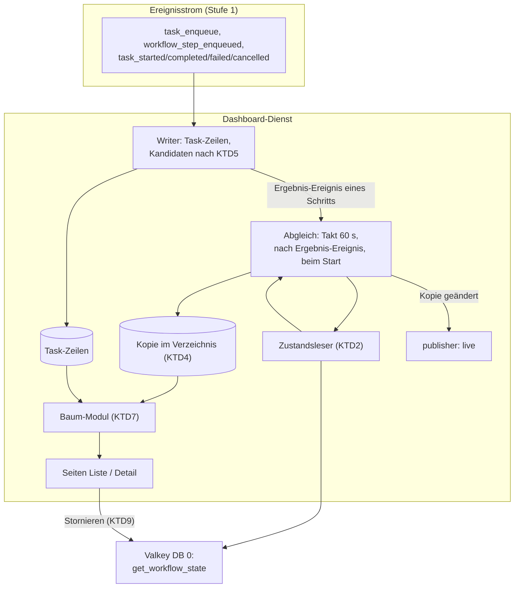
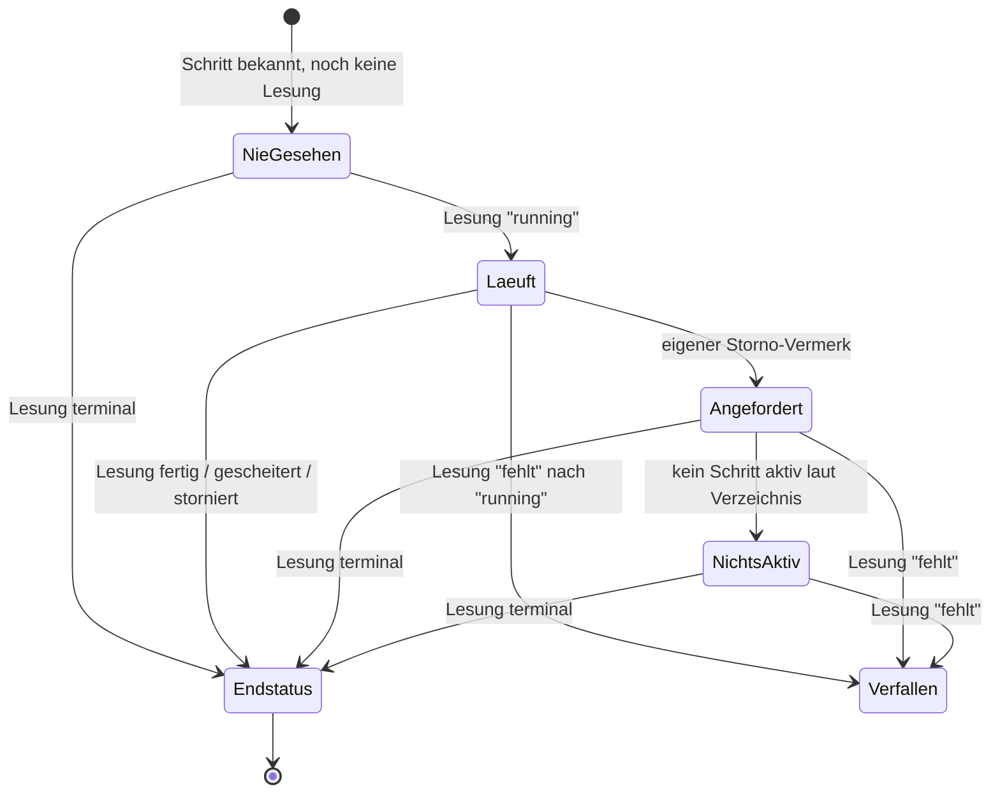

# Workflow-Ansicht - Plan

## Goal Capsule

- **Objective:** Ein Teammitglied sieht bei einem hängenden oder gescheiterten Workflow — etwa einem Chord, der fünfzig Dateien herunterlädt und erst danach weiterarbeitet — im Browser, worauf er wartet, was warum gescheitert ist und was in den nächsten Schritt ging, ohne Logs oder Valkey-Schlüssel zu lesen.
- **Product authority:** Dieser Plan besitzt nur den Bereich Workflows der zweiten Stufe. Queue-Seite, Scheduler, Audit-Ansicht und Graphen sind nicht aktiver Umfang. Grundform, Stack, Anmeldung und Live-Aktualisierung gelten unverändert aus `docs/plans/2026-09-16-1558-feat-dashboard-plan.md`; Änderungen am swarmq-Kern brauchen nach dessen KD13 eine eigene Absprache.
- **Means:** Ein Abgleich im Dashboard-Dienst liest den Workflow-Zustand selbst über die öffentliche Backend-Schnittstelle und hält eine Kopie im Verzeichnis (KTD1, KTD3); Liste und Baum werden daraus und aus den Task-Zeilen abgeleitet (KTD7).
- **Execution profile:** Testgetrieben nach `AGENTS.md` — ein fehlschlagender Test je Schritt, kein Produktionscode ohne ihn. Ausnahmen nur für Vorlagen, Stylesheet und reine Konfiguration.
- **Stop conditions:** Halte an, wenn eine Einheit eine Funktion im swarmq-Kern bräuchte, wenn die Ansicht einen Endstatus aus Schritten ableiten müsste (R6), oder wenn ein Integrationstest ein anderes Valkey als Port 6399 erreichen würde.
- **Open blockers:** keine.

---

## Product Contract

### Summary

Ein neuer Bereich „Workflows“ listet alle Workflows der letzten sieben Tage mit Status und Fortschritt. Die Detailansicht zeigt die Topologie als Baum, in dem auffällige Glieder offen stehen und fertige gefaltet sind. Ein Teammitglied kann den ganzen Workflow stornieren.

### Problem Frame

Workflows (`chain`, `group`, `chord`) sind in Phoenix noch nicht im Einsatz; der erste geplante Fall ist ein Chord, der viele Dateien parallel herunterlädt und erst weiterarbeitet, wenn alle fertig sind. Der Betreiber will sie erst einsetzen, wenn sie sich ohne großen Aufwand debuggen lassen.

Heute sieht das Dashboard die Schritte eines Workflows nur als einzelne Tasks in der Task-Liste. Welche Schritte zu welchem Workflow gehören, wie weit er ist und warum ein Body nicht startet, muss man aus Kennungen der Form `<workflow_id>#<step_path>` und dem Workflow-Zustand in Valkey selbst zusammensetzen. Den Body eines Chords sieht man gar nicht, solange er nicht eingereiht ist. Der Workflow-Zustand verfällt nach 24 Stunden, und für das Ende eines Workflows gibt es kein Signal.

### Key Decisions

- KD1. **Workflows zuerst unter den Bereichen der zweiten Stufe** (session-settled: user-approved — chosen over Queue-Seite, Scheduler, Audit-Ansicht und Graphen: die Daten sind am weitesten vorbereitet, und Flower bietet dafür nichts). Governs Scope Boundaries.
- KD2. **Eigene Workflow-Liste in der Navigation** (session-settled: user-approved — chosen over einem Einstieg nur über die Task-Ansicht und über einer Liste nur mit problematischen Workflows: ein hängender Workflow soll auf einen Blick auffallen). Governs R1, R2, R3.
- KD3. **Das Dashboard hält eine eigene Kopie von Topologie, Status und Fehler** (session-settled: user-approved — chosen over „nur was das Verzeichnis weiß“ und über einer getrennt markierten Doppelanzeige: nur so bleibt ein Workflow die vollen sieben Tage mit nie gestarteten Schritten und Endstatus sichtbar). Governs R5, R6, R7.
- KD4. **Die Kopie umfasst keine Ergebnisse** (session-settled: user-approved — chosen over einer Kopie der Ergebnisse: große Nutzdaten würden ein zweites Mal abgelegt; nach Ablauf der Ergebnis-Frist zeigt die Ansicht „Ergebnis abgelaufen“). Governs R13.
- KD5. **Die Detailansicht ist ein Baum der Topologie** (session-settled: user-directed — chosen over Stufen-Kästen mit Zählern und über einer flachen Schritt-Tabelle, entschieden an einer Skizze: der Baum trägt jede Form, auch verschachtelte). Governs R8, R9.
- KD6. **Fertige Glieder sind gefaltet, auffällige immer offen** (session-settled: user-approved — chosen over „alles offen“ und über einer Faltschwelle: große Gruppen bleiben lesbar, ohne dass ein Problem hinter einer Faltung verschwindet). Governs R9.
- KD7. **Der ganze Workflow ist aus der Ansicht stornierbar** (session-settled: user-approved — chosen over einer rein lesenden Ansicht: der Betreiber will einen falsch gestarteten Download-Lauf anhalten können). Governs R15, R16.
- KD8. **Ein verfallener Zustand, zuletzt laufend gesehen, bekommt einen eigenen Anzeigezustand** (session-settled: user-approved — chosen over dem Weiterzeigen des zuletzt gesehenen „läuft“: die Kopie würde sonst sieben Tage einen Lauf behaupten, den es nicht mehr gibt). Governs R17.
- KD9. **Zusammengesetzte Glieder eines Chord-Kopfs zeigen ihr Ergebnis nur, wo es einen Schritt gibt** (session-settled: user-approved — chosen over einer eigenen Anzeige des Sammelergebnisses: die Bibliothek gibt dessen Kennung nicht öffentlich heraus). Governs R18.

### Actors

- A1. **Ops-Teammitglied** — sucht einen Workflow, liest seinen Zustand, storniert ihn.
- A2. **Dashboard-Dienst** — erkennt Workflows aus dem Ereignisstrom, liest ihren Zustand und hält die Kopie.
- A3. **Einreihende Anwendung** — startet Workflows; mit Anwendungs-Hook meldet sie die ersten Schritte schon bei der Einreihung.
- A4. **Worker** — führt Schritte aus und reiht Folgeschritte ein; der Worker-Hook meldet beides.

### Requirements

**Workflow-Liste**

- R1. Die Navigation erhält den Bereich „Workflows“; seine Tabellenseite listet jeden Workflow, von dem das Verzeichnis in den letzten sieben Tagen einen Schritt kennt.
- R2. Jede Zeile zeigt Kennung, Form der Wurzel (Kette, Gruppe, Chord), Name des ersten Schritts, Status, Fortschritt als „fertige Schritte / Schritte laut Topologie“, Start und letzte Aktivität.
- R3. Die Liste filtert nach Status und Zeitraum und findet einen Workflow über seine Kennung oder über die Kennung eines seiner Schritte.
- R4. Ein Workflow, dessen erster Schritt den Anwendungs-Hook nicht passiert hat, erscheint erst, wenn ein Worker einen Schritt aufgreift; die Liste trägt dazu denselben stehenden Hinweis wie die Task-Liste (Stufe 1, R31).

**Zustand und Lebensdauer**

- R5. Der Dienst liest den Workflow-Zustand, solange er in Valkey vorliegt, und hält Topologie, Status und Fehler als eigene Kopie bis zum Ablauf der Aufbewahrung aus Stufe 1, R5.
- R6. Workflow-Status sind: läuft, fertig, gescheitert, storniert, Stornierung angefordert. Ein Endstatus gilt erst, wenn der Workflow-Zustand ihn trägt; das Dashboard leitet ihn nicht aus den Schritten ab. „Stornierung angefordert“ kennt das Dashboard nur für Stornierungen, die es selbst ausgelöst hat. Anzeigezustände ohne Endstatus regeln R7, R16 und R17.
- R7. Hat der Dienst den Zustand eines Workflows nie lesen können, bevor er in Valkey verfiel, zeigt die Ansicht nur die aus dem Verzeichnis bekannten Schritte und nennt das als „Zustand nie gesehen“ statt einen Status zu raten. Die Listenzeile trägt denselben Status und zählt den Fortschritt nur über die bekannten Schritte.
- R17. Verschwindet ein Zustand, den der Dienst zuletzt als „läuft“ gesehen hat, zeigen Liste und Ansicht „Zustand verfallen, zuletzt: läuft“ mit dem Zeitpunkt der letzten Lesung; das ist kein Endstatus, und die Liste kann danach filtern.

**Detailansicht**

- R8. Die Detailansicht zeigt die Topologie als eingerückten Baum: Ketten, Gruppen, Chord-Kopf und Chord-Body als Knoten, jeder Schritt als Zeile mit Pfad, Task-Name, Status, Dauer oder Wartezeit und Sprung zur Task-Ansicht.
- R9. Gescheiterte, laufende, wartende und in Wiederholung befindliche Glieder stehen immer als eigene Zeile; fertige Glieder einer Gruppe fasst der Baum zu einer aufklappbaren Zeile mit ihrer Zahl zusammen.
- R10. Jeder Gruppenknoten und der Chord-Kopf tragen Zähler je Status; ein Chord-Body, der noch nicht eingereiht ist, nennt, auf wie viele Glieder er noch wartet.
- R11. Ein Schritt, der laut Topologie existiert, aber nie eingereiht wurde, erscheint im Baum als „nicht eingereiht“ mit dem Grund, den der Zustand hergibt: wartet auf Vorgänger, oder nie gestartet, weil der Workflow gescheitert oder storniert ist. Ist ein Vorgänger-Glied laut Verzeichnis storniert, heißt es „wartet auf storniertes Glied, startet nie“; der Workflow-Status bleibt, was der Zustand trägt.
- R12. Bei einem gescheiterten Workflow nennt die Ansicht oben den Fehlertext aus dem Zustand und die gescheiterten Schritte laut Verzeichnis, frühester zuerst, mit Sprung in den Baum; der Zustand selbst nennt keinen Schritt. Findet sich kein gescheiterter Schritt, etwa weil schon die Einreihung scheiterte, steht nur der Fehlertext da.
- R13. Die Ansicht zeigt für die Glieder eines Chord-Kopfs deren Ergebnisse als Eingabe des Body, soweit sie noch lesbar sind; ein verfallenes Ergebnis heißt „Ergebnis abgelaufen“.
- R18. Ein Kopf-Glied, das selbst eine Kette ist, zeigt das Ergebnis ihres letzten Schritts; ein Kopf-Glied, das selbst eine Gruppe ist, zeigt „nicht einzeln anzeigbar“.
- R14. Neue Ereignisse eines offenen Workflows aktualisieren Liste und Baum wie in Stufe 1, R13 und R13a.

**Stornieren**

- R15. Ein Teammitglied storniert einen laufenden Workflow aus der Detailansicht nach einer Bestätigung; die Aktion ist ein Audit-Ereignis nach Stufe 1, R27. Hat der Workflow zwischen Klick und Bestätigung einen Endstatus erreicht, meldet die Ansicht, dass er nicht mehr stornierbar ist, und schreibt kein Audit-Ereignis.
- R16. Die Ansicht sagt vor und nach dem Stornieren, was es bewirkt: noch nicht aufgegriffene Schritte werden beim Aufgreifen abgebrochen, laufende Schritte laufen zu Ende, danach wird nichts mehr eingereiht. Bis der Zustand „storniert“ trägt, zeigt sie „Stornierung angefordert“; eine bereits bestehende Anforderung ist kein Fehler. Läuft oder wartet laut Verzeichnis kein Schritt mehr, heißt es „Stornierung angefordert, nichts mehr aktiv“: die Bibliothek schreibt „storniert“ nur, wenn nach der Anforderung ein Schritt erfolgreich endet, und dieser Anzeigezustand ist ausdrücklich kein Endstatus im Sinne von R6.

### Key Flows

- F1. Chord-Body startet nicht
  - **Trigger:** Ein Download-Chord läuft seit einer Stunde, der Body hat nicht begonnen.
  - **Actors:** A1, A2
  - **Steps:** Teammitglied öffnet Workflows; filtert auf „läuft“; sieht den Workflow mit „47/51“; öffnet ihn; der Chord-Kopf zeigt 47 fertig (gefaltet), 2 laufen, 1 in Wiederholung; der Body nennt „wartet auf 3 Glieder“; springt vom Glied in Wiederholung in dessen Task-Ansicht und liest den Fehler des letzten Versuchs. Scheitert ein Glied endgültig, markiert die Bibliothek den ganzen Workflow sofort als gescheitert; dieser Fall ist F2.
  - **Covers R1, R2, R8, R9, R10, R11**

- F2. Gescheiterter Workflow am Morgen danach
  - **Trigger:** Ein Workflow ist nachts gescheitert, der Zustand in Valkey ist inzwischen abgelaufen.
  - **Actors:** A1, A2
  - **Steps:** Teammitglied filtert auf „gescheitert“; öffnet den Workflow; die Ansicht zeigt aus der Kopie den Schritt, der ihn beendet hat, mit Fehlertext, und die nie gestarteten Folgeschritte; die Ergebnisse der fertigen Glieder stehen als „Ergebnis abgelaufen“, sofern ihre Frist vorbei ist.
  - **Covers R5, R11, R12, R13**

- F3. Falsch gestarteten Lauf anhalten
  - **Trigger:** Ein Chord wurde mit der falschen Dateiliste gestartet.
  - **Actors:** A1, A2, A4
  - **Steps:** Teammitglied öffnet den Workflow; klickt „Workflow stornieren“; bestätigt nach dem Hinweis zur Wirkung; die Ansicht zeigt „Stornierung angefordert“; laufende Downloads enden, wartende werden beim Aufgreifen abgebrochen; endet danach noch ein Download erfolgreich, wechselt der Status zu „storniert“, sonst zeigt die Ansicht „Stornierung angefordert, nichts mehr aktiv“; das Audit hält die Aktion fest.
  - **Covers R15, R16**

### Acceptance Examples

- AE1. **Covers R2, R10.** Given: ein Chord mit 50 Downloads im Kopf und einem Body; 47 Downloads sind fertig. When: die Liste geladen wird. Then: die Zeile zeigt „47/51“ und „läuft“.
- AE2. **Covers R9.** Given: eine Gruppe mit 500 Gliedern, davon 498 fertig, 1 läuft, 1 gescheitert. When: die Detailansicht geöffnet wird. Then: der Baum zeigt zwei Gliedzeilen und eine aufklappbare Zeile „498 fertig“.
- AE3. **Covers R11.** Given: ein Chord, dessen Kopf noch läuft. When: die Detailansicht geöffnet wird. Then: der Body steht als „nicht eingereiht — wartet auf Vorgänger“ im Baum, obwohl ihn noch kein Ereignis gemeldet hat.
- AE4. **Covers R6, R11, R12.** Given: in einer Kette `a → b → c` ist `b` gescheitert. When: die Detailansicht geöffnet wird. Then: der Status ist „gescheitert“, oben steht `b` mit Fehlertext, und `c` steht als „nie gestartet, Workflow gescheitert“.
- AE5. **Covers R5.** Given: ein Workflow ist vor drei Tagen fertig geworden, sein Zustand in Valkey ist verfallen. When: ein Teammitglied ihn öffnet. Then: die Ansicht zeigt Baum und Status „fertig“ aus der Kopie.
- AE6. **Covers R7.** Given: der Dienst war länger als 24 Stunden nicht in Betrieb, und ein Workflow lief in dieser Zeit ab. When: ein Teammitglied ihn nach dem Neustart öffnet. Then: die Ansicht zeigt die Schritte aus dem Verzeichnis, nennt „Zustand nie gesehen“ und keinen Endstatus.
- AE7. **Covers R13.** Given: die Ergebnis-Frist der Kopf-Glieder ist vorbei. When: die Detailansicht geöffnet wird. Then: jedes Glied zeigt „Ergebnis abgelaufen“ statt eines leeren Feldes.
- AE8. **Covers R16.** Given: für einen Workflow wurde bereits eine Stornierung angefordert, der Status ist noch nicht „storniert“. When: ein zweites Teammitglied „Workflow stornieren“ klickt. Then: die Ansicht meldet die bestehende Anforderung und behandelt das nicht als Fehler.
- AE9. **Covers R15.** Given: ein Workflow ist bereits fertig. When: ein Teammitglied die Detailansicht öffnet. Then: der Knopf „Workflow stornieren“ wird nicht angeboten.
- AE10. **Covers R15.** Given: ein Teammitglied hat „Workflow stornieren“ geklickt, der Workflow wird vor der Bestätigung fertig. When: es bestätigt. Then: die Ansicht meldet, dass der Workflow nicht mehr stornierbar ist, und das Audit enthält keinen Eintrag.
- AE11. **Covers R16.** Given: ein Chord, dessen 50 Downloads alle noch in der Queue warten, wird aus dem Dashboard storniert. When: die Worker alle Glieder beim Aufgreifen abgebrochen haben. Then: die Ansicht zeigt „Stornierung angefordert, nichts mehr aktiv“, keinen Endstatus, und bietet kein erneutes Stornieren an.

### Success Criteria

- Der Betreiber setzt den ersten Download-Chord in Phoenix ein, ohne zum Debuggen Valkey-Schlüssel oder Logs lesen zu müssen.
- „Warum läuft der Body nicht?“ ist in unter einer Minute beantwortet, von der Liste bis zum schuldigen Glied.
- Die Ansicht nennt nie einen Endstatus, den der Workflow-Zustand nicht trägt.

### Scope Boundaries

- Einen Workflow neu starten oder einzelne Schritte erneut ausführen: das Dashboard reiht weiterhin nichts ein (Stufe 1, „Outside this product's identity“).
- Einzelne Schritte aus der Workflow-Ansicht stornieren; dafür bleibt die Task-Ansicht.
- Ergebnisse über ihre eigene Frist hinaus aufbewahren (KD4).
- Eine Kernänderung, mit der ein beim Aufgreifen abgebrochener Workflow-Schritt den Workflow als „storniert“ markiert; sie würde R16s Anzeigezustand überflüssig machen, braucht aber nach KD13 aus Stufe 1 eine eigene Absprache.
- Ein Signal für das Ende eines Workflows im swarmq-Kern; der Dienst liest den Zustand stattdessen selbst. Wäre ein solches Signal später nötig, braucht es nach KD13 aus Stufe 1 eine eigene Absprache.

<!-- ce-section: work-relationships -->
### How This Work Fits Together

Dieser Plan besitzt den Bereich Workflows. Die übrige Aufteilung der zweiten Stufe ist der heutige Stand des Verständnisses, kein Fahrplan.

- **Queue-Seite** — Can proceed independently of: dieser Plan; nutzt die passive Queue-Deklaration aus Stufe 1.
- **Scheduler-Ansicht** — Can proceed independently of: dieser Plan; braucht die Scheduler-Signale, die das Verzeichnis heute nur für den Worker-Zeitstempel nutzt.
- **Audit-Ansicht** — Shares: die Stornierung aus R15 schreibt in denselben Audit-Strom, den die Audit-Ansicht später zeigt.
- **Echtzeit-Graphen** — Still to decide: ob sie überhaupt kommen oder Grafana der Ort bleibt.

### Dependencies / Assumptions

- **swarmq 0.7** ist die Grundlage: das Signal `WORKFLOW_STEP_ENQUEUED` (seit 0.6.0) trägt `workflow_id` und `step_path`, der ganze Workflow-Zustand ist über den öffentlichen Backend-Vertrag `get_workflow_state` lesbar, `WorkflowHandle.cancel()` storniert kooperativ. Eine Aufzählung aller Workflows bietet die Bibliothek nicht; die Liste entsteht aus den Ereignissen des Verzeichnisses.
- **Die Frist des Workflow-Zustands gleitet**: `Client.apply` setzt sie mit `state_ttl_ms` (Standard 24 Stunden), danach setzt jeder Worker sie bei jedem Schreiben auf seine eigene `result_ttl` neu. Der Abgleich muss deutlich öfter lesen als die kleinste Frist im Betrieb (KTD3).
- **Stornierungen von außen sind unsichtbar**: die Anforderung liegt in einem eigenen Merker, den die öffentliche Schnittstelle nicht lesen lässt. Storniert die Anwendung oder die Kommandozeile, sieht das Dashboard das erst, wenn der Zustand „storniert“ trägt.
- **Kein Signal für das Workflow-Ende**: der Endstatus steht nur im Zustand. Die Ansicht muss ihn deshalb aus dem Zustand lesen, nicht aus einem Ereignis.
- **Der erste Einsatz ist künftig**: Workflows laufen in Phoenix noch nicht; die Anforderungen stützen sich auf den geplanten Download-Chord.

### Outstanding Questions

**Deferred to Implementation**

- Wie der Baum eine sehr tiefe Verschachtelung (Gruppe in Kette in Chord) auf Notebook-Breite einrückt; die Regeln in `docs/reference/oberflaeche.md` geben den Rahmen, die Grenze zeigt sich erst an echten Vorlagen.
- Ob 60 Sekunden als Takt des Abgleichs im Alltag passen; der Wert ist konfigurierbar (KTD3).

### Sources / Research

**Product Contract preservation:** changed: R17 und R18 neu, mit KD8 und KD9, in der Planungs-Synthese bestätigt; Dependencies korrigiert (Zustand über den Backend-Vertrag, gleitende Frist); die drei Planungsfragen sind in KTD3, KTD7 und KTD13 beantwortet.

- Stufe-1-Plan mit Grundform, Aufbewahrung, Live-Aktualisierung, Audit und KD13: `docs/plans/2026-09-16-1558-feat-dashboard-plan.md`.
- Ergebnisanzeige, die R13 wiederverwendet: `docs/plans/2026-09-23-1050-feat-ergebnisanzeige-plan.md`, `src/swarmq_dashboard/web/ergebnis.py`.
- Vorhandene Spalten `workflow_id` und `step_path` im Verzeichnis: `src/swarmq_dashboard/directory/schema.py`, Befüllung in `src/swarmq_dashboard/directory/writer.py`.
- Gestaltungsregeln und Stylesheet: `docs/reference/oberflaeche.md`, `docs/reference/oberflaeche.css`.
- swarmq: Zustand und Statuswerte in `src/swarmq/workflow_state.py`, Pfadbildung und Task-Kennung `<workflow_id>#<step_path>` in `src/swarmq/workflow_topology.py`, `WorkflowHandle.children()` und `cancel()` in `src/swarmq/workflow_orchestration.py`, Standardfrist in `src/swarmq/client/workflows.py`.

---

## Planning Contract

### Key Technical Decisions

- KTD1. **Der Zustand kommt über den öffentlichen Backend-Vertrag `get_workflow_state`, nicht über `WorkflowHandle`** (session-settled: user-approved — chosen over `WorkflowHandle.status()` und `children()`: der Handle gibt Topologie und Fehler nicht heraus, und `children()` lädt alle Ergebnisse, was KD4 widerspräche). Storniert wird weiter über `SwarmQ.workflow(id).cancel()`. Governs R5, R6, R7, R17.
- KTD2. **Der Zustandsleser folgt dem Ergebnisleser.** Er verbindet sich erst bei Bedarf mit eigenem Valkey-Klienten, sperrt sich nach jedem Verbindungs- oder Lesefehler für eine Frist und liefert Zustände statt Ausnahmen: gelesen, fehlt, nicht lesbar (unbekannte Version `v` oder kaputtes JSON), Backend nicht erreichbar. Vorbild ist `src/swarmq_dashboard/web/ergebnis.py` mit seiner Sperre `SPERRE_S` (Plan `docs/plans/2026-09-23-1050-feat-ergebnisanzeige-plan.md`, KTD1). Governs R5, R7.
- KTD3. **Der Abgleich liest per Takt und nach Ereignissen** (session-settled: user-approved — chosen over einem Lesen nur bei Ereignissen: die Ereignisse eines Schritts kommen vor dem Schreiben des Zustands an, ein Lesen nur dann bliebe auf „läuft“ stehen). Jeder nicht beendete Workflow wird alle 60 Sekunden gelesen (`SQD_WORKFLOW_POLL_S`), ein Workflow zusätzlich sofort und zwei Sekunden später, wenn einer seiner Schritte ein Ergebnis-Ereignis meldet (fertig, gescheitert, Dead Letter, storniert) oder ein Worker einen Folgeschritt einreiht (`workflow_step_enqueued`), und alle beim Start einmal. Ein Workflow-Schritt wird über die Spalte `workflow_id` oder das Muster aus KTD5 erkannt. Der Takt muss weit unter der kleinsten `result_ttl` der Worker liegen, weil jedes Schreiben die Frist neu setzt. Governs R5, R6, R14, R17.
- KTD4. **Die Kopie ist eine eigene Tabelle im Verzeichnis und läuft mit derselben Aufbewahrung ab.** Sie hält je Workflow Wurzelform, Topologie, `step_tasks`, Status, Fehler, Sichtbarkeit des Zustands (gesehen, nie gesehen, verfallen), Zeitpunkte und den eigenen Storno-Vermerk. `expire()` löscht sie nach demselben Schlüssel „letzte Aktivität“ wie die Task-Zeilen, sonst überlebt eine der Quellen die andere. Die Topologie enthält die Argumente der Schritte im Klartext; dafür gilt, was Stufe 1 für Argumente festlegt (KD11, KD16 dort). `step_tasks` wächst nur: eine Lesung ergänzt Pfade, entfernt aber keine, wie die Bibliothek sie vereinigt. Die Kopie stammt aus Lesungen, nicht aus dem Strom; ein Neuaufbau des Verzeichnisses aus dem Strom (Stufe 1, U5) verliert sie, betroffene Workflows fallen ehrlich auf „Zustand nie gesehen“ zurück, und noch vorhandene Zustände liest der Abgleich beim Start neu. Governs R5, R7, R17.
- KTD5. **Ein Schritt gehört zu einem Workflow, wenn ein Ereignis `workflow_id` trägt oder seine Kennung dem Muster `<workflow_id>#<step_path>` folgt und der Zustand das bestätigt.** Der Worker gibt `workflow_id` nicht in seinen Middleware-Kontext (`_build_message_dict` in `src/swarmq/worker/pipeline.py`); nur Schritte, die ein Worker selbst einreiht, melden sie über `workflow_step_enqueued`. Ohne Anwendungs-Hook ist darum die ganze erste Front, also alle Kopf-Glieder eines Chords und jede Gruppe, nur über das Muster erkennbar. Das Muster ist damit der Hauptweg, kein Randfall; es prüft den Teil vor dem `#` auf die UUID-Form der Bibliothek (36 Zeichen, wie `valid_workflow_id` in `src/swarmq/worker/decode.py`). Weil eigene Task-Kennungen ein `#` enthalten dürfen, bleibt ein Kandidat nur aus dem Muster unsichtbar, bis eine Lesung ihn bestätigt. `workflow_id` und `step_path` werden beim Eingang auf Form und Länge geprüft (`docs/solutions/patterns/r3-5-unique-tasks-implementation-learnings-2026-04-17.md` in swarmq). Governs R1, R3, R4.
- KTD6. **Der angezeigte Status folgt einer festen Vorrangregel.** Ein Endstatus aus der Kopie schlägt alles, auch den eigenen Storno-Vermerk. Danach folgt „Zustand verfallen“, stets mit dem zuletzt angezeigten Zustand: „zuletzt: läuft“ nach R17, „zuletzt: Stornierung angefordert“ oder „zuletzt: Stornierung angefordert, nichts mehr aktiv“, wenn das der letzte Stand war; so bleibt die eigene Stornierung sichtbar und filterbar. Dann folgen „Stornierung angefordert, nichts mehr aktiv“, „Stornierung angefordert“ und „läuft“; „Zustand nie gesehen“ gilt nur ohne jede Lesung. Der eigene Storno-Vermerk liegt im Verzeichnis und überlebt einen Neustart. Governs R6, R7, R16, R17.
- KTD7. **Baum, Zähler und Gründe entstehen in einem reinen Modul aus Topologie und Task-Zeilen.** Der Status eines Blatts kommt aus seiner Task-Zeile. Ein Blatt gilt als eingereiht, wenn es in `step_tasks` steht oder eine Task-Zeile mit seinem Pfad existiert; die Bibliothek veröffentlicht zuerst und vermerkt danach, deshalb kann die Zeile vor dem Vermerk da sein. Steht ein Blatt in `step_tasks`, hat aber noch keine Zeile, gilt es als „eingereiht, noch nicht gemeldet“ und zählt als aktiv. Sind laut Verzeichnis alle Vorgänger fertig, der Nachfolger aber nicht eingereiht und der Workflow läuft, heißt es „Vorgänger fertig, nicht eingereiht“ statt „wartet auf 0 Glieder“. Der Pfad `""` der einfachen Wurzel ist gültig und nicht leer. Fortschritt zählt Blätter; „wartet auf N Glieder“ zählt die direkten Glieder des Kopfs. Governs R2, R8, R9, R10, R11, R12, R16.
- KTD8. **Ergebnisse der Kopf-Glieder liest die Ansicht über den vorhandenen Ergebnisleser.** Die Regel folgt `_terminal_result_id` der Bibliothek: ein Blatt nutzt seine Kennung, eine Kette folgt rekursiv ihrem letzten Element, ein Chord seinem Body, und eine Gruppe, auch am Ende einer Kette, bekommt keinen Lesezugriff (R18). Storno wird vor Fehler geprüft, weil `TaskCancelledError` von `TaskError` erbt (Ergebnisanzeige-Plan, KTD2). Governs R13, R18.
- KTD9. **Stornieren liest den Zustand unmittelbar vorher neu und protokolliert jeden Ausgang.** Endstatus oder verschwundener Zustand ergibt „nicht mehr stornierbar“ ohne Audit-Eintrag (R15). Sonst ruft der Dienst `cancel()` auf und schreibt den Vermerk vor dem Audit, wie `mark_cancel_requested` für Tasks. Gibt `cancel()` „schon gesetzt“ zurück, lautet das Audit „lief bereits“ und die Ansicht zeigt die bestehende Anforderung (AE8). Das Formular trägt ein Bestätigungsfeld wie die DLQ-Aktionen und antwortet mit Redirect nach dem Muster in `src/swarmq_dashboard/web/routes/dlq.py`. Governs R15, R16.
- KTD10. **Live-Aktualisierung braucht keinen eigenen Kanal.** Die Seiten rendern ihren Zustand vollständig vom Server, `web/static/live.js` lädt sie bei jedem Ereignis neu und gleicht den DOM ab. Neu ist nur, dass der Abgleich bei jeder Änderung der Kopie über `services.publisher` meldet, weil diese Änderungen kein Strom-Ereignis haben. Governs R14.
- KTD11. **Die Workflow-Seiten liegen in eigenen Modulen.** Neu sind ein Routenmodul, ein Vorlagenordner, ein Leser-Modul und das Baum-Modul; `web/app.py` bekommt nur Verdrahtung, weil es mit gut 940 Zeilen schon das größte Modul ist. Governs R1, R8.
- KTD12. **Die Navigation und die Audit-Aktionen sind durch Tests festgeschrieben und wachsen erst nach einem roten Test.** `tests/unit/web/test_templates.py` hält die Bereiche fest, `tests/unit/test_audit.py` die Aktionen. Governs R1, R15.
- KTD13. **Eine gefaltete Zeile öffnet die fertigen Glieder als Unterseite mit Blättern.** Das Aufklappen lädt die Detailansicht mit geöffneter Gruppe und zeigt die fertigen Glieder seitenweise zu 100, nach dem Blätter-Muster der Task-Liste. So bleibt der Baum lesbar, auch bei Hunderten Gliedern (KD6). Governs R9.

### High-Level Technical Design

Drei Quellen fließen in die Ansicht, und nur eine davon kennt das Ende eines Workflows.

Der angezeigte Status ist eine Vorrangregel über Kopie, Lesungen und eigenen Vermerk (KTD6), keine Ableitung aus Schritten.

`Endstatus` ist fertig, gescheitert oder storniert und kommt nur aus einer Lesung (R6). `Verfallen` und `NichtsAktiv` sind Anzeigezustände, keine Endstatus; `Verfallen` nennt den Zustand, aus dem es kam (KTD6).

### Assumptions

- Die Worker in Phoenix laufen mit der Standard-`result_ttl` von 24 Stunden; läge sie unter wenigen Minuten, müsste `SQD_WORKFLOW_POLL_S` sinken.
- Workflows bleiben in Phoenix auf wenige Hundert gleichzeitig laufende; eine Lesung je Workflow und Minute ist dann eine vernachlässigbare Last auf Valkey.

### Sequencing

U1 und U4 sind unabhängig und können zuerst kommen. U2 folgt, dann U3 auf U1 und U2, U5 auf U2. U6 braucht U4 und U5, U7 braucht U1 und U6, U8 kommt zuletzt.

---

## Implementation Units

### U1. Zustandsleser und Storno-Adapter

- **Goal:** Den Workflow-Zustand über den Backend-Vertrag lesen und einen Workflow stornieren, beides als Zustände statt Ausnahmen.
- **Requirements:** R5, R6, R7, R15, R16; KTD1, KTD2, KTD9.
- **Dependencies:** keine.
- **Files:** `src/swarmq_dashboard/workflows.py` (neu), `tests/unit/test_workflows.py` (neu), `tests/integration/test_workflow_zustand.py` (neu).
- **Approach:**
  1. Ein Protokoll mit `lesen(workflow_id)` und `stornieren(workflow_id)` und eine echte Klasse, die sich wie `SwarmQErgebnisleser` verbindet und sperrt.
  2. `lesen` dekodiert das JSON des Zustands und gibt ein eingefrorenes Bild zurück: Status, Wurzelform, Topologie, `step_tasks`, Fehler; unbekanntes `v` oder kaputtes JSON wird „nicht lesbar“.
  3. `stornieren` ruft `SwarmQ.workflow(id).cancel()` und unterscheidet „neu gesetzt“, „schon gesetzt“, „nicht gefunden“ (`WorkflowNotFound`) und „Backend nicht erreichbar“.
- **Patterns to follow:** `src/swarmq_dashboard/web/ergebnis.py` (Verbindung, Sperre, injizierbare Uhr und App), `src/swarmq_dashboard/web/cancel.py` für den Aufruf von `cancel`.
- **Test scenarios:**
  - Ein Zustand mit Status „running“, einem Chord und zwei eingereihten Gliedern wird als laufend mit Wurzelform Chord und beiden Pfaden gelesen.
  - Kein Zustand vorhanden ergibt „fehlt“.
  - Ein Zustand mit unbekannter Version ergibt „nicht lesbar“, ohne Ausnahme.
  - Ein Lesefehler sperrt den Leser; ein zweiter Aufruf innerhalb der Sperrfrist versucht keine Verbindung und meldet „Backend nicht erreichbar“.
  - `stornieren` auf einen laufenden Workflow ergibt „neu gesetzt“, der zweite Aufruf „schon gesetzt“.
  - `stornieren` auf einen verfallenen Workflow ergibt „nicht gefunden“.
  - Integration: ein echter Chord über swarmq auf Valkey Port 6399, DB 0, wird gelesen, storniert, und der Merker ist gesetzt.
- **Verification:** Der Leser liefert für jede der vier Lagen einen benannten Zustand, und der Integrationstest läuft gegen die Testdienste grün.

### U2. Kopie im Verzeichnis und Zugehörigkeit der Schritte

- **Goal:** Die Kopie als Tabelle anlegen, Workflows aus Ereignissen erkennen und die Kopie mit der Aufbewahrung ablaufen lassen.
- **Requirements:** R1, R3, R4, R5, R7, R17; KTD4, KTD5, KTD6.
- **Dependencies:** keine.
- **Files:** `src/swarmq_dashboard/directory/schema.py`, `src/swarmq_dashboard/directory/writer.py`, `tests/unit/directory/test_schema.py`, `tests/unit/directory/test_writer.py`.
- **Approach:**
  1. Tabelle für die Kopie in `_SCHEMA` und `TABLES`, dazu ein Index auf `task.workflow_id`.
  2. Der Writer legt beim Eingang eines Ereignisses mit `workflow_id` einen Workflow an und merkt eine Kennung nach dem Muster aus KTD5 als unbestätigten Kandidaten vor.
  3. Methoden, mit denen der Abgleich die Kopie aus einer Lesung schreibt, einen verfallenen Zustand vermerkt und den eigenen Storno-Vermerk setzt.
  4. `expire()` löscht Workflows nach demselben Aktivitätszeitpunkt wie Task-Zeilen.
- **Patterns to follow:** `_SCHEMA` und `_spalten_nachziehen` in `directory/schema.py`, die Handler-Tabelle `_HANDLERS` und `mark_cancel_requested` in `directory/writer.py`.
- **Test scenarios:**
  - Ein `task_enqueue` mit `workflow_id` legt einen bestätigten Workflow an.
  - Ein `task_cancelled` mit Kennung `<uuid>#/h/g3` ohne `workflow_id` legt einen unbestätigten Kandidaten an.
  - Ein `task_completed` mit Kennung `<uuid>#/h/g0` ohne `workflow_id` legt ebenfalls einen Kandidaten an; das ist der Normalfall ohne Anwendungs-Hook.
  - Eine Lesung ergänzt `step_tasks` der Kopie um neue Pfade und entfernt keinen vorhandenen.
  - Eine Kennung mit `#`, deren Teil vor dem `#` die Form einer Workflow-Kennung verfehlt, legt nichts an.
  - Eine übergroße `workflow_id` wird verworfen und protokolliert, der Task selbst bleibt erhalten.
  - Die Kopie aus einer Lesung überschreibt Status und Fehler, nie aber einen schon gespeicherten Endstatus mit „running“.
  - „Verfallen“ wird nur vermerkt, wenn die letzte Lesung „running“ war.
  - `expire()` entfernt einen Workflow, dessen letzte Aktivität älter als die Aufbewahrung ist, und lässt einen jüngeren stehen.
  - Das Schema legt die neue Tabelle und den Index auch in einer bestehenden Verzeichnisdatei an.
- **Verification:** Die neuen Tests und die bestehende Verzeichnis-Suite sind grün, und eine vorhandene Datei aus Stufe 1 öffnet ohne Fehler.

### U3. Abgleich im Dienst

- **Goal:** Die Kopie laufend aktuell halten und offene Seiten bei jeder Änderung benachrichtigen.
- **Requirements:** R5, R6, R14, R16, R17; KTD3, KTD6, KTD10.
- **Dependencies:** U1, U2.
- **Files:** `src/swarmq_dashboard/directory/abgleich.py` (neu), `src/swarmq_dashboard/web/app.py`, `src/swarmq_dashboard/config.py`, `tests/unit/directory/test_abgleich.py` (neu), `tests/unit/web/test_naht.py`, `tests/unit/test_config.py`.
- **Approach:**
  1. Ein Schritt „alle offenen Workflows lesen“ und ein Schritt „diesen Workflow jetzt und in zwei Sekunden lesen“.
  2. Bestätigte Kandidaten werden sichtbar, unbestätigte nach einer Lesung „fehlt“ verworfen.
  3. Verdrahtung als eigener `_takt` in `Services`, ein Hook im Ingest für Ergebnis-Ereignisse von Workflow-Schritten, ein Lauf beim Start; der Leser kommt als injizierbares Argument und in das Schließen beim Herunterfahren.
  4. Jede Änderung der Kopie meldet über `services.publisher`.
- **Patterns to follow:** `Services._takt`, `start_maintenance` und `_aufraeumen` in `web/app.py`; SQLite-Arbeit über `asyncio.to_thread`; Konfiguration nach dem Muster von `SQD_RETENTION_DAYS` in `config.py`.
- **Execution note:** Zeitabhängiges Verhalten mit injizierter Uhr und Ereignissen prüfen, ohne `asyncio.sleep` in Tests (`AGENTS.md`).
- **Test scenarios:**
  - Ein laufender Workflow, dessen Lesung „completed“ ergibt, steht danach als fertig in der Kopie, und genau eine Live-Meldung geht hinaus.
  - Ein Ergebnis-Ereignis eines Schritts löst eine sofortige Lesung und eine zweite nach zwei Sekunden aus; die zweite sieht den inzwischen geschriebenen Endstatus.
  - Ein Ergebnis-Ereignis eines Schritts, der nur über das Muster als Workflow-Schritt erkennbar ist, löst ebenfalls eine Lesung aus.
  - Ein `workflow_step_enqueued` löst eine Lesung aus.
  - Ein Workflow mit Endstatus wird vom Takt nicht mehr gelesen.
  - Ein zuletzt laufend gesehener Workflow, dessen Lesung „fehlt“ ergibt, wird verfallen, mit Zeitpunkt der letzten Lesung.
  - Covers AE6. Ein bestätigter Workflow, dessen erste Lesung „fehlt“ ergibt, bleibt „nie gesehen“ und bekommt keinen Endstatus.
  - Ein unbestätigter Kandidat, dessen Lesung „fehlt“ ergibt, wird verworfen und erscheint nie in der Liste.
  - „Backend nicht erreichbar“ ändert die Kopie nicht und erscheint als Grund in `status()`.
  - Naht: der Abgleich läuft nach dem Start ohne manuellen Anstoß und schließt den Leser beim Herunterfahren.
  - `SQD_WORKFLOW_POLL_S` wird gelesen, der Standard ist 60.
- **Verification:** Eine Kopie folgt einem echten Statuswechsel innerhalb eines Takts, ohne dass ein Test schläft.

### U4. Baum, Zähler und Gründe

- **Goal:** Aus Topologie, `step_tasks` und Task-Zeilen den Baum mit allen Anzeigen ableiten, ohne I/O.
- **Requirements:** R2, R6, R8, R9, R10, R11, R12, R16, R18; KTD6, KTD7, KTD8.
- **Dependencies:** keine.
- **Files:** `src/swarmq_dashboard/workflow_baum.py` (neu), `tests/unit/test_workflow_baum.py` (neu).
- **Approach:**
  1. Knoten je Topologie-Element mit Pfad, Art, Kindern und für Blätter Status aus der Task-Zeile.
  2. Zähler je Gruppe und Kopf, Fortschritt als fertige Blätter zu allen Blättern, „wartet auf N“ über die direkten Kopf-Glieder.
  3. Gründe für nicht eingereihte Schritte in dieser Reihenfolge: Workflow gescheitert oder storniert, Vorgänger storniert, Vorgänger fertig aber nicht eingereiht, wartet auf Vorgänger.
  4. Faltung: fertige Glieder einer Gruppe als eine Zeile, alle anderen offen.
  5. Angezeigter Workflow-Status nach der Vorrangregel aus KTD6, darunter „nichts mehr aktiv“.
  6. Ergebnis-Kennung je Kopf-Glied nach KTD8 und die gescheiterten Schritte in zeitlicher Reihenfolge nach R12.
- **Patterns to follow:** reine Funktionen und eingefrorene Datenklassen wie `Ergebnisbild` in `web/ergebnis.py`.
- **Test scenarios:**
  - Covers AE1. Ein Chord mit 50 Downloads, davon 47 fertig, ergibt Fortschritt 47/51 und Status „läuft“.
  - Covers AE2. Eine Gruppe mit 498 fertigen, einem laufenden und einem gescheiterten Glied ergibt zwei offene Zeilen und eine gefaltete Zeile mit 498.
  - Covers AE3. Ein Chord, dessen Kopf läuft, zeigt den Body als „nicht eingereiht — wartet auf Vorgänger“.
  - Covers AE4. Eine Kette mit gescheitertem Mittelschritt zeigt ihn oben mit dem Fehlertext und den letzten Schritt als „nie gestartet, Workflow gescheitert“.
  - Ein Kopf-Glied, das storniert ist, lässt den Body „wartet auf storniertes Glied, startet nie“ zeigen, und der Status bleibt „läuft“.
  - Alle Glieder fertig, Body nicht in `step_tasks`, Status „running“ ergibt „Vorgänger fertig, nicht eingereiht“.
  - Ein Blatt in `step_tasks` ohne Task-Zeile ist „eingereiht, noch nicht gemeldet“ und zählt für „nichts mehr aktiv“ als aktiv.
  - Ein Body mit laufender Task-Zeile, der in `step_tasks` noch fehlt, gilt als laufend und bekommt keinen Grund „nicht eingereiht“.
  - Ein Zustand, der zuletzt als „Stornierung angefordert, nichts mehr aktiv“ angezeigt wurde und dann verfällt, zeigt „Zustand verfallen, zuletzt: Stornierung angefordert, nichts mehr aktiv“.
  - Covers AE11. Eigener Storno-Vermerk, alle Glieder storniert, keines aktiv, Status „running“ ergibt „Stornierung angefordert, nichts mehr aktiv“.
  - Ein Endstatus „completed“ mit gesetztem Storno-Vermerk ergibt „fertig“.
  - Die einfache Wurzel mit Pfad `""` ergibt einen Baum mit genau einem Blatt.
  - Ein Kopf-Glied, das eine Kette ist, verweist auf die Kennung ihres letzten Blatts; ein Kopf-Glied, das eine Gruppe ist, hat keinen Verweis.
  - Ein Kopf-Glied `chain(a, group(b, c))` hat keinen Verweis, weil die Kette auf einer Gruppe endet.
  - Ohne Topologie (nie gesehen) entsteht ein flacher Baum aus den bekannten Schritten, und der Fortschritt zählt nur diese (R7).
- **Verification:** Jede Anzeige aus R8 bis R12 und R16 lässt sich aus einem Testfall ohne Datenbank und ohne Netzwerk ablesen.

### U5. Abfragen für Liste und Detail

- **Goal:** Workflows filtern, suchen, blättern und für die Detailansicht mit ihren Task-Zeilen laden.
- **Requirements:** R1, R2, R3, R7, R9, R17; KTD4, KTD13.
- **Dependencies:** U2.
- **Files:** `src/swarmq_dashboard/directory/queries.py`, `tests/unit/directory/test_queries.py`.
- **Approach:**
  1. Eine Listenabfrage mit Filter nach Anzeigestatus und Zeitraum, Keyset-Cursor und stets gesetzter Notiz.
  2. Suche über die Workflow-Kennung oder eine Schrittkennung; eine Schrittkennung führt auf ihren Workflow.
  3. Eine Detailabfrage mit Kopie und allen Task-Zeilen des Workflows über den neuen Index, und eine Seitenabfrage für fertige Glieder einer Gruppe zu 100.
- **Patterns to follow:** `Filter`, `Page`, `_encode` und `_decode` in `directory/queries.py`.
- **Test scenarios:**
  - Die Liste zeigt nur bestätigte Workflows, neueste zuerst.
  - Der Filter „gescheitert“ findet einen gescheiterten und keinen laufenden Workflow; der Filter „verfallen“ findet einen verfallenen.
  - Die Suche nach `wf1#/h/g3` findet `wf1`.
  - Das Blättern über 250 Workflows liefert drei Seiten ohne Doppel und ohne Lücke.
  - Die Seitenabfrage für 498 fertige Glieder liefert fünf Seiten zu höchstens 100.
  - Ein leeres Verzeichnis liefert eine leere Seite mit Notiz, nie `None`.
- **Verification:** Die Abfragen tragen die Liste und die Detailansicht, ohne dass eine Route SQL enthält.

### U6. Seiten Liste und Detail

- **Goal:** Den Bereich „Workflows“ mit Liste, Baum, Ergebnissen der Kopf-Glieder und Hinweisen ausliefern.
- **Requirements:** R1, R2, R3, R4, R7, R8, R9, R10, R11, R12, R13, R14, R17, R18; KTD8, KTD10, KTD11, KTD12, KTD13.
- **Dependencies:** U4, U5.
- **Files:** `src/swarmq_dashboard/web/routes/workflows.py` (neu), `src/swarmq_dashboard/web/templates/workflows/liste.html` (neu), `src/swarmq_dashboard/web/templates/workflows/detail.html` (neu), `src/swarmq_dashboard/web/templates/__init__.py`, `src/swarmq_dashboard/web/app.py`, `tests/unit/web/test_workflows_routes.py` (neu), `tests/unit/web/test_templates.py`.
- **Approach:**
  1. Zuerst den Navigationstest auf die neue Liste der Bereiche rot stellen, dann den Bereich eintragen.
  2. Routen für Liste, Detail und die Seite fertiger Glieder; Kontext wie in `web/routes/tasks.py` mit `status`, `account`, `aktiv` und `csrf_token`.
  3. Die Workflow-Zustände bekommen eigene Einträge in `_ZUSTANDSART`, denn die vorhandenen Schlüssel sind Task-Vokabular („laufend“, nicht „läuft“): „läuft“ als `is-run`, „fertig“ als `is-ok`, „gescheitert“ als `is-fail`, „storniert“ als `is-idle`, beide Formen von „Stornierung angefordert“ als `is-wait`, „verfallen“ und „nie gesehen“ als `is-idle`, wie `docs/reference/oberflaeche.md` es für Unbekanntes vorsieht. Die Baum-Gründe aus R11 sind Wartezustände und bekommen `is-wait`, „nie gestartet“ bekommt `is-idle`; „Ergebnis abgelaufen“ und „nicht einzeln anzeigbar“ sind Hinweistext ohne Zustandsfarbe.
  4. Ergebnisse der Kopf-Glieder über `services.ergebnisse.lesen`, nur für die Glieder, die KTD8 zulässt.
  5. Stehende Hinweise: Herkunft wie Stufe 1 R31 (R4) und leerer Zustand über `leerzustand.html`.
  6. Kennungen mit `#` in Links über `urlencode`, stabile Element-IDs je Knoten für den DOM-Abgleich.
- **Patterns to follow:** `web/routes/tasks.py`, `tasks/liste.html`, `tasks/detail.html`, `leerzustand.html`, `_ergebnis_zu` für das Lesen von Ergebnissen.
- **Test scenarios:**
  - Die Navigation enthält „Workflows“, und der Guard-Test ist auf die neue Liste angepasst.
  - Ein laufender Workflow trägt in der Liste die Klasse `is-run`, ein Body mit „Vorgänger fertig, nicht eingereiht“ im Baum `is-wait`.
  - Ohne Sitzung liefern Liste und Detail keine Daten.
  - Die Liste zeigt eine Zeile mit Kennung, Wurzelform, erstem Schritt, Status, Fortschritt, Start und letzter Aktivität.
  - Covers AE6. Ein nie gesehener Workflow zeigt „Zustand nie gesehen“ in Liste und Detail.
  - Ein verfallener Workflow zeigt „Zustand verfallen, zuletzt: läuft“ mit Zeitpunkt.
  - Covers AE5. Ein fertiger Workflow mit verfallenem Zustand zeigt Baum und „fertig“ aus der Kopie.
  - Covers AE7. Kopf-Glieder mit abgelaufenem Ergebnis zeigen „Ergebnis abgelaufen“.
  - Ein Kopf-Glied, das eine Gruppe ist, zeigt „nicht einzeln anzeigbar“, und der Ergebnisleser wird dafür nicht aufgerufen.
  - Eine Schrittkennung mit `#` ist in Liste und Baum anklickbar und führt zur Task-Ansicht.
  - Der Link der gefalteten Zeile öffnet die Seite mit den fertigen Gliedern.
  - Die Vorlagen bestehen die bestehenden Prüfungen über alle Vorlagen (Escaping, Assets).
- **Verification:** Ein Teammitglied kommt von der Navigation zur Liste, zum Baum und zum schuldigen Glied, und das bei einer Live-Meldung ohne Neuladen von Hand.

### U7. Workflow stornieren

- **Goal:** Den ganzen Workflow aus der Detailansicht stornieren, mit Bestätigung, Audit und ehrlicher Rückmeldung.
- **Requirements:** R6, R15, R16; KTD6, KTD9, KTD12.
- **Dependencies:** U1, U6.
- **Files:** `src/swarmq_dashboard/web/routes/workflows.py`, `src/swarmq_dashboard/web/templates/workflows/detail.html`, `src/swarmq_dashboard/audit.py`, `tests/unit/web/test_workflows_routes.py`, `tests/unit/test_audit.py`, `tests/unit/test_cli_audit.py`.
- **Approach:**
  1. Zuerst den Audit-Test um die Aktion `workflow_cancel` rot stellen, dann die Aktion eintragen.
  2. Route mit Bestätigungsfeld, frischer Lesung vor dem Aufruf und den Ausgängen aus KTD9, Antwort als Redirect mit Hinweis.
  3. Die Detailansicht zeigt den Knopf nur bei einem Workflow ohne Endstatus und ohne „nichts mehr aktiv“, dazu den Hinweis zur Wirkung aus R16.
- **Patterns to follow:** `cancel` in `web/routes/tasks.py`, das Bestätigungsfeld in `web/routes/dlq.py`, `mark_cancel_requested` im Writer.
- **Test scenarios:**
  - Ein laufender Workflow wird storniert: Vermerk gesetzt, Audit „ok“, die Ansicht zeigt „Stornierung angefordert“.
  - Covers AE8. Ein zweiter Klick zeigt die bestehende Anforderung, Audit „lief bereits“, kein Fehler.
  - Covers AE9. Ein fertiger Workflow zeigt keinen Knopf.
  - Covers AE10. Die frische Lesung vor dem Aufruf ergibt „completed“: Hinweis „nicht mehr stornierbar“, kein Aufruf von `cancel`, kein Audit-Eintrag.
  - Der Zustand ist beim Stornieren verschwunden: Hinweis „nicht mehr stornierbar“, kein Audit-Eintrag.
  - Backend nicht erreichbar: Hinweis, Audit „fehlgeschlagen“, kein Vermerk.
  - Ohne Bestätigungsfeld wird nichts storniert.
  - Ohne CSRF-Merkmal wird die Anfrage abgewiesen.
  - Covers F3. Nach dem Stornieren und dem Abbruch aller wartenden Glieder zeigt die Ansicht „Stornierung angefordert, nichts mehr aktiv“ und keinen Knopf.
  - Die Kommandozeile zeigt die neue Audit-Aktion.
- **Verification:** Jeder Ausgang des Stornierens hat eine benannte Anzeige und genau den Audit-Eintrag, den R15 verlangt.

### U8. Durchstich gegen echte Dienste und Doku

- **Goal:** Den Weg vom echten Chord bis zur Ansicht einmal gegen die Testdienste beweisen und den Betrieb beschreiben.
- **Requirements:** Success Criteria; R5, R14, R17; KTD3.
- **Dependencies:** U3, U6, U7.
- **Files:** `tests/integration/test_workflow_ansicht.py` (neu), `docs/reference/betrieb.md`, `README.md`.
- **Approach:**
  1. Ein Integrationstest startet über swarmq einen kleinen Chord mit Anwendungs-Hook, lässt Worker mit Worker-Hook laufen und prüft Liste, Baum und Endstatus nach dem Abgleich.
  2. Ein zweiter Fall storniert einen Chord, dessen Glieder noch warten, und erwartet „nichts mehr aktiv“.
  3. Betriebsdoku: Takt, Last auf Valkey, Bezug zur `result_ttl`, die neuen Anzeigezustände und was sie bedeuten, und dass ein Neuaufbau des Verzeichnisses die Kopie verliert; README nennt den Bereich.
- **Patterns to follow:** `tests/integration/test_ergebnis_lesen.py`, Fixtures aus `tests/integration/conftest.py` mit Ports 5699 und 6399.
- **Execution note:** Keine Zustände direkt in Valkey schreiben, wo die Bibliothek selbst schreibt; auf deren Schreiben warten (`docs/solutions/logic-errors/scheduler-cron-sync-clobber-test-flake-2026-06-01.md` in swarmq).
- **Test scenarios:**
  - Covers F1. Ein Chord aus drei Downloads und einem Body erscheint in der Liste, zeigt den Fortschritt und nach dem Ende „fertig“.
  - Covers AE11. Ein Chord, dessen Glieder in der Queue warten, zeigt nach dem Stornieren und Aufgreifen „Stornierung angefordert, nichts mehr aktiv“.
- **Verification:** Beide Integrationstests laufen gegen die Testdienste grün, und die Betriebsdoku nennt jede neue Einstellung.

---

## Verification Contract

| Prüfung | Kommando | Gilt für |
|---|---|---|
| Einheiten | `uv run pytest tests/unit -q` | jede Einheit |
| Integration | `uv run pytest tests/integration -q` mit Testdiensten auf 5699 und 6399 | U1, U8 |
| Stil | `uv run ruff check src/ tests/` | jede Einheit |
| Typen | `uv run mypy --strict src/` | jede Einheit |

Die Integrationstests laufen nur gegen die Testcontainer auf Port 6399; ein Valkey auf 6379 gehört anderen Projekten und würde geleert.

---

## Definition of Done

- Jede Einheit U1 bis U8 ist umgesetzt, jede Codezeile ist durch einen vorher roten Test begründet, und alle vier Prüfungen oben sind grün.
- Jedes Abnahmebeispiel AE1 bis AE11 hat mindestens einen Test, der es mit `Covers` nennt.
- Keine Änderung am swarmq-Kern; das Dashboard nutzt nur öffentliche Schnittstellen.
- Die Ansicht zeigt nirgends einen Endstatus, den keine Lesung geliefert hat (R6).
- Code aus verworfenen Ansätzen ist entfernt, nicht auskommentiert.
- Betriebsdoku und README beschreiben den Bereich und `SQD_WORKFLOW_POLL_S`.
