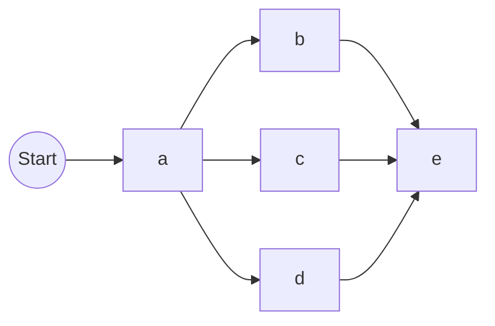
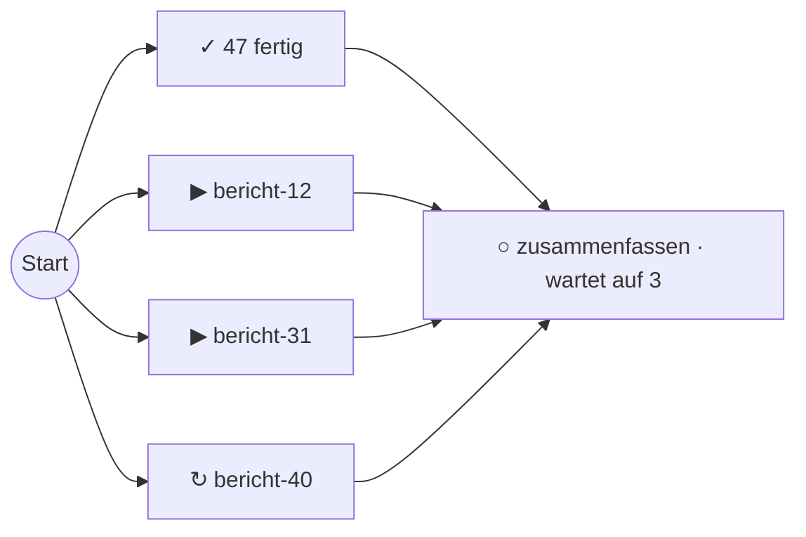

# Workflow als Diagramm - Plan

## Goal Capsule

- **Objective:** Ein Teammitglied erfasst beim Öffnen eines Workflows auf einen Blick, wie die Schritte zusammenhängen, worauf der Workflow wartet und welcher Schritt ihn aufhält, ohne eine eingerückte Liste lesen zu müssen.
- **Means:** Ein vom Server gerendertes SVG-Diagramm (Knoten und Linien, Variante B der Skizze) als zweite Ansicht der Detailseite, umschaltbar gegen die bisherige Liste (KTD1, KTD2).
- **Product authority:** Dieser Plan ändert nur die Detailseite eines Workflows. Liste der Workflows, Glieder-Seite, Stornieren und Abgleich bleiben unverändert; der swarmq-Kern bleibt unberührt.
- **Execution profile:** Testgetrieben nach `AGENTS.md`, ohne Ausnahme für Vorlagen: die Anordnung ist ein reines Modul und wird über Unit-Tests entwickelt, die SVG-Vorlage über zuerst rote Route-Tests. Ausgenommen ist nur das Stylesheet.
- **Stop conditions:** Halte an, wenn eine Form der Topologie sich nicht ohne Überschneidungen anordnen lässt, wenn das Diagramm eine neue JavaScript-Bibliothek bräuchte, oder wenn die Live-Aktualisierung das Diagramm sichtbar neu aufbaut, statt es abzugleichen.
- **Open blockers:** keine.

---

## Product Contract

### Summary

Die Detailseite eines Workflows zeigt ihn als Diagramm: Schritte als Knoten, Linien für die Reihenfolge, Auffächern und Zusammenführen bei Gruppen und Chords. Ein Umschalter „Diagramm | Liste“ wechselt zur bisherigen Liste, und die Wahl bleibt für die nächsten Aufrufe gemerkt.

### Problem Frame

Die Workflow-Ansicht aus Stufe 2 zeigt die Topologie als eingerückte Liste. Beim Testen am 2026-09-29 empfand der Betreiber das als nicht intuitiv: Dass ein Chord erst auffächert und dann auf alle Glieder wartet, muss man aus Pfaden wie `/h/g3` und der Einrückung erschließen. Eine Skizze mit drei Varianten (Stufen-Spalten, Knoten-Graph, Fortschrittsbalken) an denselben Beispielen wurde verglichen; der Knoten-Graph überzeugte am meisten.

### Key Decisions

- KD1. **Variante B, der Knoten-Graph mit Linien** (session-settled: user-directed — chosen over A Stufen-Spalten und C Fortschrittsbalken, entschieden an einer Skizze: das Auffächern und Zusammenführen ist an den Linien direkt zu sehen). Governs R1, R2, R3, R4.
- KD2. **Umschalter „Diagramm | Liste“, Wahl gemerkt** (session-settled: user-directed — chosen over „Diagramm oben, Liste darunter“ und „Diagramm ersetzt die Liste“: beide Ansichten bleiben vollwertig). Governs R7, R8.

### Requirements

**Diagramm**

- R1. Das Diagramm zeigt jeden sichtbaren Schritt als Knoten mit Zustandszeichen, Zustandswort, Task-Name und Dauer oder Wartezeit; Farbe trägt den Zustand nie allein (`docs/reference/oberflaeche.md`).
- R2. Die Anordnung läuft von links nach rechts: eine Kette steht hintereinander, eine Gruppe untereinander, ein Chord fächert in seinen Kopf auf und führt in den Body zusammen; Verschachtelung rückt nach rechts. Knoten und Linien überschneiden sich nicht.
- R3. Eine Linie trägt die Zustandsfarbe ihres Ziel-Schritts (laufend, Wiederholung, eingereiht sind unterscheidbar); Linien zu einem Schritt, der nie starten wird, sind gestrichelt.
- R4. Fertige Glieder einer Gruppe erscheinen als ein Sammelknoten „N fertig“, der auf die vorhandene Seite der fertigen Glieder verweist; auffällige Glieder stehen einzeln, wie in der Liste (Faltung aus der Workflow-Ansicht, KD6 dort).
- R5. Jeder Schritt-Knoten ist ein Link zur Task-Ansicht des Schritts; ein nicht eingereihter Schritt nennt seinen Grund und hat keinen Link.
- R6. Ist das Diagramm breiter als der Bereich, scrollt es waagerecht, statt zu schrumpfen; Text bleibt lesbar.

**Umschalter**

- R7. Die Detailseite hat einen Umschalter „Diagramm | Liste“; beide Ansichten zeigen denselben Stand und dieselben Kopfangaben (Status, Fehlerkopf, Stornieren).
- R8. Die gewählte Ansicht steht in der Adresse und wird gemerkt: ein späterer Aufruf ohne Angabe zeigt die zuletzt gewählte; ohne je getroffene Wahl zeigt die Seite das Diagramm.

**Live**

- R9. Die Live-Aktualisierung gleicht das Diagramm ab, statt es neu aufzubauen: jeder Knoten und jede Linie hat eine stabile Kennung, und die gewählte Ansicht bleibt bei der Aktualisierung erhalten.

### Acceptance Examples

- AE1. **Covers R2, R4.** Given: ein Chord mit 50 Downloads, davon 47 fertig, 2 laufend, 1 in Wiederholung, Body nicht eingereiht. When: die Detailseite im Diagramm geöffnet wird. Then: links stehen ein Sammelknoten „47 fertig“ und drei einzelne Knoten untereinander, rechts der Body mit „wartet auf 3“, und von jedem der vier Knoten führt eine Linie zum Body.
- AE2. **Covers R3.** Given: ein gescheiterter Chord mit nie gestartetem Body. When: das Diagramm geöffnet wird. Then: die Linien zum Body sind gestrichelt, der Body nennt „nie gestartet, Workflow gescheitert“.
- AE3. **Covers R2.** Given: `chain(a, group(b, c, d), e)`. When: das Diagramm geöffnet wird. Then: `a` steht links, `b`, `c`, `d` untereinander in der Mitte, `e` rechts; `a` fächert zu allen drei auf, alle drei führen zu `e`.
- AE4. **Covers R8.** Given: ein Teammitglied hat „Liste“ gewählt. When: es einen anderen Workflow ohne Angabe in der Adresse öffnet. Then: die Seite zeigt die Liste.
- AE5. **Covers R9.** Given: die Seite zeigt das Diagramm. When: eine Live-Meldung die Seite neu lädt. Then: sie zeigt wieder das Diagramm, und die Knoten behalten ihre Kennungen.

### Scope Boundaries

- Zoom und Verschieben mit der Maus; waagerechtes Scrollen genügt (R6).
- Ein Diagramm in der Workflow-Liste oder auf der Glieder-Seite.
- Export des Diagramms als Bild.
- Eine neue JavaScript-Bibliothek; das Diagramm ist reines SVG vom Server.

---

## Planning Contract

### Key Technical Decisions

- KTD1. **Die Anordnung ist ein reines Modul über dem vorhandenen Baum.** `src/swarmq_dashboard/workflow_diagramm.py` nimmt einen `Baum` aus `workflow_baum.py` und liefert Geometrie: Knoten mit Kennung, Rechteck, Art, Zustand, Beschriftung und Ziel-Link sowie Linien mit Start, Ende und Zustand, dazu Breite und Höhe. Zustand, Zähler, Gründe und Faltung kommen unverändert aus `workflow_baum.py`; das Diagramm-Modul rechnet nur Positionen. Governs R1, R2, R4.
- KTD2. **Die Anordnung nutzt, dass Workflows reihen-parallel sind.** Jedes Element ergibt einen Block mit Breite, Höhe sowie Eingangs- und Ausgangspunkten: ein Blatt ist ein Kasten fester Größe; eine Kette reiht ihre Blöcke mit festem Abstand nebeneinander; eine Gruppe stapelt ihre Glieder untereinander und zentriert sie; ein Chord ist die Kette aus Kopf-Gruppe und Body. Gruppenglieder stehen linksbündig; der Ausgang eines kürzeren Glieds wird waagerecht bis an den rechten Rand des Gruppenblocks verlängert, sodass alle Ein- und Ausgänge eines Blocks auf seinem Rand liegen und Kurven nur im Abstand zwischen zwei Blöcken verlaufen. Der Sammelknoten steht oben im Stapel, vor den offenen Gliedern. Zwischen zwei aufeinanderfolgenden Blöcken verbindet eine Linie jeden Ausgang mit jedem Eingang, solange eine Seite nur einen Punkt hat; haben beide Seiten mehrere, führt ein kleiner Knotenpunkt dazwischen, damit keine Linienmatrix entsteht. Ein Startpunkt links führt in den ersten Block. Governs R2.
- KTD3. **Das SVG entsteht in einer Jinja-Vorlage aus der Geometrie.** `web/templates/workflows/_diagramm.html` zeichnet Rechtecke, Beschriftungen und Pfade (kubische Kurven wie in der Skizze) mit CSS-Klassen für die Zustände; die Farben kommen aus den `light-dark`-Tokens in `web/static/app.css`, dunkler Modus gilt damit mit. Jeder Knoten ist ein SVG-`<a>` mit `aria-label` und sichtbarem Fokusrahmen; das SVG trägt `role="group"` und eine Kurzbeschreibung in `<title>` — nicht `role="img"`, das die Links für Screenreader verbergen würde. Ein abgeschnittener Name steht vollständig in `<title>` des Knotens. Das Zustandszeichen folgt der Zustandsklasse aus `_ZUSTANDSART` (fertig ✓, läuft ▶, Wiederholung/Warten ↻, gescheitert/Dead Letter/abgelaufen/abgewiesen ✗, storniert/eingereiht/nicht eingereiht ○); das Zustandswort daneben unterscheidet die Status innerhalb einer Klasse. Governs R1, R3, R5, R6.
- KTD4. **Stabile Kennungen aus dem Topologie-Pfad.** Knoten heißen `dk-` plus Pfad mit `-` statt `/` (wie `knoten-…` in `_baum.html`), der Sammelknoten `dk-<gruppe>-fertig`, der Startpunkt `dk-start`, ein Knotenpunkt `dk-<pfad des folgenden Blocks>-ein`, Linien `dk-kante-<von>-<nach>` mit diesen Namen. Damit gleicht idiomorph das Diagramm bei jeder Live-Meldung Element für Element ab. Governs R9.
- KTD5. **Die Wahl steht in `?ansicht=diagramm|liste` und in einem Cookie.** Die Route liest zuerst die Adresse, dann das Cookie `sqd_workflow_ansicht`, sonst „diagramm“; ist die Adresse gesetzt, schreibt sie das Cookie (pfadgebunden auf `/workflows`, `SameSite=Strict`, `Secure` wie die übrigen Cookies nach `_sicher(request)` in `web/routes/login.py`). `static/live.js` lädt `location.href`, die Adresse bleibt also erhalten. Unbekannte Werte gelten als „diagramm“. Governs R7, R8, R9.
- KTD6. **Linienzustände folgen dem Ziel-Knoten.** Die Linie trägt die `_ZUSTANDSART`-Klasse ihres Ziels (blau für laufend, bernstein für Wiederholung, neutral für eingereiht, grün für fertig); gestrichelt ist sie, wenn das Ziel nicht eingereiht ist und einer der Gründe „nie gestartet …“ oder „… startet nie“ gilt. Der Sammelknoten zählt als fertig. Eine Linie in einen Knotenpunkt übernimmt die auffälligste Klasse der Linien aus ihm und ist gestrichelt, wenn alle Linien aus ihm gestrichelt sind. Governs R3.

### High-Level Technical Design

Die Blöcke setzen sich aus drei Regeln zusammen; das Beispiel aus AE3 ergibt:

Ein Chord mit 50 Downloads nach der Faltung (AE1):

### Sources

- Skizze der drei Varianten: lokal in der Sitzung vom 2026-09-29, Variante B.
- Vorhandene Logik: `src/swarmq_dashboard/workflow_baum.py` (`Knoten`, `offene_kinder`, `gefaltete_kinder`, `GRUND_*`), `src/swarmq_dashboard/web/templates/workflows/_baum.html` (Kennungen `knoten-…`), `src/swarmq_dashboard/web/routes/workflows.py` (`workflow_detail`, `_kontext`).
- Gestaltungsregeln: `docs/reference/oberflaeche.md`; Tokens in `src/swarmq_dashboard/web/static/app.css`.

---

## Implementation Units

### U1. Anordnung als reines Modul

- **Goal:** Aus einem `Baum` die Geometrie des Diagramms berechnen.
- **Requirements:** R1, R2, R4; KTD1, KTD2.
- **Dependencies:** keine.
- **Files:** `src/swarmq_dashboard/workflow_diagramm.py` (neu), `tests/unit/test_workflow_diagramm.py` (neu).
- **Approach:**
  1. Blockgröße für Blatt, Kette, Gruppe und Chord rekursiv berechnen, dann Koordinaten vergeben.
  2. Gefaltete Glieder einer Gruppe als ein Sammelknoten oben im Stapel, darunter die offenen Glieder einzeln in der Reihenfolge von `offene_kinder`.
  3. Linien nach KTD2, mit Knotenpunkt, wenn beide Seiten mehrere Punkte haben.
- **Patterns to follow:** `workflow_baum.py` (eingefrorene Datenklassen, keine I/O); die Test-Hilfen `sig`, `kopie`, `zeile` in `tests/unit/test_workflow_baum.py`.
- **Test scenarios:**
  - Ein einzelner Schritt ergibt Startpunkt, einen Knoten und eine Linie.
  - Covers AE3. `chain(a, group(b, c, d), e)` ergibt `a` links, `b`/`c`/`d` gleich weit rechts untereinander, `e` rechts davon, sieben Linien (davon eine vom Startpunkt).
  - Covers AE1. Ein Chord mit 47 fertigen und 3 auffälligen Gliedern ergibt vier Knoten im Kopf, davon einen Sammelknoten „47 fertig“, und vier Linien zum Body.
  - Eine Gruppe, die auf eine Gruppe folgt, bekommt einen Knotenpunkt statt einer Linienmatrix.
  - Eine Kette in einer Gruppe in einem Chord rückt nach rechts, ohne dass sich Rechtecke überschneiden.
  - `chord(group(chain(b, c), d), e)`: `d` ist bis an den rechten Rand des Kopfs verlängert, und keine Linie schneidet ein Rechteck, das weder ihr Start noch ihr Ziel ist.
  - Keine zwei Knoten überlappen und jede Linie beginnt am rechten Rand ihres Quellknotens, geprüft über alle obigen Fälle.
  - Ohne Topologie (flacher Baum) ergeben die bekannten Schritte eine Spalte ohne erfundene Verbindungen.
  - Breite und Höhe umschließen alle Knoten.
- **Verification:** Jede Form aus den Szenarien ergibt eine überschneidungsfreie Geometrie, ohne Datenbank und ohne Vorlage.

### U2. Zustände, Beschriftung und Ziele

- **Goal:** Jeder Knoten und jede Linie trägt Zustand, Beschriftung und Link.
- **Requirements:** R1, R3, R4, R5; KTD6.
- **Dependencies:** U1.
- **Files:** `src/swarmq_dashboard/workflow_diagramm.py`, `tests/unit/test_workflow_diagramm.py`.
- **Approach:** Zustandszeichen nach KTD3 und Zustandswort je Blattstatus; Dauer oder Wartezeit wie in `_baum.html`; Linienzustand nach KTD6; Ziel-Link je Knoten (Task-Ansicht, Glieder-Seite für den Sammelknoten, keiner für nicht eingereihte Schritte). Sitzt `wartet_auf` an einem inneren Knoten (Body als Kette oder Gruppe), zeigen es die Eingangsknoten seines Blocks.
- **Patterns to follow:** `_ZUSTANDSART` in `src/swarmq_dashboard/web/templates/__init__.py` für die Zuordnung Zustand → Klasse.
- **Test scenarios:**
  - Covers AE2. Ein gescheiterter Chord ergibt gestrichelte Linien zum Body und den Grund „nie gestartet, Workflow gescheitert“ am Body.
  - Linien zu laufenden, eingereihten und wiederholten Schritten sind hervorgehoben.
  - Der Sammelknoten verweist auf die Glieder-Seite seiner Gruppe; ein Schritt-Knoten auf die Task-Ansicht mit kodierter Kennung (`#` als `%23`).
  - Ein nicht eingereihter Knoten hat keinen Link und nennt seinen Grund.
  - Ein langer Task-Name wird gekürzt, der volle Name bleibt erhalten.
  - Ein Chord, dessen Body eine Kette ist, zeigt „wartet auf N“ am ersten Schritt der Kette.
  - Linien zu einem laufenden, einem wiederholten und einem eingereihten Schritt tragen drei verschiedene Klassen.
  - Jeder Blattstatus aus `workflow_baum.py` (auch storniert, dead_letter, abgelaufen, abgewiesen) hat Zeichen und Wort.
- **Verification:** Jeder Zustand aus `workflow_baum.py` hat Zeichen, Wort und Klasse, und kein Knoten hängt an Farbe allein.

### U3. Diagramm in der Detailseite

- **Goal:** Die Detailseite rendert das Diagramm als SVG.
- **Requirements:** R1, R5, R6, R9; KTD3, KTD4.
- **Dependencies:** U2.
- **Files:** `src/swarmq_dashboard/web/templates/workflows/_diagramm.html` (neu), `src/swarmq_dashboard/web/templates/workflows/detail.html`, `src/swarmq_dashboard/web/routes/workflows.py`, `src/swarmq_dashboard/web/static/app.css`, `docs/reference/oberflaeche.css`, `tests/unit/web/test_workflows_routes.py`.
- **Approach:**
  1. Die Route gibt die Geometrie aus U1/U2 an die Vorlage.
  2. `_diagramm.html` zeichnet Knoten, Beschriftungen und Linien, mit Kennungen nach KTD4, in einem Container mit waagerechtem Scrollen.
  3. Zustandsklassen für Knoten und Linien über die vorhandenen Tokens, gleichlautend in `docs/reference/oberflaeche.css` und `web/static/app.css` (der Test `test_das_stylesheet_ist_die_freigegebene_vorlage` prüft, dass die Vorlage im gelieferten Stylesheet steht).
- **Execution note:** Jede Vorlagen-Änderung folgt einem zuerst roten Route-Test.
- **Patterns to follow:** `_baum.html` (Makros, stabile Kennungen), die Vorlagen-Prüfungen über alle `*.html` in `tests/unit/web/test_templates.py`.
- **Test scenarios:**
  - Covers AE1. Die Detailseite eines Chords enthält ein SVG mit dem Sammelknoten `dk-h-fertig` und dem Body `dk-b` samt „wartet auf“.
  - Jeder Schritt-Knoten ist ein Link zur Task-Ansicht, der Sammelknoten zur Glieder-Seite.
  - Das SVG trägt `role="group"` und eine Kurzbeschreibung in `<title>`, kein `role="img"`; Knoten sind `<a>` mit `aria-label`.
  - Covers AE5. Zweimal gerendert ergibt dieselben Kennungen in derselben Reihenfolge.
  - Die bestehenden Vorlagen-Prüfungen (Escaping, Assets) bleiben grün.
- **Verification:** Die Detailseite zeigt das Diagramm, und ein Teammitglied kommt per Klick vom Knoten zur Task-Ansicht.

### U4. Umschalter und gemerkte Wahl

- **Goal:** „Diagramm | Liste“ umschalten und die Wahl merken.
- **Requirements:** R7, R8, R9; KTD5.
- **Dependencies:** U3.
- **Files:** `src/swarmq_dashboard/web/routes/workflows.py`, `src/swarmq_dashboard/web/templates/workflows/detail.html`, `tests/unit/web/test_workflows_routes.py`.
- **Approach:** Die Route bestimmt die Ansicht nach KTD5 und setzt das Cookie, wenn die Adresse eine Wahl trägt; in der Ansicht „diagramm“ ruft sie `_ergebnisse` nicht auf, weil das Diagramm die Eingabe des Body nicht zeigt; der Umschalter besteht aus zwei Links mit `?ansicht=…`, der aktive ist markiert. Kopfangaben, Fehlerkopf und Stornieren stehen in beiden Ansichten.
- **Patterns to follow:** Cookie-Setzen in `web/routes/login.py`.
- **Test scenarios:**
  - Ohne Angabe und ohne Cookie zeigt die Seite das Diagramm.
  - Covers AE4. `?ansicht=liste` zeigt die Liste und setzt das Cookie; ein folgender Aufruf eines anderen Workflows ohne Angabe zeigt die Liste.
  - Ein unbekannter Wert zeigt das Diagramm und setzt kein Cookie.
  - In der Ansicht „diagramm“ wird der Ergebnisleser nicht aufgerufen, in der Liste wie bisher.
  - Der Storno-Knopf und der Fehlerkopf erscheinen in beiden Ansichten.
  - Covers AE5. Der Umschalter-Link der aktiven Ansicht trägt die Markierung, und die Adresse behält `ansicht` bei.
- **Verification:** Die Wahl überlebt Seitenwechsel und Live-Meldungen.

### U5. Doku und Durchstich

- **Goal:** Die Ansicht ist beschrieben und gegen einen echten Chord geprüft.
- **Requirements:** R1, R2, R8.
- **Dependencies:** U4.
- **Files:** `docs/reference/oberflaeche.md`, `README.md`, `tests/integration/test_workflow_ansicht.py`.
- **Approach:** Die Regeln des Diagramms (Zeichen, Linienarten, Sammelknoten, Umschalter) in `oberflaeche.md`; im bestehenden Durchstich zusätzlich prüfen, dass die Detailseite des echten Chords ein Diagramm mit Body-Knoten liefert.
- **Test scenarios:**
  - Covers F1 der Workflow-Ansicht. Der echte Chord aus dem Durchstich zeigt im Diagramm den Body und nach dem Ende „fertig“.
- **Verification:** Integrationstest grün, Doku nennt die Linienarten und den Umschalter.

---

## Verification Contract

| Prüfung | Kommando | Gilt für |
|---|---|---|
| Einheiten | `uv run pytest tests/unit -q` | jede Einheit |
| Integration | `SQD_TEST_RABBITMQ_PORT=5699 SQD_TEST_VALKEY_PORT=6399 uv run pytest tests/integration -q` | U5 |
| Stil | `uv run ruff check src/ tests/` | jede Einheit |
| Typen | `uv run mypy --strict src/` | jede Einheit |

Integrationstests nur gegen die Testcontainer auf 5699 und 6399.

---

## Definition of Done

- U1 bis U5 sind umgesetzt; jede Zeile Produktionscode und jede Vorlagen-Änderung ist durch einen vorher roten Test begründet (nur das Stylesheet ist ausgenommen).
- Alle vier Prüfungen sind grün.
- Das Diagramm funktioniert im hellen und im dunklen Modus und scrollt bei breiten Workflows waagerecht.
- Keine neue Abhängigkeit, keine Änderung an swarmq.
- Code aus verworfenen Ansätzen ist entfernt.
